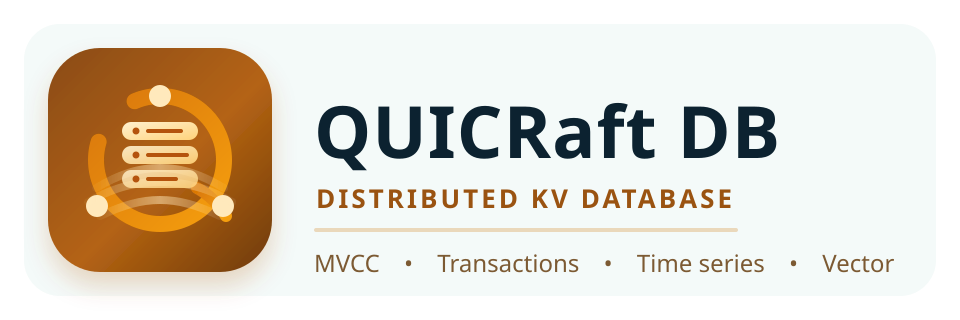

<!--
Copyright 2026 Jeremy Hahn

Licensed under the Apache License, Version 2.0 (the "License");
you may not use this file except in compliance with the License.
You may obtain a copy of the License at

http://www.apache.org/licenses/LICENSE-2.0

Unless required by applicable law or agreed to in writing, software
distributed under the License is distributed on an "AS IS" BASIS,
WITHOUT WARRANTIES OR CONDITIONS OF ANY KIND, either express or implied.
See the License for the specific language governing permissions and
limitations under the License.
-->

# QRDB Implementation Documentation



Technical documentation for the QRDB distributed transactional key-value
store. These documents describe the system as implemented, with references
to source code locations, actual struct definitions, and verified behavior
from the test suite.

## Documents

| Document | Description |
|---|---|
| [api.md](api.md) | REST, gRPC, Unix socket, and MCP API reference with endpoint specifications and error codes |
| [01-architecture.md](01-architecture.md) | System overview, three-layer store architecture (storage backends, store engines, state machines), package structure, data flow, dependency graph, and key design decisions |
| [02-mvcc.md](02-mvcc.md) | MVCC engine internals, revision tracking, key encoding scheme, compaction, and historical reads |
| [03-transactions.md](03-transactions.md) | Compare-and-swap transactions, snapshot isolation, conflict detection, and atomic multi-operation execution |
| [04-watch.md](04-watch.md) | Real-time change notifications, event ordering guarantees, prefix watching, and delivery semantics |
| [05-consistency.md](05-consistency.md) | Consistency levels (Strong, Linearizable, Eventual), routing behavior, and read path selection |
| [06-leases.md](06-leases.md) | Distributed lease management, TTL enforcement, keep-alive protocol, and automatic key expiry |
| [07-batch-operations.md](07-batch-operations.md) | Atomic multi-operation execution at the KV layer without conditional logic |
| [08-secondary-indexes.md](08-secondary-indexes.md) | Secondary index types, unique/sparse flags, struct tag integration, database-scoped names, PebbleDB/memory backends, and query planner integration |
| [09-timeseries.md](09-timeseries.md) | Time-series storage with composite keys, aggregation functions, tag filtering, and retention policies |
| [10-write-modes.md](10-write-modes.md) | Durability vs performance tradeoffs, engine and storage backend selection (KVEngine/MVCCEngine, memory/file/pebble) |
| [11-batch-aggregator.md](11-batch-aggregator.md) | Group commit strategy, flush triggers, and write amplification reduction |
| [12-configuration.md](12-configuration.md) | Complete YAML configuration reference for all subsystems with defaults and validation rules |
| [13-operations.md](13-operations.md) | Deployment topology, monitoring with Prometheus, health checks, drain/shutdown, and CLI commands |
| [14-migration-from-dragondb.md](14-migration-from-dragondb.md) | Migration guide for refactoring from go-dragondb, interface mapping, and package reorganization |
| [15-vectors.md](15-vectors.md) | Vector database: namespace management, vector CRUD, similarity search, hybrid search, index rebuild, compaction, GPU acceleration |
| [16-query-planner.md](16-query-planner.md) | Query planner & fluent query API: cost-based index selection, DAO query builder, security model, and legacy index escape hatches |
| [17-entity-sql-bridge.md](17-entity-sql-bridge.md) | Entity-SQL bridge: ORM-style query interface, schema generation from entity types, SQL integration |
| [18-distributed-locking.md](18-distributed-locking.md) | Distributed lock service: fencing tokens, blocking/non-blocking acquisition, reentrant locks, lease-based TTL, watch-based blocking, REST/gRPC APIs |
| [embedding/README.md](embedding/README.md) | Embedding service: OpenAI-compatible providers (Ollama, OpenAI, vLLM), caching, batch processing |
| [rag/README.md](rag/README.md) | Retrieval-Augmented Generation: document chunking, ingestion pipeline, semantic retrieval |
| [sql/README.md](sql/README.md) | SQL wire protocol: MySQL and PostgreSQL compatibility, mTLS auth, PG syntax translation, multi-tenancy, index-accelerated WHERE clauses, and query optimization |
| [etcd/README.md](etcd/README.md) | etcd protocol compatibility: per-database gRPC endpoint, Kubernetes integration, watch/lease/transaction support |

## Subsystem Documentation

| Document | Description |
|---|---|
| [seal/README.md](seal/README.md) | ExtendedBarrier: three-layer architecture, dual-mode operation, storage wrapping |
| [seal/shamir.md](seal/shamir.md) | Shamir threshold unsealing, recovery keys, rekey, root token generation |
| [seal/multi-tenant.md](seal/multi-tenant.md) | BarrierRegistry, TenantBarrier, per-tenant DEK isolation |
| [storage/README.md](storage/README.md) | Canonical storage engine layer: file, memory, pebble, namespace |
| [auth/README.md](auth/README.md) | Pluggable authentication interfaces, default mTLS authenticator |
| [sdk/README.md](sdk/README.md) | Go SDK with 5 transports: REST, gRPC, Unix, MCP, embedded |
| [cli/README.md](cli/README.md) | qrdb client CLI: full command tree, global flags, transport auto-detection, deprecation notes |
| [capabilities/README.md](capabilities/README.md) | Compile-time feature registration, build-tag gated capabilities API |
| [permissions/README.md](permissions/README.md) | Fine-grained permission system: resource:action format, categories, registry |
| [users/README.md](users/README.md) | Passwordless mTLS user management, KVStore schema, secondary indexes |
| [roles/README.md](roles/README.md) | Role-based access control, built-in roles, RBAC authorizer, permission cache |
| [certs/README.md](certs/README.md) | Pluggable CertProvider, barrier-sealed CA key, PKCS#12 export |
| [audit/README.md](audit/README.md) | Dual-backend audit logging: KVStore + slog JSON file |
| [gui/README.md](gui/README.md) | Universal GUI: Wails v2 + Svelte 5, desktop + browser, setup wizard |
| [typescript-sdk/README.md](typescript-sdk/README.md) | TypeScript SDK: @qrdb/sdk, WailsClient + RestClient transports |

## Module

```
github.com/jeremyhahn/go-qrdb
```
