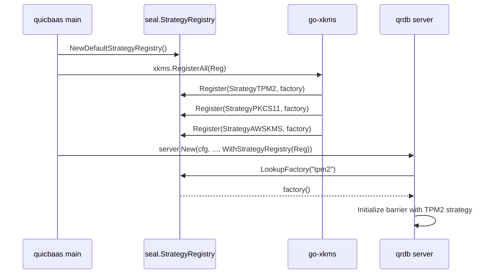

# Barrier and Seal — Architecture

> **Status: NORMATIVE** · Scope: go-qrdb · Last verified: 2026-08-19

The barrier is the at-rest encryption boundary. Everything persistent passes
through it, and when it is sealed the data path refuses every read and write.

Shamir M-of-N custody, Security Officers and recovery keys are a feature of
their own: [../shamir-custody/](../shamir-custody/).

## Problem

At-rest encryption in a database that must also run on a TPM, a PKCS#11 HSM,
AWS KMS, GCP KMS, Azure Key Vault or Vault — without the database importing any
of their SDKs, and without a second implementation per backend.

## Shape chosen

A three-layer split, with **hardware arriving by composition rather than by
import**.

```
go-quicraft/pkg/seal/          Interfaces + go-enclave protected memory + minimal Barrier + Software/None/Shamir primitives
        ↑
go-qrdb/pkg/seal/              StorageBarrier: multi-tenant, storage wrapping, recovery, root tokens,
                               share exchange, StrategyRegistry (Software + None pre-registered)
go-qrdb/pkg/keydelivery/       Per-node tenant root-key transport over mTLS + HPKE
go-qrdb/pkg/clusterkeys/       Node-identity and peer-authentication for key delivery
        ↑
go-xkms/pkg/seal/              Hardware strategies (TPM2, PKCS#11, AWS KMS, GCP KMS, Azure KV, Vault)
                               registered into a qrdb StrategyRegistry at composition time
```

- **go-quicraft** defines the barrier interfaces (`Barrier`, `SnapshotBarrier`, `EpochTracker`) and a minimal default implementation with AES-256-GCM, epoch rotation, deployment ID isolation, brute-force protection, and go-enclave locked-memory protection. It also owns the baseline software-shape strategies: `SoftwareStrategy` (passphrase-based) and `NoneStrategy` (no encryption).
- **go-qrdb** wraps go-quicraft's barrier in `StorageBarrier`, adding all database-layer features. The `pkg/dek/` package provides cluster and tenant DEK management using `seal.EncryptionBarrier` for key wrapping.
- **go-xkms** ships hardware `SealingStrategy` implementations and registers them into a qrdb `StrategyRegistry` so qrdb can resolve `--barrier-strategy <name>` at init time without importing any HSM SDK.


That third layer is the point. **qrdb has no compile-time dependency on any
hardware code**; it calls a registered factory by name.

## Strategies

| StrategyID | Constant | Source | When to use |
|------------|----------|--------|-------------|
| `passphrase` | `seal.StrategyPassphrase` | go-quicraft (re-exported) | Single passphrase, FIPS-aware KDF (Argon2id or PBKDF2-SHA256). The default. |
| `shamir`   | `seal.StrategyShamir`   | go-qrdb (`pkg/seal/strategy_shamir.go`) | M-of-N quorum unseal; the Shamir secret is a random unseal key that AEAD-wraps the root key (Vault-style indirection, see [shamir.md](../seal/shamir.md)). |
| `none`     | `seal.StrategyNone`     | go-quicraft (re-exported) | Barrier disabled; data stored plaintext. Dev/test or OS-level FDE deployments. Valid enable-encryption source (plaintext→keyed migration). |
| `system-barrier` | `seal.StrategySystemBarrier` | go-qrdb (tenant strategy only) | Auto-unseal with per-tenant root key wrapped under the system barrier; no per-tenant credential required. System-managed convenience mode for dedicated tenants. Valid enable-encryption source (credential-free→keyed migration). |

> **Config alias:** the YAML `seal.strategy` field accepts `software` as a **deprecated alias** for `passphrase`. It is canonicalized once at config load (`SealConfig.CanonicalStrategy()`), so every consumer sees the canonical `passphrase` ID — the software/passphrase strategy reports `ID() == "passphrase"`.

Hardware strategies (`tpm2`, `pkcs11`, `aws-kms`, `gcp-kms`, `azure-kv`, `vault`) live in go-xkms and register themselves through `StrategyRegistry.Register` at composition time.

When multiple strategies are registered, the caller must specify which one to use at initialization via `--barrier-strategy <name>`. qrdb returns `ErrNoStrategySpecified` if multiple strategies are available but none was explicitly selected. When only one strategy is registered (e.g., Software or None in development), that strategy is selected unconditionally.


Hardware strategies (`tpm2`, `pkcs11`, `aws-kms`, `gcp-kms`, `azure-kv`,
`vault`) live in go-xkms and register themselves through
`StrategyRegistry.Register` at composition time.

When several strategies are registered the caller must name one at
initialization (`--barrier-strategy <name>`); qrdb returns
`ErrNoStrategySpecified` if it cannot choose. With exactly one registered, that
one is selected unconditionally.

## The strategy registry

`StrategyRegistry` decouples the daemon from concrete strategy implementations. The daemon parses `--barrier-strategy <name>` and calls `LookupFactory` on the registry; the registry returns a `StrategyFactory` that constructs the strategy on demand. (`pkg/seal/strategy_registry.go:39-58`)

```go
type StrategyRegistry interface {
    Register(name StrategyID, factory StrategyFactory) error
    Unregister(name StrategyID)
    LookupFactory(name StrategyID) (StrategyFactory, error)
    ListAvailable() []StrategyID
}

type StrategyFactory func() (SealingStrategy, error)
```

### Defaults — `NewDefaultStrategyRegistry`

`NewDefaultStrategyRegistry()` (`pkg/seal/strategy_registry.go:88-97`) returns a registry pre-populated with the two software strategies qrdb owns outright:

- `StrategyPassphrase` — built via `NewDeferredSoftwareStrategy()` so the passphrase can be supplied at Initialize/Unseal time rather than at construction.
- `StrategyNone` — built via `NewNoneStrategy()`.

`StrategyShamir` is intentionally NOT registered in the default registry because the Shamir strategy requires a `Threshold` and `Shares` configuration that only the daemon's init command can supply; the daemon constructs it inline at init time.

### Hardware injection — `WithStrategyRegistry`

Higher layers add hardware strategies on top by handing qrdb's server constructor a registry through `WithStrategyRegistry`:

```go
// pkg/server/server.go:478-486
func WithStrategyRegistry(reg seal.StrategyRegistry) ServerOption {
    return func(o *serverOptions) { o.strategyRegistry = reg }
}
```

The typical composition flow (driven by go-quicbaas):



The same registry can be used to inject test/fake strategies in integration tests without any hardware coupling.


### Alternatives rejected

- **Importing hardware SDKs into qrdb.** Rejected as a hard invariant: **zero
  hardware coupling.** No TPM2 code, no PKCS#11 code, no `pkcs11` build tag in
  any qrdb Go file. qrdb defines the seam; hardware arrives by composition.
- **Registering Shamir in the default registry.** Deliberately not done — the
  Shamir strategy needs a threshold and share count only the daemon's init
  command can supply, so the daemon constructs it inline at init time.
- **A shared cluster-wide DEK.** Rejected in favour of the per-node key model
  below: a compromised node key must not expose tenant keys on other nodes.
- **Making `none` invisible.** Rejected: with `none` selected the audit log
  marks every barrier operation `strategy: none`, so the absence of encryption
  is permanently visible in the trail.

## Per-node key architecture

qrdb uses a **per-node-independent key model** (not a shared cluster-wide DEK):

- Each cluster node holds its own **system barrier** with its own **master key (KEK)**. The KEK is never
  shared across nodes and is managed per-node by the system barrier's configured strategy.
- **Per-tenant barriers** in multi-node clusters: when a tenant database replicates across nodes,
  each replica node receives the tenant's root key over a secure channel and re-wraps it under that
  *node's own system barrier* for storage. This preserves per-node KEK independence — a compromised
  node key does not expose tenant keys on other nodes.
- **Key delivery**: `pkg/keydelivery/` implements secure cross-node transport of tenant root keys
  over the cluster mTLS control plane, with HPKE encryption to bind the payload to the recipient
  node's certificate. `pkg/clusterkeys/` handles node-identity authentication — chain validity, the
  node SPIFFE SAN, the placement gate, and **certificate revocation**, on both the receiving and the
  sending side. Revocation is checked separately because the other three are all satisfied by a
  revoked certificate: without it, a node whose certificate an operator has withdrawn keeps taking
  part in key delivery, and a leader keeps sealing tenant root keys to it. See
  [certificate-authority → Where revocation is enforced](../certificate-authority/architecture.md#where-revocation-is-enforced)
  and
  [../multi-tenancy.md → Per-node-independent key design](../multi-tenancy/architecture.md#per-node-independent-key-design).


## Transparent at-rest encryption

All persistent data is encrypted transparently at rest via the `StorageBarrier`:

- **System data** (KV, MVCC, raft log) is barrier-encrypted under the system barrier's master key.
- **Tenant data** on dedicated isolation modes (volume, raft) is barrier-encrypted under the tenant's
  own master key (which is persisted under the system barrier for system-managed auto-unseal, or
  under the tenant's strategy for self-managed).
- The barrier operates transparently: callers put/get plaintext, the barrier handles encryption/decryption
  automatically.

See [multi-tenant.md](../seal/multi-tenant.md) for the full tenant-barrier lifecycle and key-management modes.


## Cluster auto-unseal — `ShareExchangeCoordinator`

The `ShareExchangeCoordinator` enables cluster-level auto-unseal by exchanging Shamir shares between nodes. It is transport-agnostic — callers inject a `ShareTransport` implementation.

```go
type ShareTransport interface {
    SendShare(ctx context.Context, toNodeID uint64, msg *ShareExchangeMessage) error
    BroadcastShareRequest(ctx context.Context, fromNodeID uint64) error
}
```

### Flow

1. Each node starts a coordinator with its `nodeID`, threshold, and transport
2. On boot, `CollectSharesWithTimeout` broadcasts a share request to peers
3. Peers respond with their encrypted shares via `OnShareReceived`
4. When the quorum threshold is met, the `UnsealHandler` callback fires
5. The handler calls `StorageBarrier.UnsealWithShares()` to reconstruct the root key

### Key Design

- **Lock-free state**: `started` and `quorumCalled` use `sync/atomic.Bool`
- **Exactly-once unseal**: `CompareAndSwap` ensures the handler fires once
- **Map-based dispatch**: Message routing uses `map[ShareMessageType]handler` for O(1) lookup
- **No `time.Sleep`**: Uses `time.NewTimer` + `select` for timeouts


## CA key lifecycle

The CA private key is one of the things the barrier protects, and its lifecycle
is the clearest illustration of what sealing means:

The `DefaultCertProvider` (`pkg/cert/default_provider.go`) stores its ECDSA
P-256 CA private key using the encryption barrier for at-rest protection.
**The live DER-encoded key is an ordinary `[]byte` field (`p.caKey`), not an
mlocked enclave** — `pkg/cert` does not currently hold it in a `secure.Buffer`
or `secure.Secret`. It is wiped with `secure.Wipe` on every construction
failure path and on `Seal`, which bounds how long the plaintext survives on
the Go heap, but does not lock it out of swap or exclude it from a core dump
while it is live. Moving it into a `secure.Buffer` is tracked as a gap, not
implemented here; do not describe this as enclave-protected until it is.

### Bootstrap

1. Generate ECDSA P-256 CA key pair (`crypto/rand`)
2. Encrypt private key via `EncryptionBarrier.Encrypt()`
3. Store wrapped blob in KVStore at `__sys:cert_ca/{tenantID}/wrapped_key`
4. Store CA cert PEM in KVStore at `__sys:cert_ca/{tenantID}/cert_pem`
5. Zero the DER-encoding scratch slice (`secure.Wipe`) on every error path;
   on success, the DER bytes are retained as `p.caKey` (see above) for signing

### Unseal to Operational

1. Load wrapped blob from KVStore
2. Decrypt via `EncryptionBarrier.Decrypt()`
3. Cache the decrypted DER bytes as `p.caKey`
4. Parse the ECDSA private key from `p.caKey` on each `GenerateClientCert` call
5. Wipe and replace `p.caKey` when `loadCA` re-caches it

### Seal

1. `secure.Wipe(p.caKey)`, then `p.caKey = nil`
2. Nil the cached CA certificate
3. All `GenerateClientCert()` calls return `CAKeyNotAvailableError`


## Trust boundaries

- **Sealed means refused, not degraded.** Once sealed, the data path returns
  `ErrBarrierSealed` for every read and write until unsealed.
- **Only an allowlisted set of endpoints is reachable while sealed** — see
  [seal/sealed-window.md](../seal/sealed-window.md).
- **The `none` strategy stores plaintext.** It is for development, test
  fixtures, and deployments where the device already provides authenticated
  full-disk encryption. The go-xkms `--require-encryption` compliance gate
  refuses to come up against a `none`-mode barrier.
- **Key material is memory-protected where the holder uses `pkg/secure`** —
  `secure.Buffer` / `secure.Secret` (go-enclave-backed), mlocked
  and wiped on seal. The system barrier's own root key and tenant DEKs
  (`pkg/dek`, `pkg/seal`'s tenant key manager) go through `pkg/secure`. The
  CA private key in `pkg/cert.DefaultCertProvider` is the current exception —
  see its own lifecycle section above — and is wiped (`secure.Wipe`) but not
  mlocked while live.
- **PINs follow dual control**: supplying `--so-pin` requires `--user-pin` and
  vice versa, so the resulting pair satisfies FIPS 140-3 and PCI-DSS v4 dual
  control. PINs are rejected outright with `--barrier-strategy=none`.

## What this feature deliberately does not do

- **No hardware crypto of its own.** TPM2, PKCS#11 and cloud KMS all live in
  go-xkms and reach qrdb through `WithStrategyRegistry`.
- **No strategy change without a migration.** The strategy is fixed at
  initialization; moving off `none` is `barrier enable-encryption`, which is a
  real re-encryption, not a config flip.
- **No per-tenant barrier on a shared store.** See
  [../databases/](../databases/architecture.md).
- **No custody model.** Officers, shares, quorum, recovery and root tokens are
  [../shamir-custody/](../shamir-custody/).

## Companion documents

- [seal/sealed-window.md](../seal/sealed-window.md) — the sealed-window endpoint
  allowlist, the format-version sentinel, and the pre-host listener boot
  sequence.
- [seal/enabling-encryption.md](../seal/enabling-encryption.md) — the
  encryption-at-rest lifecycle.
- [seal/compliance.md](../seal/compliance.md) — FIPS, FedRAMP, PCI-DSS and
  HIPAA mapping.
- [seal/multi-tenant.md](../seal/multi-tenant.md) — per-tenant barrier
  isolation; see also [../multi-tenancy/](../multi-tenancy/).
- [seal/per-node-barrier-architecture.md](../seal/per-node-barrier-architecture.md)
  and [seal/cluster-enable-encryption-design.md](../seal/cluster-enable-encryption-design.md)
  — design records, including phases marked DEFERRED. Read them as history and
  intent, not as shipped behaviour.
