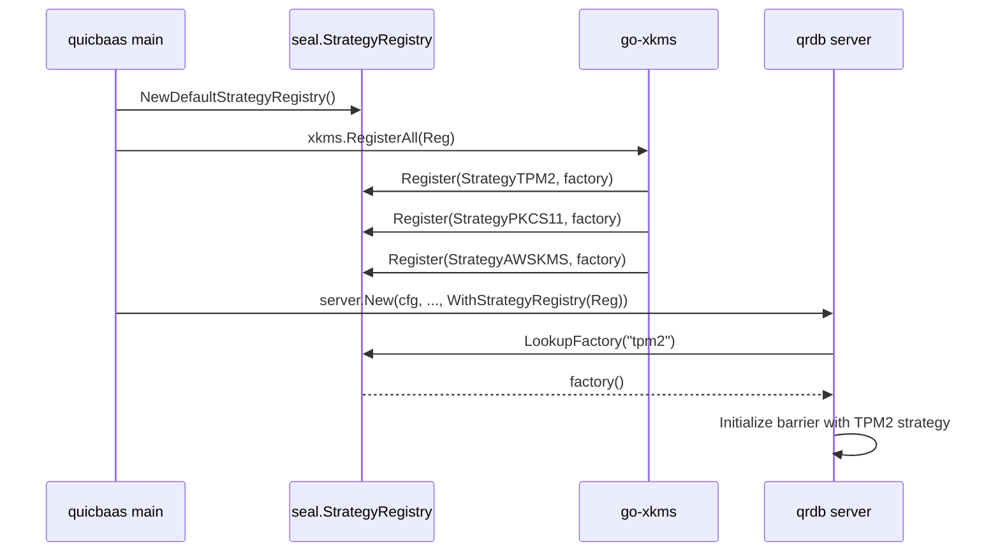

# Barrier and Seal — Architecture

> **Status: NORMATIVE** · Scope: go-qrdb · Last verified: 2026-10-01

The barrier is the at-rest encryption boundary. Everything persistent passes
through it, and when it is sealed the data path refuses every read and write.

Shamir M-of-N custody, Security Officers and recovery keys are a feature of
their own: [../shamir-custody/](../shamir-custody/).

## Problem

At-rest encryption in a database that must also run on a TPM, a PKCS#11 HSM,
AWS KMS, GCP KMS, Azure Key Vault or Vault — without the database importing any
of their SDKs, and without a second implementation per backend.

## Shape chosen

A three-layer split, with **hardware arriving by composition rather than by
import**.

```
go-quicraft/pkg/seal/          Interfaces + go-enclave protected memory + minimal Barrier + Software/None/Shamir primitives
        ↑
go-qrdb/pkg/seal/              StorageBarrier: multi-tenant, storage wrapping, recovery, root tokens,
                               share exchange, StrategyRegistry (Software + None pre-registered)
go-qrdb/pkg/keydelivery/       Per-node tenant root-key transport over mTLS + HPKE
go-qrdb/pkg/clusterkeys/       Node-identity and peer-authentication for key delivery
go-qrdb/pkg/clusterseal/       Replicated seal records, per-node enforcement, the serving lease
        ↑
go-xkms/pkg/seal/              Hardware strategies (TPM2, PKCS#11, AWS KMS, GCP KMS, Azure KV, Vault)
                               registered into a qrdb StrategyRegistry at composition time
```

- **go-quicraft** defines the barrier interfaces (`Barrier`, `SnapshotBarrier`, `EpochTracker`) and a minimal default implementation with AES-256-GCM, epoch rotation, deployment ID isolation, brute-force protection, and go-enclave locked-memory protection. It also owns the baseline software-shape strategies: `SoftwareStrategy` (passphrase-based) and `NoneStrategy` (no encryption).
- **go-qrdb** wraps go-quicraft's barrier in `StorageBarrier`, adding all database-layer features. The `pkg/dek/` package is the per-tenant data encryption keyring: versioned application keys stored in each tenant's own store, wrapped by the tenant's barrier — see [tenant-dek](../tenant-dek/architecture.md).
- **go-xkms** ships hardware `SealingStrategy` implementations and registers them into a qrdb `StrategyRegistry` so qrdb can resolve `--barrier-strategy <name>` at init time without importing any HSM SDK.


That third layer is the point. **qrdb has no compile-time dependency on any
hardware code**; it calls a registered factory by name.

## Strategies

| StrategyID | Constant | Source | When to use |
|------------|----------|--------|-------------|
| `passphrase` | `seal.StrategyPassphrase` | go-quicraft (re-exported) | Single passphrase, FIPS-aware KDF (Argon2id or PBKDF2-SHA256). The default. |
| `shamir`   | `seal.StrategyShamir`   | go-qrdb (`pkg/seal/strategy_shamir.go`) | M-of-N quorum unseal; the Shamir secret is a random unseal key that AEAD-wraps the root key (Vault-style indirection, see [shamir-custody](../shamir-custody/)). |
| `none`     | `seal.StrategyNone`     | go-quicraft (re-exported) | Barrier disabled; data stored plaintext. Dev/test or OS-level FDE deployments. Valid enable-encryption source (plaintext→keyed migration). |
| `system-barrier` | `seal.StrategySystemBarrier` | go-qrdb (tenant strategy only) | Auto-unseal with per-tenant root key wrapped under the system barrier; no per-tenant credential required. System-managed convenience mode for dedicated tenants. Valid enable-encryption source (credential-free→keyed migration). |

Hardware strategies (`tpm2`, `pkcs11`, `aws-kms`, `gcp-kms`, `azure-kv`, `vault`) live in go-xkms and register themselves through `StrategyRegistry.Register` at composition time.

When multiple strategies are registered, the caller must specify which one to use at initialization via `--barrier-strategy <name>`. qrdb returns `ErrNoStrategySpecified` if multiple strategies are available but none was explicitly selected. When only one strategy is registered (e.g., Software or None in development), that strategy is selected unconditionally.


Hardware strategies (`tpm2`, `pkcs11`, `aws-kms`, `gcp-kms`, `azure-kv`,
`vault`) live in go-xkms and register themselves through
`StrategyRegistry.Register` at composition time.

When several strategies are registered the caller must name one at
initialization (`--barrier-strategy <name>`); qrdb returns
`ErrNoStrategySpecified` if it cannot choose. With exactly one registered, that
one is selected unconditionally.

## The strategy registry

`StrategyRegistry` decouples the daemon from concrete strategy implementations. The daemon parses `--barrier-strategy <name>` and calls `LookupFactory` on the registry; the registry returns a `StrategyFactory` that constructs the strategy on demand. (`pkg/seal/strategy_registry.go:39-58`)

```go
type StrategyRegistry interface {
    Register(name StrategyID, factory StrategyFactory) error
    Unregister(name StrategyID)
    LookupFactory(name StrategyID) (StrategyFactory, error)
    ListAvailable() []StrategyID
}

type StrategyFactory func() (SealingStrategy, error)
```

### Defaults — `NewDefaultStrategyRegistry`

`NewDefaultStrategyRegistry()` (`pkg/seal/strategy_registry.go:88-97`) returns a registry pre-populated with the two software strategies qrdb owns outright:

- `StrategyPassphrase` — built via `NewDeferredSoftwareStrategy()` so the passphrase can be supplied at Initialize/Unseal time rather than at construction.
- `StrategyNone` — built via `NewNoneStrategy()`.

`StrategyShamir` is intentionally NOT registered in the default registry because the Shamir strategy requires a `Threshold` and `Shares` configuration that only the daemon's init command can supply; the daemon constructs it inline at init time.

### Hardware injection — `WithStrategyRegistry`

Higher layers add hardware strategies on top by handing qrdb's server constructor a registry through `WithStrategyRegistry`:

```go
// pkg/server/server.go:478-486
func WithStrategyRegistry(reg seal.StrategyRegistry) ServerOption {
    return func(o *serverOptions) { o.strategyRegistry = reg }
}
```

The typical composition flow (driven by go-quicbaas):



The same registry can be used to inject test/fake strategies in integration tests without any hardware coupling.


### Alternatives rejected

- **Importing hardware SDKs into qrdb.** Rejected as a hard invariant: **zero
  hardware coupling.** No TPM2 code, no PKCS#11 code, no `pkcs11` build tag in
  any qrdb Go file. qrdb defines the seam; hardware arrives by composition.
- **Registering Shamir in the default registry.** Deliberately not done — the
  Shamir strategy needs a threshold and share count only the daemon's init
  command can supply, so the daemon constructs it inline at init time.
- **A shared cluster-wide DEK.** Rejected in favour of the per-node key model
  below: each node's node barrier has its own key. Tenant raft replicas are
  the exception today — they share the tenant root key (see the correction
  under *Per-node key architecture*).
- **Making `none` invisible.** Rejected: with `none` selected the audit log
  marks every barrier operation `strategy: none`, so the absence of encryption
  is permanently visible in the trail.

## Per-node key architecture

qrdb uses a **per-node-independent key model** (not a shared cluster-wide DEK):

- Each cluster node holds its own **system barrier** with its own **master key (KEK)**. The KEK is never
  shared across nodes and is managed per-node by the system barrier's configured strategy.
- **Per-tenant barriers** in multi-node clusters: when a tenant database replicates across nodes,
  each replica node receives the tenant's key material over a secure channel. A system-managed
  tenant's replica receives the tenant **root key** and re-wraps it under that *node's own node
  barrier*; a self-managed tenant's replica receives the tenant's already-wrapped root-key blob and
  is unsealed on that node with the tenant's own credential.

  > **Correction (2026-10-01):** this section previously said a compromised node key does not
  > expose tenant keys on other nodes. The wrapping key is per node, but the tenant root key — and
  > the keys derived from it — is the **same on every replica**: `ExportRootKeyContext` ships the
  > epoch and salt precisely so replicas derive identical keys (`pkg/seal/import_key.go`). A node
  > whose node key and disk are both compromised therefore yields the tenant key that also
  > decrypts that tenant's data on every other replica. Replacing the shared tenant key with one
  > key per replica waits on a separate design for where a dedicated tenant's identity records
  > are stored: today they are encrypted with the tenant key and replicated through the system
  > shard, so every node that serves the tenant must hold the same key.
- **Key delivery**: `pkg/keydelivery/` implements secure cross-node transport of tenant root keys
  over the cluster mTLS control plane, with HPKE encryption to bind the payload to the recipient
  node's certificate. `pkg/clusterkeys/` handles node-identity authentication — chain validity, the
  node SPIFFE SAN, the placement gate, and **certificate revocation**, on both the receiving and the
  sending side. Revocation is checked separately because the other three are all satisfied by a
  revoked certificate: without it, a node whose certificate an operator has withdrawn keeps taking
  part in key delivery, and a leader keeps sealing tenant root keys to it. See
  [certificate-authority → Where revocation is enforced](../certificate-authority/architecture.md#where-revocation-is-enforced)
  and
  [../multi-tenancy.md → Per-node-independent key design](../multi-tenancy/architecture.md#per-node-independent-key-design).


## Sealing the node barrier seals the whole node

A seal of the node (system) barrier is a seal of **everything that node
holds**. Every path that seals it -- the single-admin seal on every transport
(REST, gRPC, unix, QUIC, MCP, embedded, desktop), a share-holder seal
quorum's completion, and a cluster seal record for the node barrier applied by each node's
monitor -- goes through one whole-node seal (`service.SealWholeNode`, the
same seal shutdown performs): every database barrier, then every tenant
barrier, then the node barrier, so no database or tenant root key or DEK stays
in memory while the node reports sealed. Every
open stream ends with the node's sealed refusal, through the stream registry,
exactly as a tenant seal ends that tenant's. Sealing the node barrier alone, as
before, left every unsealed tenant's keys in memory behind a gate that only
refused requests.

A **cut-off** is not a seal: a node that cannot read the seal records stops
serving and ends its streams, but keeps every key, and resumes on its own once
it can read them again.

**Unseal order.** The node barrier unseals first. A **system-managed**
(auto-unseal) tenant, whose root key the node barrier wraps, is unsealed with
it, credential-free -- but only one **the node seal itself sealed**. The node
seal records each system-managed tenant it moves from unsealed to sealed, and
the node barrier's unseal (`StorageBarrier.OnUnsealed`, by passphrase, Shamir
quorum or recovery keys) brings back exactly those. Databases follow the same rule:
the node unseal brings back only a system-managed database the node seal
sealed, and no database barrier is system-managed today -- a passphrase
database stays sealed until its owner unseals it, a Shamir database until its
holder quorum does, and either unseal then works as it always does. A tenant
or database sealed for its own reasons stays sealed: one its admin sealed, before the node seal or since; one
whose cluster seal record is sealed or cannot be read. The re-unseal runs on a
context detached from the unseal request; a tenant that fails to come back
stays sealed, is retried at the next node unseal, and its own unseal recovers
it at any time. A **self-managed** tenant stays sealed until its own admin
unseals it with the tenant's credential. The operator impact: after a
node seal, the platform operator's unseal restores the node and its
system-managed tenants; every self-managed tenant on the node stays down until
its own admin acts, exactly as after a restart.

## Transparent at-rest encryption

All persistent data is encrypted transparently at rest via the `StorageBarrier`:

- **System data** (KV, MVCC, raft log) is barrier-encrypted under the system barrier's master key.
- **Tenant data** on dedicated isolation modes (volume, raft) is barrier-encrypted under the tenant's
  own master key (which is persisted under the system barrier for system-managed auto-unseal, or
  under the tenant's strategy for self-managed).
- The barrier operates transparently: callers put/get plaintext, the barrier handles encryption/decryption
  automatically.

See [multi-tenant.md](../seal/multi-tenant.md) for the full tenant-barrier lifecycle and key-management modes.


## No cluster auto-unseal

Custody is per node. A Shamir barrier is unsealed only by a quorum of its own
authenticated share holders ([../shamir-custody/](../shamir-custody/)); nodes
never exchange shares.


## Sealing in a cluster

A seal is an incident-response control: the operator wants a key out of every
process that holds it, now. This section is the contract for how a seal at
each barrier level reaches every node of a cluster.

### Three barrier levels

| Level | What it protects | Who may seal it | Who may clear a cluster seal |
|---|---|---|---|
| **Node barrier** | one node's whole data plane: the system shard, the Raft log, the identity plane | the platform operator — an identity of the `system` tenant holding `seal:seal`; a Shamir node barrier needs an M-of-N seal quorum of its share holders | the platform operator, `seal:unseal`, on a node that has unsealed itself |
| **Tenant barrier** | one tenant's dedicated data, on every node that holds it | that tenant's own administrators (`tenant_barrier:seal`); a Shamir tenant barrier needs a seal quorum of its share holders. **The platform operator cannot seal a tenant's barrier** | the tenant's administrators, by unsealing the tenant on a node |
| **Database barrier** | one database's own store | the tenant that owns the database (`databases:seal`) | the owning tenant, by unsealing the database on a node |

No level gives anyone access across tenants. A platform operator acts on node
barriers; a tenant acts on its own tenant and database barriers, and on no
other tenant's. The SO PIN dual factor guards a node seal exactly as it does
on a single node.

### Shape chosen

**A seal is a small replicated record; enforcement is local; unsealing stays
per node.**

```
operator ──seal──▶ any node N (authorizes the caller; Shamir: completes the holder seal quorum)
   N: 1. writes the seal record for the barrier: epoch + 1, sealed      (system shard, guarded write)
      2. seals itself: closes the gate, ends open streams,
         stops the barrier's shards, wipes ITS OWN key from memory
every other node M (seal monitor, reads the records every poll interval):
      3. sees the new epoch sealed → performs step 2 on itself
```

The record carries **who, when, which node accepted it, and an epoch — and no
key material**: never a key, a share, a credential or an envelope. No key
crosses the network to seal or unseal anything, and none enters the Raft log.
Each node seals and unseals its own data with its own key; hardware strategies
composed in from go-xkms or go-quicbaas through the `StrategyRegistry` keep
working unchanged, because nothing here touches how a node holds its key.

The receiving node writes the record **first** and seals itself second,
because the node barrier's key also protects that node's own Raft log: a node
that wiped it first could not take part in committing the record.

### The seal record

One record per barrier, in the replicated system store:

```
__sys:cluster/seal/records/node                          node barrier (every node's)
__sys:cluster/seal/records/tenant/<tenant>               one tenant's barrier
__sys:cluster/seal/records/database/<tenant>/<database>  one database's barrier
__sys:cluster/seal/acks/<node>                           node-barrier seal acknowledgements
```

```json
{"barrier":"tenant/acme","epoch":7,"sealed":true,
 "principal":"alice","principal_tenant":"acme",
 "node":"192.0.2.11:5000","at":"2026-10-01T12:00:00Z"}
```

A record is written only with a guarded write — create-if-absent for the first
epoch, compare-and-swap against the exact record read before it after that —
so two concurrent seal or clear requests serialize and the loser is refused
with `SealEpochConflictError` rather than lost. The epoch only increases. A
seal raises it with `sealed: true`; a clear raises it with `sealed: false`.

### Enforcement on each node

Every node runs a **seal monitor**. It reads every record with one
linearizable range read per poll interval (default 1 s). For each barrier
whose epoch has advanced to `sealed`, it seals that barrier **on this node**,
in this order:

1. **Close the gate.** New requests for the barrier are refused from here on.
   For the node barrier this is the sealed-window gate on every transport,
   the in-process embedded client included -- it refuses exactly what the
   network listeners refuse, from the same allowlist, on every request method
   and on every method of every sub-client it hands out (login, session,
   factor, RBAC, permission, audit, volume pool);
   for a tenant or database barrier it is the sealed-barrier refusal at
   request resolution.
2. **End open streams.** Every watch on every transport — REST, gRPC, Unix,
   QUIC, MCP, embedded and the etcd listener — opened against the barrier's
   data ends with the barrier's sealed error, as do the etcd watch and lease
   keep-alive streams themselves. Before this, a stream was checked only when
   it opened. Every one subscribes to the node's one stream registry: the
   network listeners' watches through the server's service registry, and the
   embedded client's unscoped watches directly (as the caller's tenant's
   default database), both through `clusterseal.Streams.GuardWatcher`.
   A stream subscribes **before** it asks whether it may open
   (`clusterseal.Streams.SubscribeServing`), and the order is what makes a seal
   unmissable: a seal closes its gate before it ends streams, so one that
   lands before the subscription is refused by the check, and one that lands
   after it ends the subscription. Checking first and subscribing second left
   a window in which a stream opened as the seal landed outlived it. A missed
   seal is enforced on a clear record, so its gate is the wipe itself: streams
   are ended once more after the wipe, and a stream opening after that finds
   the barrier sealed.
3. **Stop the barrier's shards.** A tenant seal closes the tenant's dedicated
   Raft shards and its volume host on this node (closed, not purged), so no
   apply ever runs against a sealed barrier. They are rebuilt on first use
   once the tenant is unsealed again.
4. **Wipe the key.** The barrier is sealed, which destroys its key in memory.

A **node-barrier** seal also wipes every tenant and database key held on that
node: once a node is sealed nothing on it can be served, and leaving tenant
keys resident there serves nobody. The tenant and database records are not
changed. When the node is unsealed, the system-managed (auto-unseal) tenants
that the node seal itself sealed come back unsealed with it; a self-managed
tenant, a database, and any tenant sealed for its own reasons come back
sealed, as after a restart (see *Sealing the node barrier seals the whole
node*).

The monitor tracks, per barrier, the last epoch it acted on, so a missed poll
converges on the next one and a record is never enforced twice.

#### The node barrier waits for every node before wiping

When a node seals its node barrier it stops taking part in the system shard,
because the key it wipes protects its Raft log. If the first nodes to see the
record wiped at once, the cluster could lose its quorum before the rest had
read the record, and those would never see it. So every node that sees a
node-barrier seal closes its gate and ends its streams at once, writes an
acknowledgement (`__sys:cluster/seal/acks/<node>`), and wipes its key only
when **every** current member of the system shard has acknowledged the epoch,
or when the acknowledgement timeout (default 5 s) runs out — whichever comes
first. Requests are refused throughout the wait; only the moment the key
leaves memory is held back.

go-quicraft marks a shard failed shortly after a log write fails against a
sealed barrier, so a node whose node barrier has been sealed while running
does not rejoin the system shard by being unsealed in place. **It is
restarted, and unsealed at boot as usual** (see *Restart* below).

### Unseal stays per node

Each node unseals with its own credential — a passphrase, a Shamir quorum
submitted to that node by the holders through the unified holder model, or a
hardware strategy. A clear record is the authorized statement that the
cluster seal is over; it never unseals anything by itself. **A node serves a
barrier only when its record is clear and that node has unsealed the barrier
itself.**

- **Tenant and database barriers.** Unsealing on a node — passphrase,
  completing the share quorum, or the database secret — first unseals that
  node's barrier; if the barrier's record says sealed, the same call then
  writes the clear record. If that write fails, the node seals the barrier
  again and the call fails, so a node never keeps serving a barrier whose
  record is still sealed. Every other node holding the barrier stays sealed
  until it is unsealed there.
- **Node barrier.** A node whose node barrier is sealed in the cluster
  record comes back from its restart and boot-time unseal **held**: its key is
  in memory and its Raft log runs, so the cluster can form a quorum, but it
  refuses every request except the sealed-window allowlist. `qrdb barrier
  cluster-unseal` — the platform operator, on any node that has unsealed
  itself — writes the clear record, and every held node then serves. A held
  node does not seal itself again for the epoch it is held at; only a newer
  sealed epoch does that.

### Cut-off nodes: the serving lease

A node that cannot read the records would never see a seal. To bound that,
**a node serves only while it holds a fresh lease on the seal records.**

- Every successful read renews the lease for `seal.cluster_lease` (default
  15 s), measured from *before* the read was issued, so a slow read shortens
  the lease rather than extending it.
- When the lease runs out, the node **stops serving**: the gate closes for
  every request outside the sealed-window allowlist and every open stream ends
  with `SealStateUnconfirmedError` (`503` / `UNAVAILABLE`, retryable). **Its
  keys stay in memory.**
- When it can read the records again it resumes **without a re-unseal**. If a
  barrier was sealed in the meantime, it enforces that seal first, before it
  serves anything.

Under the bounded clock-drift assumption Raft lease reads already make, no
node serves a barrier later than `seal.cluster_lease` after its seal record
commits.

### Restart

A node reads the records **before it serves anything**: until its first
successful read it holds no lease and refuses every request outside the
sealed-window allowlist. On that first read, a tenant or database barrier whose
record is sealed is sealed on this node — including a system-managed tenant
that auto-unsealed at boot — and the node barrier, if its record is sealed,
comes up held as described above. The tenant shard reconciler does not start
a tenant's shards while the tenant's record is sealed.

### Rollout — the `cluster-seal` feature

A node running a binary that does not read the records would keep serving
after a cluster seal. Cluster sealing is therefore gated on the cluster
feature gate: this release advertises the `cluster-seal` feature, and records
are written and enforced only once the feature is **activated** — every
member of the system shard advertises it. Activation, not per-group
enablement, is the right test, because enforcement is per node, not per Raft
group. Once activated, a binary without the feature refuses to start, which
is the gate's existing downgrade rule.

**Until the feature is activated, a seal acts on the receiving node only** —
the behaviour of every earlier release — and every barrier status reports
`cluster_seal.active: false`, so an operator can see that a seal did not
reach the other nodes. Each node still reads the records on every poll,
acting on none of them, so that it holds a fresh read when the feature turns
on: activation interrupts nothing. A standalone node, and a raft node with no transport,
has no other node to reach: its seals are node-local and its status reports
`active: false`.

### Ordering against in-flight writes

A write acknowledged to its client before the gate closed on the node that
accepted it is durable. A write not yet acknowledged has an indeterminate
outcome — the outcome of any leader loss in Raft: its entry may be applied
when the barrier is next unsealed, because it may already be committed, but it
is never applied while the barrier is sealed on that node, because the
barrier's shards stop before its key is wiped.

### Threat model

| Actor | Can | Cannot |
|---|---|---|
| Holder of a barrier's seal permission, on any node | seal that barrier on every node in one call | read data; unseal without the credential; seal another tenant's barrier |
| Platform operator | seal and clear the node barrier cluster-wide | seal, unseal or clear a tenant's or database's barrier |
| Network attacker between nodes | delay record reads and so cut nodes off (availability) | read or inject key material: none travels |
| Root on one node | read the keys that node holds; ignore a seal locally | stop the other nodes enforcing it |
| A member able to write any replicated record | write a false `sealed` record (denial of service) | — such a member is outside this design's protection, as it is for every replicated record |

A partition that outlasts the lease refuses service on the side that cannot
read the records, even when nothing was sealed. That is the price of the
bound, and it falls on nodes that already cannot serve linearizable reads.

### Alternatives rejected

- **Pushing keys between nodes** — the node that verified an unseal delivering
  a root key or unseal credential to the others so that one unseal covers the
  cluster. Rejected: no key material crosses the network, and no single key
  unlocks every node.
- **Broadcasting the seal over the cluster mTLS channel.** No ordering, no
  durable record for a restarting node, and no way to tell a missed message
  from a refused one.
- **A new Raft opcode.** A replicated KV record already gives a totally
  ordered, durable record without per-group gating.
- **Self-sealing a cut-off node after a grace period.** The chosen rule is
  *stop serving, keep the key*: a cut-off node refuses requests and resumes
  without a re-unseal once it can read the records again.
- **A plaintext "sealed" latch file per node.** A restarting node already
  refuses until it reads the replicated records, and a file an attacker with
  disk access can delete is no control.

## CA key lifecycle

The CA private key is one of the things the barrier GATES, and its
lifecycle is the clearest illustration of what sealing means — though, per
the owner's CA-at-rest ruling, the barrier no longer ENCRYPTS the stored
record itself the way an earlier revision did; see
[../certificate-authority/architecture.md](../certificate-authority/architecture.md)
for the normative description and this section's own correction below.

Both CA keys — Key A (the cluster CA, `__sys:cluster_ca/`) and Key B (the
per-tenant login CA, `__sys:cert_ca/{tenantID}/`, resolved lazily by
`pkg/cert.DefaultCertProvider`) — are `cakey.SoftwareProvider` instances
now, not key material `pkg/cert` or `pkg/clusterca` holds directly: neither
package has a `caKey` field of its own any more. `cakey.SoftwareProvider`
caches the live key as an ordinary `*ecdsa.PrivateKey` in memory, not an
mlocked enclave — it does not currently hold it in a `secure.Buffer` or
`secure.Secret`. It is wiped with `secure.Wipe` on every construction
failure path and on `Seal`, which bounds how long the plaintext survives on
the Go heap, but does not lock it out of swap or exclude it from a core dump
while it is live. Moving it into a `secure.Buffer` is tracked as a gap, not
implemented here; do not describe this as enclave-protected until it is.

### Bootstrap

1. Generate ECDSA P-256 CA key pair (`crypto/rand`)
2. Encode the key and a self-signed certificate for it TOGETHER as one JSON
   record (no barrier encryption of the record itself)
3. `kvStore.PutIfAbsent(__sys:cert_ca/{tenantID}/material, record)` — the
   atomic primitive that makes two callers racing a brand-new tenant's
   first-ever boot converge on exactly one CA
4. Cache the key and certificate in memory

### Unseal to Operational

1. Load the material record from KVStore
2. Decode the key and certificate from it
3. Cache both in memory

### Seal

1. `secure.Wipe` the in-memory key, then nil the cached key reference
2. The cached certificate (public data) is NOT cleared
3. Every `Signer`/`Certificate` call returns `BarrierSealedError` until
   `Unseal` runs again


## Trust boundaries

- **Sealed means refused, not degraded.** Once sealed, the data path returns
  `ErrBarrierSealed` for every read and write until unsealed.
- **Only an allowlisted set of endpoints is reachable while sealed** — see
  [seal/sealed-window.md](../seal/sealed-window.md).
- **The `none` strategy stores plaintext.** It is for development, test
  fixtures, and deployments where the device already provides authenticated
  full-disk encryption. The go-xkms `--require-encryption` compliance gate
  refuses to come up against a `none`-mode barrier.
- **Key material is memory-protected where the holder uses `pkg/secure`** —
  `secure.Buffer` / `secure.Secret` (go-enclave-backed), mlocked
  and wiped on seal. The system barrier's own root key and tenant DEKs
  (`pkg/dek`, `pkg/seal`'s tenant key manager) go through `pkg/secure`. The
  CA private key, for both Key A and Key B (`cakey.SoftwareProvider`), is the
  current exception — see its own lifecycle section above — and is wiped
  (`secure.Wipe`) but not mlocked while live.
- **Protected memory is not readable from outside the process.** `qrdbd
  start` and the `qrdb` desktop/CLI binary mark themselves non-dumpable (Linux) or denies debugger attach (macOS)
  before it holds any key, so a same-user process cannot read the mlocked pages
  through ptrace, `/proc/<pid>/mem` or a core file. The environment opt-out for
  debugging logs a warning; see
  [../deployment/architecture.md](../deployment/architecture.md#process-inspection-hardening).
- **PINs follow dual control**: supplying `--so-pin` requires `--user-pin` and
  vice versa, so the resulting pair satisfies FIPS 140-3 and PCI-DSS v4 dual
  control. PINs are rejected outright with `--barrier-strategy=none`.

## What this feature deliberately does not do

- **No hardware crypto of its own.** TPM2, PKCS#11 and cloud KMS all live in
  go-xkms and reach qrdb through `WithStrategyRegistry`.
- **No strategy change without a migration.** The strategy is fixed at
  initialization; moving off `none` is `barrier enable-encryption`, which is a
  real re-encryption, not a config flip.
- **No per-tenant barrier on a shared store, and no per-database barrier off
  the database's data path.** A per-database barrier is accepted only where it
  wraps the store the database is served from, and a sealed database is refused
  at request resolution on every engine. Once the `cluster-seal` feature is
  activated, a database seal is a cluster seal record that every node holding
  the database's barrier enforces (see *Sealing in a cluster*). Until
  per-database storage bindings land, only the system tenant can create one.
  See [../databases/](../databases/architecture.md).
- **No key moves between nodes when sealing or unsealing.** A seal record holds
  no key material, and every node unseals itself with its own credential.
- **No custody model.** Officers, shares, quorum, recovery and root tokens are
  [../shamir-custody/](../shamir-custody/).

## Companion documents

- [seal/sealed-window.md](../seal/sealed-window.md) — the sealed-window endpoint
  allowlist, the format-version sentinel, and the pre-host listener boot
  sequence.
- [seal/enabling-encryption.md](../seal/enabling-encryption.md) — the
  encryption-at-rest lifecycle.
- [seal/compliance.md](../seal/compliance.md) — FIPS, FedRAMP, PCI-DSS and
  HIPAA mapping.
- [seal/multi-tenant.md](../seal/multi-tenant.md) — per-tenant barrier
  isolation; see also [../multi-tenancy/](../multi-tenancy/).
- [seal/per-node-barrier-architecture.md](../seal/per-node-barrier-architecture.md)
  and [seal/cluster-enable-encryption-design.md](../seal/cluster-enable-encryption-design.md)
  — design records, including phases marked DEFERRED. Read them as history and
  intent, not as shipped behaviour.
