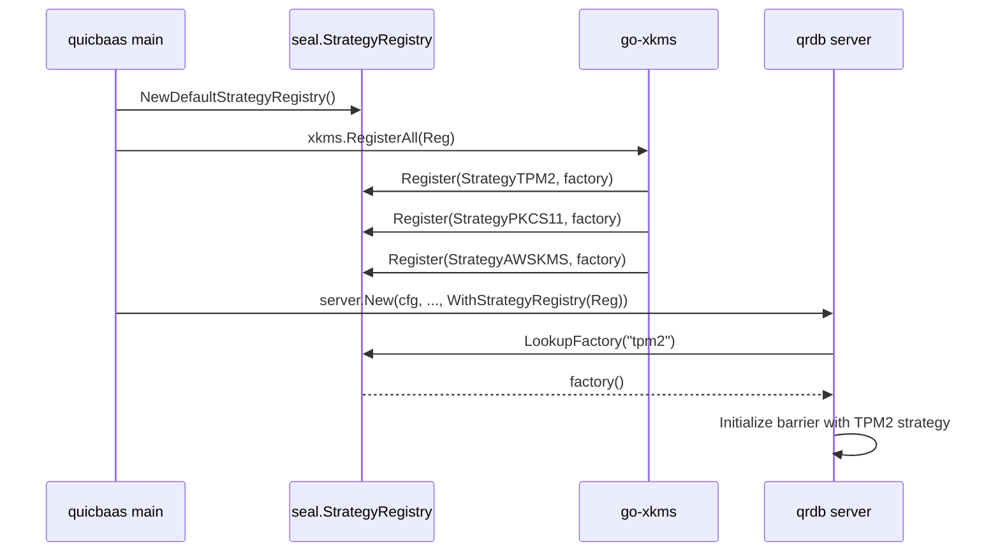

# Barrier and Seal — Architecture

> **Status: NORMATIVE** · Scope: go-qrdb · Last verified: 2026-10-26
> Conflicts with this document are defects. Fix them here first.

The barrier is the at-rest encryption boundary. Everything persistent passes
through it, and when it is sealed the data path refuses every read and write.

Shamir M-of-N custody, Security Officers and recovery keys are a feature of
their own: [../shamir-custody/](../shamir-custody/).

## Problem

At-rest encryption in a database that must also run on a TPM, a PKCS#11 HSM,
AWS KMS, GCP KMS, Azure Key Vault or Vault — without the database importing any
of their SDKs, and without a second implementation per backend.

## Shape chosen

A three-layer split, with **hardware arriving by composition rather than by
import**.

```
go-quicraft/pkg/seal/          Interfaces + go-enclave protected memory + minimal Barrier + Software/None/Shamir primitives
        ↑
go-qrdb/pkg/seal/              StorageBarrier: multi-tenant, storage wrapping, recovery, root tokens,
                               share exchange, StrategyRegistry (Software + None pre-registered)
go-qrdb/pkg/keydelivery/       Node-to-node HPKE envelope over mTLS (no tenant key)
go-qrdb/pkg/clusterkeys/       Node-identity and peer-authentication for key delivery
go-qrdb/pkg/clusterseal/       Replicated seal records, per-node enforcement, the serving lease
        ↑
go-xkms/pkg/seal/              Hardware strategies (TPM2, PKCS#11, AWS KMS, GCP KMS, Azure KV, Vault)
                               registered into a qrdb StrategyRegistry at composition time
```

- **go-quicraft** defines the barrier interfaces (`Barrier`, `SnapshotBarrier`, `EpochTracker`) and a minimal default implementation with AES-256-GCM, epoch rotation, deployment ID isolation, brute-force protection, and go-enclave locked-memory protection. It also owns the baseline software-shape strategies: `SoftwareStrategy` (passphrase-based) and `NoneStrategy` (no encryption).
- **go-qrdb** wraps go-quicraft's barrier in `StorageBarrier`, adding all database-layer features. The `pkg/dek/` package is the per-tenant data encryption keyring: versioned application keys stored in each tenant's own store, wrapped by the tenant's barrier — see [tenant-dek](../tenant-dek/architecture.md).
- **go-xkms** ships hardware `SealingStrategy` implementations and registers them into a qrdb `StrategyRegistry` so qrdb can resolve `--barrier-strategy <name>` at init time without importing any HSM SDK.


That third layer is the point. **qrdb has no compile-time dependency on any
hardware code**; it calls a registered factory by name.

## Strategies

| StrategyID | Constant | Source | When to use |
|------------|----------|--------|-------------|
| `passphrase` | `seal.StrategyPassphrase` | go-quicraft (re-exported) | Single passphrase, FIPS-aware KDF (Argon2id or PBKDF2-SHA256). The default. |
| `shamir`   | `seal.StrategyShamir`   | go-qrdb (`pkg/seal/strategy_shamir.go`) | M-of-N quorum unseal; the Shamir secret is a random unseal key that AEAD-wraps the root key (Vault-style indirection, see [shamir-custody](../shamir-custody/)). |
| `none`     | `seal.StrategyNone`     | go-quicraft (re-exported) | Barrier disabled; data stored plaintext. Dev/test or OS-level FDE deployments. Valid enable-encryption source (plaintext→keyed migration). |
| `system-barrier` | `seal.StrategySystemBarrier` | go-qrdb (tenant strategy only) | Auto-unseal with per-tenant root key wrapped under the system barrier; no per-tenant credential required. System-managed convenience mode for dedicated tenants. Valid enable-encryption source (credential-free→keyed migration). |

Hardware strategies (`tpm2`, `pkcs11`, `aws-kms`, `gcp-kms`, `azure-kv`,
`vault`) live in go-xkms and register themselves through
`StrategyRegistry.Register` at composition time.

When several strategies are registered the caller must name one at
initialization (`--barrier-strategy <name>`); qrdb returns
`ErrNoStrategySpecified` if it cannot choose. With exactly one registered, that
one is selected unconditionally.

## Changing the passphrase

A passphrase-sealed barrier's passphrase is changed by **re-wrapping**, not
rotating: the root key and every byte of data stay as they are, and only the
persisted root-key blob is replaced, sealed under the new passphrase.

- **The current passphrase is proven, not assumed.** The barrier is unsealed,
  but holding an unsealed barrier is not holding its passphrase: the change
  opens the persisted blob with the current passphrase and compares it with
  the live key. A mismatch is `ErrCredentialMismatch` and nothing is written.
- **The write is a guarded swap.** The new blob replaces the old one only
  while the old one is still the blob the check read, so a rotation, rekey or
  second change that lands in between is never overwritten
  (`ErrPassphraseChangeConflict`). Storage with no guarded swap is refused
  (`ErrGuardedSwapUnsupported`) rather than written unguarded. A change
  that arrives while another rewrite of the root key is in flight, such as an
  overlapping change, is refused before it reads anything
  (`ErrRootKeyWriteInProgress`); like the conflict it is a retryable `409` /
  `Aborted`.
- **The load generation is kept,** so the next unseal does not read the
  change as a generation going backwards.
- **One service call, every transport.** `BarrierChangePassphrase` is a
  service method that REST, gRPC, the Unix socket, QUIC, MCP and the embedded
  client delegate to, under `seal:rekey`, which the dual-factor gate holds to
  the Security Officer's PIN. An embedder calls `Node.ChangePassphrase`.

Rejected: changing the passphrase by an encryption migration
(`enable-encryption`) re-encrypts every key and tears the data plane down for
what is a change of the key's wrapping; a rekey round is the Shamir custody
mechanism and has no meaning for a single passphrase.

## The strategy registry

`StrategyRegistry` decouples the daemon from concrete strategy implementations. The daemon parses `--barrier-strategy <name>` and calls `LookupFactory` on the registry; the registry returns a `StrategyFactory` that constructs the strategy on demand. (`pkg/seal/strategy_registry.go:39-58`)

```go
type StrategyRegistry interface {
    Register(name StrategyID, factory StrategyFactory) error
    Unregister(name StrategyID)
    LookupFactory(name StrategyID) (StrategyFactory, error)
    ListAvailable() []StrategyID
}

type StrategyFactory func() (SealingStrategy, error)
```

### Defaults — `NewDefaultStrategyRegistry`

`NewDefaultStrategyRegistry()` (`pkg/seal/strategy_registry.go:88-98`) returns a registry pre-populated with the two software strategies qrdb owns outright:

- `StrategyPassphrase` — built via `NewDeferredSoftwareStrategy()` so the passphrase can be supplied at Initialize/Unseal time rather than at construction.
- `StrategyNone` — built via `NewNoneStrategy()`.

`StrategyShamir` is intentionally NOT registered in the default registry because the Shamir strategy requires a `Threshold` and `Shares` configuration that only the daemon's configuration can supply; `NewSystemStrategyRegistry` (`pkg/seal/system_strategy.go`) adds it, with the configured threshold and total, to the registry the system barrier uses.

### Hardware injection — `WithStrategyRegistry`

Higher layers add hardware strategies on top by handing qrdb's server constructor a registry through `WithStrategyRegistry`:

```go
// pkg/server/server.go:1168-1170
func WithStrategyRegistry(reg seal.StrategyRegistry) ServerOption {
    return func(o *serverOptions) { o.strategyRegistry = reg }
}
```

The typical composition flow (driven by go-quicbaas):



The same registry can be used to inject test/fake strategies in integration tests without any hardware coupling. `sealtest.DeviceStrategy` (`pkg/seal/sealtest`) is such a fake: it wraps and unwraps the root key under a device key that never leaves it, takes no passphrase, and counts the operations it served.

### Who consults the registry

- **A tenant barrier** resolves its strategy through the registry (`TenantService` built with `WithStrategyRegistry`).
- **A database barrier** resolves its mode through the same registry first (`database.WithBarrierStrategyRegistry`, fed from `Infra.StrategyRegistry` by `BuildServices`), then falls back to the built-in `passphrase`, empty and `shamir` modes. A mode neither holds is refused with `database.UnsupportedBarrierStrategyError`, never downgraded to a passphrase barrier. So a hardware strategy a composer registers once can seal a tenant barrier and a database barrier, and `database.DatabaseBarrierManager.SupportsMode` and `database.Manager.UpdateBarrier` follow the same answer.
- **The system barrier** resolves its strategies through it too: `seal.NewSystemStrategyRegistry` overlays a composer's registry on the software strategies, and an injected `WithSealStrategy` is registered under its ID. See [extension-seams](../release/extension-seams.md).
- **The seal store** is node-local by design and is not a composition seam: per-node seal keys are the one node-local state the architecture allows.

### The barrier key seam — `BarrierKeyProvider`

Every node seals its own copy of a barrier's key. `seal.BarrierKeyProvider`
(`pkg/seal/barrier_key_provider.go`) is the seam through which one node obtains
the `SealingStrategy` that seals that key. go-qrdb ships one implementation, the
software provider over a `StrategyRegistry`; it ships no HSM, TPM, PKCS#11 or
cloud-KMS code. A composer (go-xkms, composed by go-quicbaas) injects its own
provider, and that provider decides what a key reference means.

```go
type BarrierKeyProvider interface {
    BarrierStrategy(ctx context.Context, req BarrierKeyRequest) (BarrierKeyStrategy, error)
}

type BarrierKeyRequest struct {
    Barrier    string     // "node", "tenant/<tenant>", "database/<tenant>/<database>"
    NodeID     string     // the node whose key this is
    StrategyID StrategyID // the strategy the barrier's owner chose
    KeyRef     string     // the owner's opaque key reference; go-qrdb never parses it
    Epoch      uint64     // 1 at init
}

type BarrierKeyStrategy struct {
    Strategy   SealingStrategy
    Credential CredentialKind // none | passphrase | shares
    Custody    Custody        // none | owner | platform
}
```

The provider answers two questions besides the strategy:

- **`Credential`** — what a client must supply to initialize and unseal. The
  tenant service requires a passphrase when, and only when, the provider says
  `CredentialPassphrase`, never from the strategy's name.
- **`Custody`** — who can release the key without the owner present. It
  records the owner's own choice: an owner that opts into auto-unseal hands
  custody to the platform, and that is the owner's posture to choose. go-qrdb
  cannot inspect a KMS key's policy, so the composer that injects a provider
  vouches for what it declares.

The default provider, `seal.NewBarrierKeyProvider(reg)`, resolves
`req.StrategyID` from `reg` (a nil `reg` is `NewDefaultStrategyRegistry()`) and
reports:

| Strategy | Credential | Custody |
|----------|------------|---------|
| `passphrase` | passphrase | owner |
| `shamir` | shares | owner |
| `system-barrier` | none | platform |
| `none` | none | none |
| any other registered name | none | platform |

It never claims owner custody for a strategy it knows nothing about: a
composer whose strategy wraps under a key the owner controls injects its own
provider to say so. An unregistered name is refused with
`*seal.StrategyNotRegisteredError`, which names what is registered; a factory's
error reaches the caller unchanged.

**Injection.** `server.WithBarrierKeyProvider(p)` (also `sdkserver.WithBarrierKeyProvider`).
The tenant service is built in `lifecycle.BuildServices`, before `server.New`
runs, so the SDK node builders resolve the option through
`server.ResolveCryptoOptions` and forward it into
`lifecycle.Infra.BarrierKeyProvider`. An injected provider wins; otherwise the
default provider runs over `WithStrategyRegistry`'s registry. The node names
itself by its Raft address, or `local` on a standalone node.

**Scope.** Tenant barrier initialization resolves through the seam. The
Shamir tenant path keeps its own constructor, because a parameterless factory
cannot carry a threshold and share count. The node barrier and database
barriers do not use the seam; they use `WithSealStrategy` and the registry.

### Alternatives rejected

- **Importing hardware SDKs into qrdb.** Rejected as a hard invariant: **zero
  hardware coupling.** No TPM2 code, no PKCS#11 code, no `pkcs11` build tag in
  any qrdb Go file. qrdb defines the seam; hardware arrives by composition.
- **Registering Shamir in the default registry.** Deliberately not done — the
  Shamir strategy needs a threshold and share count only the daemon's init
  command can supply, so the daemon constructs it inline at init time.
- **A shared cluster-wide DEK.** Rejected in favour of the per-node key model
  below: each node's node barrier has its own key. A tenant barrier whose
  strategy is not `none`, `passphrase` or `shamir` is the exception: its
  replicas share the tenant root key (see *Per-node key architecture*).
- **Making `none` invisible.** Rejected: with `none` selected the audit log
  marks every barrier operation `strategy: none`, so the absence of encryption
  is permanently visible in the trail.

## Per-node key architecture

qrdb uses a **per-node-independent key model** (not a shared cluster-wide DEK):

- Each cluster node holds its own **system barrier** with its own **master key (KEK)**. The KEK is never
  shared across nodes and is managed per-node by the system barrier's configured strategy.
- **Per-tenant barriers** in multi-node clusters: a tenant barrier sealed with `none`, `passphrase`
  or `shamir` has its own key on every node that serves it
  ([Per-node barrier keys](#per-node-barrier-keys)). Every other strategy does the same: each
  serving node keys itself from the barrier owner's signed init statement, and no root key or
  sealed blob crosses nodes.
- **Key plane**: `pkg/keydelivery/` implements a node-to-node HPKE envelope (it carries no tenant
  root key; the receiver refuses every envelope at its mode dispatch until verifier delivery is
  built) over the cluster mTLS control plane, with HPKE encryption to bind the payload to the recipient
  node's certificate. `pkg/clusterkeys/` handles node-identity authentication — chain validity, the
  node SPIFFE SAN, the placement gate, and **certificate revocation**, on both the receiving and the
  sending side. Revocation is checked separately because the other three are all satisfied by a
  revoked certificate: without it, a node whose certificate an operator has withdrawn keeps taking
  part in the key plane. See
  [certificate-authority → Where revocation is enforced](../certificate-authority/architecture.md#where-revocation-is-enforced)
  and
  [../multi-tenancy.md → Per-node-independent key design](../multi-tenancy/architecture.md#per-node-independent-key-design).


## Sealing the node barrier seals the whole node

A seal of the node (system) barrier is a seal of **everything that node
holds**. Every path that seals it -- the single-admin seal on every transport
(REST, gRPC, unix, QUIC, MCP, embedded, desktop), a share-holder seal
quorum's completion, and a cluster seal record for the node barrier applied by each node's
monitor -- goes through one whole-node seal (`service.SealWholeNode`, the
same seal shutdown performs): every database barrier, then every tenant
barrier, then the node barrier, so no database or tenant root key or DEK stays
in memory while the node reports sealed.

**Before any key goes, every Raft shard the node hosts is paused** -- the
system shard and every tenant shard, on the node's own Raft host and on each
volume tenant's host (go-quicraft's `Host.PauseShard`), all at once, and the
keys are wiped only once every pause has returned. A paused shard stays
loaded: nothing is shut down, its log, state machine and membership are kept,
and a leader hands its leadership to a peer first. It refuses every proposal,
read and session call with `ErrShardPaused`, which every transport answers as
retryable unavailability (`503` on REST, `UNAVAILABLE` on gRPC, and the
unavailable status on QUIC, MCP and the unix socket); it discards inbound Raft messages, applies
nothing and takes no snapshot. A pause returns only when none of the shard's
log, apply or snapshot work is in flight, so no write racing the seal reaches
the Raft log once the keys are gone. No shard starts on the node from the
pause until the resume: a tenant database shard or volume tenant host that the
reconciler or a request would bring up in that window is refused as sealed,
and a start already under way when the seal arrives finishes first, so the
pause finds its shard. A pause that fails is reported, and the
keys are wiped regardless. Shutdown and a failed boot wipe without pausing:
the host is closing anyway. Every
open stream ends with the node's sealed refusal, through the stream registry,
exactly as a tenant seal ends that tenant's.

A **cut-off** is not a seal: a node that cannot read the seal records stops
serving and ends its streams, but keeps every key, and resumes on its own once
it can read them again.

**Unseal order.** The node barrier unseals first. A **system-managed**
(auto-unseal) tenant, whose root key the node barrier wraps, is unsealed with
it, credential-free -- but only one **the node seal itself sealed**. The node
seal records each system-managed tenant it moves from unsealed to sealed, and
the node barrier's unseal (`StorageBarrier.OnUnsealed`, by passphrase, Shamir
quorum or recovery keys) brings back exactly those. Databases follow the same rule:
the node unseal brings back only a system-managed database the node seal
sealed, and no database barrier is system-managed -- a passphrase
database stays sealed until its owner unseals it, a Shamir database until its
holder quorum does, and either unseal then works as it always does. A tenant
or database sealed for its own reasons stays sealed: one its admin sealed, before the node seal or since; one
whose cluster seal record is sealed or cannot be read. The re-unseal runs on a
context detached from the unseal request; a tenant that fails to come back
stays sealed, is retried at the next node unseal, and its own unseal recovers
it at any time. A **self-managed** tenant stays sealed until its own admin
unseals it with the tenant's credential.

**The shards resume after the keys.** Once the node barrier is unsealed and
its system-managed tenants are back -- the same `OnUnsealed` observers, on
every unseal path -- every shard the seal paused resumes (`Host.ResumeShard`):
it rejoins as a follower and applies, in log order, what it held while paused.
A tenant whose barrier is still sealed has its shards and volume host closed
instead of resumed, as a tenant seal does, and they are rebuilt on first use
once the tenant is unsealed. The resume is driven by the node's own key
coming back, not by the cluster record, so a sealed system shard cannot wait
on itself: once a quorum of nodes has unsealed, the system shard elects a
leader and `cluster-unseal` can write the clear record. The operator impact: after a
node seal, the platform operator's unseal restores the node and its
system-managed tenants; every self-managed tenant on the node stays down until
its own admin acts, exactly as after a restart.

When an encryption migration replaces the node barrier with a keyed one, every
observer of the old barrier moves to the new one, in the order it was
registered: the system-managed tenant re-unseal, the shard resume and the
volume lock and unlock all follow the barrier that now guards the node, and
the old barrier keeps none.

## Transparent at-rest encryption

All persistent data is encrypted transparently at rest via the `StorageBarrier`:

- **System data** (KV, MVCC, raft log) is barrier-encrypted under the system barrier's master key.
- **Tenant data** on dedicated isolation modes (volume, raft) is barrier-encrypted under the tenant's
  own master key (which is persisted under the system barrier for system-managed auto-unseal, or
  under the tenant's strategy for self-managed).
- The barrier operates transparently: callers put/get plaintext, the barrier handles encryption/decryption
  automatically.

See [multi-tenant.md](../seal/multi-tenant.md) for the full tenant-barrier lifecycle and key-management modes.

## Sealing quiesces the encrypted stores

A Pebble store on an encrypting file system (`pkg/seal/encfs`) cannot finish a
flush, a WAL rotation or a compaction once its barrier's key is gone, and
Pebble panics when it cannot create the WAL file a flush needs. The seal watch
(`pkg/storage/pebble.SealWatch`) already refuses new work under a **sealed**
barrier; the work that matters is the work **already in flight** when the
seal arrives. `StorageBarrier.Seal` therefore drains it before the key leaves
memory:

1. The sealing observers run (`OnSealing`). A volume store an observer closes
   still flushes through the barrier, so the observers come first.
2. The barrier's quiesce gate closes (`pkg/seal/quiesce.Gate`). From here every
   flush, durable write and compaction a seal watch admits refuses with the
   same typed `*pebble.SealedError` (`ErrBarrierSealed`) a sealed barrier
   gives.
3. The seal waits, up to `seal.BarrierConfig.SealDrainTimeout` (default 10 s),
   for every store's outstanding operations to end.
4. The barrier seals: its key is wiped and `IsSealed` reports true.

Each encrypted store registers one **lease** on its barrier's gate when it
opens (`pkg/storage/pebble.Open`, named by its directory) and unregisters it
when it closes. Unregistering ends admission at once, so every later operation
on the lease is refused as sealing, but an operation the lease already
admitted keeps it in the drain until that operation releases. A store's
`Close` unregisters before it closes the store, so closing a store never takes
work in flight out of a seal's sight. `Open` registers the lease before `pebble.Open` and holds it
while Pebble recovers and creates its files, so a seal drains an open in
progress, and an open on a closed gate is refused with the typed sealed error. Every operation the watch admits holds the lease for its whole
duration (`SealWatch.Admit` ... `SealWatch.Done`): `SealWatch.Flush`, which the
Raft state machines in `pkg/store` call from `Sync`, and every write and
batch commit and `Compact` of a `pkg/storage/pebble.PebbleStorage`. The
encrypted file backend (`pkg/storage/file`) registers the same way when
`file.New` opens it over an encrypting filesystem: the open holds the lease
across its journal recovery, and every write and journaled batch commit
holds it from before its journal is published until the batch is applied.
On a closed gate the open and every write are refused with
`*file.SealedError` (`quiesce.ErrSealing`) and write nothing. A per-database
barrier's value-encrypting `database.BarrierBackend` registers a lease
(named `database`) on its database's own barrier gate, which the encryptor
from `DatabaseBarrierManager.GetBarrier` exposes: every mutation (`Put`,
`PutIfAbsent`, `CompareAndDelete`, `CompareAndSwap`, `Delete`,
`DeleteRange`, `Batch`) holds it from before it reaches the store until it
returns, so `SealDatabase` drains it, and on a closed gate it is refused
with `*database.SealedError` before it reaches the store. The storage
packages cannot import `pkg/seal`, so `quiesce.ErrSealing` and
`pebble.ErrBarrierSealed` are classified like `seal.ErrSealed`: Unavailable
and retryable in `pkg/api/errclass`, ahead of every service wrapper, and
sealed in the `pkg/store` and vector adapters' sealed-refusal checks. A lease is an atomic
counter; taking it is one atomic add and one atomic load, so the write path
takes no lock. Acquire increments, then reads the gate; the seal closes the
gate, then reads the counters, so either the operation sees the gate closed
and refuses, or the drain sees the operation and waits for it.

**A drain that runs out still seals.** The seal is the operator's control: a
store wedged on a slow disk cannot be allowed to keep a key in memory that its
owner asked to remove. `Seal` seals, then returns a
`*quiesce.DrainTimeoutError` naming the stores still in flight (joined with any
observer error), logs it at `Error` and records an audit event with phase
`drain`. As with an observer error, an error from `Seal` never means the
barrier is unsealed. A database seal whose drain ran out still marks the
database sealed and ends its streams and SQL sessions before it returns the
error.

An expired drain reports a risk; it does not remove it. The timeout cancels
nothing: an operation that passed `Admit` and then stalled is still inside
the store, and no further barrier check stands between it and Pebble. When
it resumes after the key wipe it can still race it, up to the WAL-creation
panic the seal watch describes. The seal watch turns a failure into a typed
error, not a panic, only where the file system can report its barrier state
in time. An operator who sees a `DrainTimeoutError` should treat the named
stores as having raced the wipe, and raise `seal.drain_timeout` if it recurs.

**Unseal reopens the gate**, on every unseal path (passphrase, Shamir quorum,
recovery keys), after the barrier reports unsealed.

**Not covered.** Pebble's own background flushes and compactions run on its
goroutines and are not admitted by the watch, so the drain does not wait for
them; a sealed barrier fails them and the watch bounds the logging, as before.
A go-quicraft `Host` that seals its `EpochBarrier` directly does not go through
`StorageBarrier.Seal` and so does not drain. Pebble is used as released, never
forked, and go-quicraft is unchanged.


## No cluster auto-unseal

Custody is per node. A Shamir barrier is unsealed only by a quorum of its own
authenticated share holders ([../shamir-custody/](../shamir-custody/)); nodes
never exchange shares.

Because each node is unsealed on its own, a cluster's nodes come back minutes
apart. **A node that has unsealed waits for its system shard's leader for as
long as it runs** — until a quorum of its peers is running and unsealed too —
and logs `waiting for a Raft leader` while it does; it serves nothing until
then. It never gives up and exits, because a node that left would be the one
its peers are waiting on. The same holds after the in-process restart a system
encryption migration performs, where every node recycles and is unsealed in
turn. Through the sealed window, the unseal and that wait the node keeps every
port it serves on bound — REST, the HTTP/3 socket beside it, gRPC, the QUIC
transport and MCP — and hands the same sockets from the sealed-window listener
to its own server, so no other process on the host can take one meanwhile
(see "Pre-bound sockets" in
[the API server architecture](../api-server/architecture.md)).

**A migration's owners recycle one at a time, and a node counts as back once
its Raft log has caught up.** Once the `rolling-migration` cluster feature is
active, the migration record orders the owners in steps. The next owner's turn
starts only when the last one has acked the migration, and also holds the
shard's log up to the commit index seen at that ack. So the shard is never
short of two replicas' logs at once. The step is advanced by the leader of the
scope's own Raft shard, the one node that knows how far each replica has
replicated. While that shard has no leader, no node advances the step. Every
write of the record is a compare-and-swap on the record as read, so a node
that has lost leadership cannot undo a newer step. The detail is
[engineering.md](engineering.md#owners-recycle-one-at-a-time).


## Sealing in a cluster

A seal is an incident-response control: the operator wants a key out of every
process that holds it, now. This section is the contract for how a seal at
each barrier level reaches every node of a cluster.

### Three barrier levels

| Level | What it protects | Who may seal it | Who may clear a cluster seal |
|---|---|---|---|
| **Node barrier** | one node's whole data plane: the system shard, the Raft log, the identity plane | the platform operator — an identity of the `system` tenant holding `seal:seal`; a Shamir node barrier needs an M-of-N seal quorum of its share holders | the platform operator, `seal:unseal`, on a node that has unsealed itself |
| **Tenant barrier** | one tenant's dedicated data, on every node that holds it | that tenant's own administrators (`tenant_barrier:seal`); a Shamir tenant barrier needs a seal quorum of its share holders. **The platform operator cannot seal a tenant's barrier** | the tenant's administrators, by unsealing the tenant on a node |
| **Database barrier** | one database's own store | the tenant that owns the database (`databases:seal`) | the owning tenant, by unsealing the database on a node |

No level gives anyone access across tenants. A platform operator acts on node
barriers; a tenant acts on its own tenant and database barriers, and on no
other tenant's. The SO PIN dual factor guards a node seal exactly as it does
on a single node.

### Shape chosen

**A seal is a small replicated record; enforcement is local; unsealing stays
per node.**

```
operator ──seal──▶ any node N (authorizes the caller; Shamir: completes the holder seal quorum)
   N: 1. writes the seal record for the barrier: epoch + 1, sealed      (system shard, guarded write)
      2. seals itself: closes the gate, ends open streams,
         stops the barrier's shards, wipes ITS OWN key from memory
every other node M (seal monitor, reads the records every poll interval):
      3. sees the new epoch sealed → performs step 2 on itself
```

The record carries **who, when, which node accepted it, and an epoch — and no
key material**: never a key, a share, a credential or an envelope. No key
crosses the network to seal or unseal anything, and none enters the Raft log.
Each node seals and unseals its own data with its own key; hardware strategies
composed in from go-xkms or go-quicbaas through the `StrategyRegistry` keep
working unchanged, because nothing here touches how a node holds its key.

The receiving node writes the record **first** and seals itself second,
because the node barrier's key also protects that node's own Raft log: a node
that wiped it first could not take part in committing the record.

### The seal record

One record per barrier, in the replicated system store:

```
__sys:cluster/seal/records/node                          node barrier (every node's)
__sys:cluster/seal/records/tenant/<tenant>               one tenant's barrier
__sys:cluster/seal/records/database/<tenant>/<database>  one database's barrier
__sys:cluster/seal/acks/<node>                           node-barrier seal acknowledgements
```

```json
{"barrier":"tenant/acme","epoch":7,"sealed":true,
 "principal":"alice","principal_tenant":"acme",
 "node":"192.0.2.11:5000","at":"2026-10-01T12:00:00Z"}
```

A record is written only with a guarded write — create-if-absent for the first
epoch, compare-and-swap against the exact record read before it after that —
so two concurrent seal or clear requests serialize and the loser is refused
with `SealEpochConflictError` rather than lost. The epoch only increases. A
seal raises it with `sealed: true`; a clear raises it with `sealed: false`.

### Enforcement on each node

Every node runs a **seal monitor**. It reads every record with one
linearizable range read per poll interval (default 1 s). For each barrier
whose epoch has advanced to `sealed`, it seals that barrier **on this node**,
in this order:

1. **Close the gate.** New requests for the barrier are refused from here on.
   For the node barrier this is the sealed-window gate on every transport,
   the in-process embedded client included -- it refuses exactly what the
   network listeners refuse, from the same allowlist, on every request method
   and on every method of every sub-client it hands out (login, session,
   factor, RBAC, permission, audit, volume pool);
   for a tenant or database barrier it is the sealed-barrier refusal at
   request resolution.
2. **End open streams.** Every watch on every transport — REST, gRPC, Unix,
   QUIC, MCP, embedded and the etcd listener — opened against the barrier's
   data ends with the barrier's sealed error, as do the etcd watch and lease
   keep-alive streams themselves. Every one subscribes to the node's one stream registry: the
   network listeners' watches through the server's service registry, and the
   embedded client's unscoped watches directly (as the caller's tenant's
   default database), both through `clusterseal.Streams.GuardWatcher`.
   A stream subscribes **before** it asks whether it may open
   (`clusterseal.Streams.SubscribeServing`), and the order is what makes a seal
   unmissable: a seal closes its gate before it ends streams, so one that
   lands before the subscription is refused by the check, and one that lands
   after it ends the subscription. Checking first and subscribing second would
   leave a window in which a stream opened as the seal landed outlived it. A missed
   seal is enforced on a clear record, so its gate is the wipe itself: streams
   are ended once more after the wipe, and a stream opening after that finds
   the barrier sealed.
3. **Stop the barrier's shards.** A tenant seal closes the tenant's dedicated
   Raft shards and its volume host on this node (closed, not purged), so no
   apply ever runs against a sealed barrier. They are rebuilt on first use
   once the tenant is unsealed again. A node seal pauses every shard the node
   hosts instead, the system shard included -- paused and loaded, not closed
   -- and resumes them once the node barrier is unsealed (see *Sealing the
   node barrier seals the whole node*).
4. **Wipe the key.** The barrier is sealed, which destroys its key in memory.

A **node-barrier** seal also wipes every tenant and database key held on that
node: once a node is sealed nothing on it can be served, and leaving tenant
keys resident there serves nobody. The tenant and database records are not
changed. When the node is unsealed, the system-managed (auto-unseal) tenants
that the node seal itself sealed come back unsealed with it; a self-managed
tenant, a database, and any tenant sealed for its own reasons come back
sealed, as after a restart (see *Sealing the node barrier seals the whole
node*).

The monitor tracks, per barrier, the last epoch it acted on, so a missed poll
converges on the next one and a record is never enforced twice.

#### The node barrier waits for every node before wiping

When a node seals its node barrier it stops taking part in the system shard,
because the key it wipes protects its Raft log. If the first nodes to see the
record wiped at once, the cluster could lose its quorum before the rest had
read the record, and those would never see it. So every node that sees a
node-barrier seal closes its gate and ends its streams at once, writes an
acknowledgement (`__sys:cluster/seal/acks/<node>`), and wipes its key only
when **every** current member of the system shard has acknowledged the epoch,
or when the acknowledgement timeout (default 5 s) runs out — whichever comes
first. Requests are refused throughout the wait; only the moment the key
leaves memory is held back.

The timeout bounds the whole wait, the node's own acknowledgement write
included, and the node reads the acknowledgements from its own copy of the
system shard rather than through a quorum. The nodes that see every
acknowledgement first pause their shards, so the last node to look may find
no quorum left to answer a quorum read. Acknowledgements are only ever added,
so a local copy that holds all of them proves they committed: the local read
can be late, never wrong.

Its shards are paused before the wipe, so no log write ever runs against the
sealed barrier, and **a node whose node barrier was sealed while running is
unsealed in place**: the unseal restores its keys, then resumes its shards,
and it rejoins the system shard. Restarting it and unsealing at boot works as
well (see *Restart* below).

### Unseal stays per node

Each node unseals with its own credential — a passphrase, a Shamir quorum
submitted to that node by the holders through the unified holder model, or a
hardware strategy. A clear record is the authorized statement that the
cluster seal is over; it never unseals anything by itself. **A node serves a
barrier only when its record is clear and that node has unsealed the barrier
itself.**

- **Tenant and database barriers.** Unsealing on a node — passphrase,
  completing the share quorum, or the database secret — first unseals that
  node's barrier; if the barrier's record says sealed, the same call then
  writes the clear record. If that write fails, the node seals the barrier
  again and the call fails, so a node never keeps serving a barrier whose
  record is still sealed. Every other node holding the barrier stays sealed
  until it is unsealed there.
- **Node barrier.** A node whose node barrier is sealed in the cluster
  record comes back from its restart and boot-time unseal **held**: its key is
  in memory and its Raft log runs, so the cluster can form a quorum, but it
  refuses every request except the sealed-window allowlist -- the unseal call
  and `cluster-unseal` -- with the typed sealed refusal. Status is refused
  too: a held node answers no `barrier status`, and the record's state is
  read from a node that serves. `qrdb barrier
  cluster-unseal` — the platform operator, on any node that has unsealed
  itself — writes the clear record, and every held node then serves. A held
  node does not seal itself again for the epoch it is held at; only a newer
  sealed epoch does that.

### Cut-off nodes: the serving lease

A node that cannot read the records would never see a seal. To bound that,
**a node serves only while it holds a fresh lease on the seal records.**

- Every successful read renews the lease for `seal.cluster_lease` (default
  15 s), measured from *before* the read was issued, so a slow read shortens
  the lease rather than extending it.
- When the lease runs out, the node **stops serving**: the gate closes for
  every request outside the sealed-window allowlist and every open stream ends
  with `SealStateUnconfirmedError` (`503` / `UNAVAILABLE`, retryable). The
  gate refuses requests with the same status, `SEAL_STATE_UNCONFIRMED` on
  every transport, never `SEALED`: the barrier is unsealed, and a client that
  read a cut-off as a seal would stop retrying a node that recovers on its own
  once the system shard has a leader again. **Its keys stay in memory.**
- When it can read the records again it resumes **without a re-unseal**. If a
  barrier was sealed in the meantime, it enforces that seal first, before it
  serves anything.

Under the bounded clock-rate assumption Raft lease reads already make (any two
replicas' clocks run within 1 % of each other; wall-clock steps do not count), no
node serves a barrier later than `seal.cluster_lease` after its seal record
commits.

### Restart

A node reads the records **before it serves anything**: until its first
successful read it holds no lease and refuses every request outside the
sealed-window allowlist. On that first read, a tenant or database barrier whose
record is sealed is sealed on this node — including a system-managed tenant
that auto-unsealed at boot — and the node barrier, if its record is sealed,
comes up held as described above. The tenant shard reconciler does not start
a tenant's shards while the tenant's record is sealed.

A pause is not persisted: a restarted node starts with every shard unpaused.
A node whose barrier is sealed at boot opens its Raft log only after the
boot-time unseal, so it writes no barrier-encrypted log record while sealed;
until then it serves barrier status and the unseal through the sealed-window
listener.

### Rollout — the `cluster-seal` feature

A node running a binary that does not read the records would keep serving
after a cluster seal. Cluster sealing is therefore gated on the cluster
feature gate: every binary advertises the `cluster-seal` feature, and records
are written and enforced only once the feature is **activated** — every
member of the system shard advertises it. Activation, not per-group
enablement, is the right test, because enforcement is per node, not per Raft
group. Once activated, a binary without the feature refuses to start, which
is the gate's existing downgrade rule.

**Until the feature is activated, a seal acts on the receiving node only**,
and every barrier status reports
`cluster_seal.active: false`, so an operator can see that a seal did not
reach the other nodes. Each node still reads the records on every poll,
acting on none of them, so that it holds a fresh read when the feature turns
on: activation interrupts nothing. A standalone node, and a raft node with no transport,
has no other node to reach: its seals are node-local and its status reports
`active: false`.

### Ordering against in-flight writes

A write acknowledged to its client before the gate closed on the node that
accepted it is durable. A write not yet acknowledged has an indeterminate
outcome — the outcome of any leader loss in Raft: its entry may be applied
when the barrier is next unsealed, because it may already be committed, but it
is never applied while the barrier is sealed on that node, because the
barrier's shards stop before its key is wiped.

### Threat model

| Actor | Can | Cannot |
|---|---|---|
| Holder of a barrier's seal permission, on any node | seal that barrier on every node in one call | read data; unseal without the credential; seal another tenant's barrier |
| Platform operator | seal and clear the node barrier cluster-wide | seal, unseal or clear a tenant's or database's barrier |
| Network attacker between nodes | delay record reads and so cut nodes off (availability) | read or inject key material: none travels |
| Root on one node | read the keys that node holds; ignore a seal locally | stop the other nodes enforcing it |
| A member able to write any replicated record | write a false `sealed` record (denial of service) | — such a member is outside this design's protection, as it is for every replicated record |

A partition that outlasts the lease refuses service on the side that cannot
read the records, even when nothing was sealed. That is the price of the
bound, and it falls on nodes that already cannot serve linearizable reads.

### Alternatives rejected

- **Pushing keys between nodes** — the node that verified an unseal delivering
  a root key or unseal credential to the others so that one unseal covers the
  cluster. Rejected: no key material crosses the network, and no single key
  unlocks every node.
- **Broadcasting the seal over the cluster mTLS channel.** No ordering, no
  durable record for a restarting node, and no way to tell a missed message
  from a refused one.
- **A new Raft opcode.** A replicated KV record already gives a totally
  ordered, durable record without per-group gating.
- **Self-sealing a cut-off node after a grace period.** The chosen rule is
  *stop serving, keep the key*: a cut-off node refuses requests and resumes
  without a re-unseal once it can read the records again.
- **A plaintext "sealed" latch file per node.** A restarting node already
  refuses until it reads the replicated records, and a file an attacker with
  disk access can delete is no control.

## CA key lifecycle

The CA private key is one of the things the barrier GATES: while the barrier
is sealed, no CA key signs. The barrier does not encrypt the stored record;
[../certificate-authority/architecture.md](../certificate-authority/architecture.md)
is the normative description.

Both CA keys — Key A (the cluster CA, `__sys:cluster_ca/`) and Key B (the
per-tenant login CA, `__sys:cert_ca/{tenantID}/`, resolved lazily by
`pkg/cert.DefaultCertProvider`) — are `cakey.SoftwareProvider` instances,
not key material `pkg/cert` or `pkg/clusterca` holds directly. `cakey.SoftwareProvider`
caches the live key as a `*secure.Secret` — a go-enclave `SealedEnclave`,
AES-256-GCM under the process Sealer — never as a bare `*ecdsa.PrivateKey`
on the ordinary Go heap. Signing opens it into a `secure.Buffer` (mlocked,
guard-paged) for exactly the duration of one `Sign` call and destroys the
Buffer before returning; `Seal` destroys the `Secret` outright. The one
thing go-enclave protection cannot reach is the `*ecdsa.PrivateKey`
`crypto/ecdsa` itself parses the DER bytes into for the duration of that
one `Sign` call. Go deprecates reaching into `(*ecdsa.PrivateKey).D` to
scrub it by hand, so the garbage collector reclaims it as it does any other
`crypto/ecdsa` caller's ephemeral key. Between signatures the key is never
cached in the clear.

### Bootstrap

1. Generate ECDSA P-256 CA key pair (`crypto/rand`)
2. Encode the key as the `material` record and the self-signed certificate
   for it as the SEPARATE `certificate` record (two records, not one
   combined one — see
   [../certificate-authority/architecture.md](../certificate-authority/architecture.md#the-ca-key-provider-seam-pkgcakey)
   for why)
3. `kvStore.PutAllIfAllUnchanged(__sys:cert_ca/{tenantID}/material,
   __sys:cert_ca/{tenantID}/certificate)` — ONE atomic guarded batch,
   guarded on BOTH being absent, the primitive that makes two callers
   racing a brand-new tenant's first-ever boot converge on exactly one CA
4. Seal the key into a `secure.Secret`; cache the certificate in the clear
   (public data)

### Unseal to Operational

1. Load BOTH the material and certificate records from KVStore
2. Decode the key from material, the cert from certificate
3. Seal the key into a `secure.Secret`; cache the certificate in the clear

### Seal

1. Destroy the cached `secure.Secret` outright (wipes the sealed key)
2. The cached certificate (public data) is NOT cleared
3. Every `Signer`/`Certificate` call returns `BarrierSealedError` until
   `Unseal` runs again


## Per-replica tenant keys

Independent replica keys for a tenant's nodes are specified in
[Strict tenant isolation](../multi-tenancy/architecture.md#per-replica-tenant-keys)
and built as [Per-node barrier keys](#per-node-barrier-keys).

## Per-node barrier keys

> **Status: partly implemented.** The design is
> [Per-node init design](#per-node-init-design).
> Implemented: the init statement, its verification, its record and the watcher
> (`pkg/barrierinit`); the definition of the `per-node-barrier-keys`
> feature; the first admin pinned as a tenant barrier's epoch-1 anchor at
> onboarding; the owner's signed statement on every tenant barrier init
> transport, claimed by the tenant service through the init book; the watcher
> composed into every node, which initialises the node's own key for a tenant
> it serves from a claimed statement; and the feature, advertised by every
> binary and wired as the gate on isolated tenants and on the claim (see
> **Feature gate** below). A `none` or `passphrase` tenant barrier
> is initialised on every serving node by that node, the client sending a
> passphrase init to each of them; no key is shipped between nodes.
> A Shamir tenant barrier is not shipped either: every serving node is armed
> from the claimed statement and keys itself at its holders' first quorum, and
> a replica refuses a Shamir sealed blob rather than import a key it could
> never unwrap. Not implemented: database and node barriers, and the owner-CA
> anchor a later epoch verifies against.

Every node that serves an isolated tenant's barrier initialises **its own**
key from one replicated, signed, keyless **init statement**, through the
`BarrierKeyProvider` seam. No key is carried between nodes. The design applies
the same mechanism to database barriers and the node barrier, which do not use
it.

**The statement** (`barrierinit.InitStatement`) names the barrier
(`clusterseal.Barrier`: `node`, `tenant/<t>`, `database/<t>/<d>`), an epoch
(1 at init, one more per re-key or strategy change), the sealing strategy, the
strategy's opaque `KeyRef`, and the strategy's public parameters: a Shamir
threshold, roster hash and unseal-key check value, or a passphrase KDF salt.
It carries no key, no share and no passphrase check value, which would be an
offline-guessing oracle.

- **`KeyRef` is opaque to qrdb.** qrdb ships no hardware, HSM or cloud KMS
  code. An injected strategy — go-xkms supplies those — reads the reference;
  qrdb only carries it.
- **The encoding signed** is the context `qrdb-barrier-init-statement-v1`
  followed by every field but the signature, each byte or string field
  prefixed with its uint32 big-endian length and each integer as a uint64
  big-endian: the `initproof.Message` pattern with its own context, so a
  signature over a statement can never be replayed as an init proof or an
  mTLS challenge, and no two statements share an encoding. Every
  variable-length field is capped at 16 KiB.

**Who may sign.** The barrier's owner, and only the owner:

| Epoch | Signer | Anchor the node verifies against |
|---|---|---|
| 1 | the pending first admin | the SPKI thumbprint recorded at tenant create (at first boot, for the node barrier) |
| 2 and later | a holder of a client certificate from the owner's CA | the owner's CA certificate, pinned in the system tenant; the certificate must be valid when verified |

The statement carries the signer's whole DER `SubjectPublicKeyInfo`, and
after epoch 1 its certificate: a thumbprint cannot verify a signature, and the
epoch-1 anchor is itself a thumbprint, so the key travels with the statement. Signing goes through a `crypto.Signer`, the same seam the init
proof uses, so a device-held key signs without leaving its device. A
statement the platform, or one compromised node, writes — naming a key the
platform controls, say — fails on every honest node with
`*barrierinit.InitStatementError`.

**The record.** One per barrier, in the system store under
`__sys:cluster/barrier/init/<barrier>`, beside the cluster seal records and,
like them, holding only public fields. It keeps every epoch, epoch 1 first,
so a joiner can verify the chain.

- **Epoch 1 is a guarded create-if-absent.** Of two concurrent claims exactly
  one is stored; the other gets `*BarrierAlreadyInitializedError` before any
  key exists. A retry of the stored statement succeeds, signed again or not:
  the record is compared by what the statement says, its signer among it, not
  by its signature bytes.
- **Later epochs are a guarded compare-and-set** over the record read. A
  statement that skips, repeats or rewinds an epoch, or lost a race, gets
  `*EpochConflictError` naming the recorded epoch.
- Both are the existing guarded write (`protocol.OpGuarded`), evaluated by the
  state machine on every replica: **no Raft opcode of its own.** A standalone
  node keeps the same record in its own store.
- A cluster that has not activated `guarded-writes` refuses the write with
  `*GuardedWritesUnavailableError` rather than propose it unguarded.

**The watcher** (`barrierinit.Watcher`) runs on every node. It polls the
records, and for each barrier the node serves delivers the latest epoch it
has not yet delivered — once, and only if it verifies against the node's own
anchors — to the node's barrier initialisation. A statement that does not
verify is logged and never delivered; a delivery that fails is retried on the
next poll; one corrupt record does not hold up the others.

A node does not wait for its next poll to answer a holder quorum request.
`TenantBarrierQuorumBegin` and `TenantBarrierQuorumSubmit` first deliver the
tenant's latest record through the same watcher (`Watcher.Deliver`), with the
same placement filter, verification and once-per-epoch bookkeeping. Any node
serving the tenant then answers from the statement its creator claimed, as
the creator does, and not from a registry that the last poll left behind. A
delivery that fails refuses the request.

### How a node takes part (tenant barriers)

1. **Onboarding pins the anchor.** When a tenant is created with its first
   admin, the admin's SPKI thumbprint is pinned under
   `__sys:cluster/barrier/anchor/tenant/<t>` with a guarded create-if-absent.
   The pending-admin record is consumed once the admin's account exists; the
   pin is not, because a node that initialises its key later (one that was
   down, a joiner) still verifies epoch 1 against it. Pinning the same
   thumbprint again succeeds, so a re-run onboarding completes; any other is
   refused (`*barrierinit.AnchorConflictError`). A tenant ID is retired on
   delete and never reused, so a pin never names a stale tenant.
2. **The owner's client signs the statement.** The client that initialises
   the barrier signs the epoch-1 statement — the tenant's barrier, the
   strategy (empty means `passphrase`), no key reference — with the same
   `crypto.Signer` that signs the init proof, and sends it with the init
   request on every transport. A client without a signer sends none.
3. **The node that takes the call claims it first.** Before it generates its
   own key, it checks that the statement names exactly the barrier, strategy
   and key reference the request initialises, verifies it against the pinned
   anchor, and records it. Every strategy is admitted this way, Shamir
   included: a Shamir init claims its statement before it registers a roster
   officer or splits a share, so a statement naming another strategy refuses
   it with nothing written. A raft-isolated tenant, whose barrier every node of
   its groups serves, is refused without a statement
   (`*tenant.InitStatementRequiredError`): the other nodes could never
   initialise. A `barrier` or `volume` tenant, served by one node, may still
   be initialised without one.
4. **Every other node initialises its own key.** On a clustered node with
   dedicated Raft groups, the watcher delivers the claimed statement for each
   tenant one of whose groups — its home group or a dedicated database — has a
   replica placed on the node, and the node initialises its own key through
   its own `BarrierKeyProvider` from the statement's strategy and key
   reference. Only a strategy whose key needs no caller credential (`none`,
   or an injected strategy reading its `KeyRef`) is initialised this way: a
   passphrase key needs the owner's passphrase on each node and a Shamir key
   the holders' ceremony, and both wait for the client fan-out.
5. **A restarted node reattaches from the statement.** After a restart a
   tenant barrier comes back as a sealed shell carrying the node's system
   strategies, which need not include the tenant's — a passphrase-sealed
   node has no `none`, and an injected strategy is keyed by the tenant's
   `KeyRef`, not by its ID alone. So an unseal reads the barrier's latest
   claimed statement, verifies it against the pinned anchor, asks the node's
   `BarrierKeyProvider` for the strategy, key reference and epoch it names,
   and unseals with exactly that strategy. A root key sealed with another
   strategy is refused (`*seal.UnsealStrategyMismatchError`) rather than
   opened, and a system strategy that merely shares the stated ID is never
   used. A raft-isolated tenant with no statement is refused
   (`*tenant.InitStatementMissingError`): it could not have been initialised
   without one. Three cases unseal through the shell's registrations: a
   Shamir barrier, whose shares are the credential; a `barrier` or
   `volume` tenant initialised without a statement; and a tenant whose
   statement names `none` but whose root key `enable-encryption` has since
   re-sealed with a passphrase, because that migration records no later
   statement.

**The first admin's account is completed once, by the owner's call.** The
barrier-ready step that creates the pending first admin's roles, account and
certificate binding runs on the node that took the owner's init, as the owner,
within bounds of its own (`bootstrap.AdminCompletionBounds`: a 2-minute
budget, 10 seconds per attempt) rather than the request's deadline: the writes
it makes are replicated, and a Raft election in a freshly created group can
use most of a request's deadline. A node that initialised its key from the
statement does not run it — it has no caller to run it as; a later status read
or unseal on any node runs it as that caller should anything remain.

**Guarded writes are not a separate prerequisite.** The record and the anchor
are written only through the guarded write, and a cluster that has not
activated `guarded-writes` refuses them with
`*barrierinit.GuardedWritesUnavailableError` (`Unavailable`, retryable) rather
than write unguarded. Both features activate automatically once every member
runs a binary that knows them, and a binary that knows `per-node-barrier-keys`
knows `guarded-writes`; an isolated tenant cannot be created until
`per-node-barrier-keys` is active. So on a cluster where a claim can be
reached at all, guarded writes are already enforced, and the error is seen
only transiently during a rolling upgrade. Nothing activates it by hand.

**Custody is the tenant's choice.** A platform-sealed key — one that
auto-unseals because the platform holds what wraps it — is not refused under
any isolation policy. The statement's strategy records the tenant's opt-in,
so the choice is auditable.

**Shared tenants have no keys of their own.** The shared Raft group is one
more tenant with its own barrier, which the platform manages. A shared
(`prefix`) tenant's data is therefore readable by the platform; a tenant that
needs confidentiality from the platform chooses an isolated type.

**The serving set** is the tenant's replica count: a tenant quota the system
owner or a system admin sets through the existing quota and entitlement
records, never the tenant's own admin.

**Feature gate.** `per-node-barrier-keys` is activation-based, built like
`cluster-seal`. Until every member advertises it, an isolated tenant is not
created (nor a tenant changed to an isolated type) and no statement is
recorded: `*feature.NotActiveError`. See
[../multi-tenancy/architecture.md](../multi-tenancy/architecture.md#feature-gate-and-upgrade).
A single-member cluster activates it at its first check. A standalone node
holds only its own binary and gates nothing.

Every node composes the watcher: a clustered node with its tenant placements
as the barriers it serves, a standalone node with every tenant barrier.

## Per-node init design

**Terminology.** A **platform-sealed** tenant key is one wrapped under a key
the platform, not the tenant, controls — for example under a node's barrier.
The code names this mode system-managed (`AllowSystemManagedBarrier`). This page says *platform-sealed* everywhere, so
that it is never confused with the **system tenant**, which is the platform's
own tenant.

### Rules

| Rule | What it fixes |
|---|---|
| **Node-local init where no client credential is needed, client fan-out where one is.** | Both are driven by a signed, keyless init statement. |
| **Passphrase joiner verifier: HPKE from a serving peer.** | An unsealed serving node delivers the tenant-wide verifier to a joining node over the `clusterkeys` HPKE channel. |
| **KMS `KeyRef`: one tenant-controlled key by default, a per-node template allowed.** | The statement's `KeyRef` names one KMS key the tenant controls, and the tenant grants each node's identity. A provider may resolve `KeyRef` as a per-node template instead. |
| **One barrier mechanism.** | `BarrierKeyProvider` covers the node barrier, isolated-tenant barriers and database barriers; the system barrier is folded in (§11). |
| **Auto-unseal is the tenant's choice.** | No isolation policy refuses a platform-sealed key. `Custody` records the tenant's opt-in, and the auditable barrier status shows it. qrdb ships no native hardware or cloud crypto, only seams; `KeyRef` stays opaque. |
| **Shared tenants have no keys of their own.** | A shared (`prefix`) tenant's data sits in the shared store under each node's barrier, so **it is readable by the platform**. A tenant that needs confidentiality from the platform chooses an isolated type. A per-tenant envelope scheme for shared tenants is rejected. |
| **Serving set = the tenant's replica count, a tenant quota.** | The system owner or a system admin sets it through the existing quota and entitlement records; a tenant admin cannot change its own. |
| **The tenant signs its serving set.** | The tenant signs the set of nodes that may hold its key with the same signer chain as its `InitStatement`; placement adds members only for nodes in that set. For a tenant that chose auto-unseal, the platform signs. Trusting platform placement instead is rejected: placement is platform-controlled, and the platform could otherwise add a member that receives the tenant's statement. |
| **Moving off `none` in place is a signed epoch.** | `none` → keyed is a new signed `InitStatement` epoch through `BarrierKeyProvider`, the same for every tenant type, strict included. The passphrase reaches other nodes over HPKE from a serving peer. A verified backup is a precondition only; there is no separate backup/restore migration path. |

### The governing requirement

The requirement this design meets:

- **Every tenant has its own keys.** That means the system tenant, every
  shared tenant and every isolated tenant.
- **The system owner cannot view or access any tenant's data.**
- **No tenant can access another tenant's data.**
- **Each tenant manages its own keys.**
- **Every tenant works the same way.**

The requirement holds for isolated tenants. A
shared tenant has no keys of its own and its data is readable by the platform
(§8); a tenant that needs confidentiality from the platform chooses an
isolated type.

[Limits](#limits) states plainly what this design does not reach.

### The problem

On a cluster of more than one node, an isolated tenant (`raft`, `barrier` or
`volume`) whose key is sealed by its own credential needs a key on every node
that serves it:

1. **Tenant create places the home group on every node.** The home group gets
   a replication factor of `max(ClusterSize(), 1)` and `DedicatedWAL = true`
   (`pkg/service/tenant_home.go`, `ProvisionTenantHome`).
2. **`barrier init` reaches one node.** That node resolves a strategy and
   registers and initializes the tenant barrier (`pkg/tenant/service.go`,
   `resolveStrategy`; `pkg/seal/barrier_registry.go`,
   `InitializeTenantWithStrategy`).
3. **A replica starts only behind an unsealed barrier.** Every other node
   defers its home-group replica while the barrier is not registered there or
   is sealed (`pkg/server/tenant_shard_reconciler.go`, `ensureStarted`). With
   one replica started out of three, the group has no quorum and the pending
   first admin is never written.

No node ships its key to another: the tenant-key transport is deleted, and
the database service and the rebalance service only place a new replica,
which keys itself from the barrier owner's signed init statement on the init
watcher's next poll (`pkg/barrierinit`).

### Binding rules

The rules state the target design.

- **No key transport.**
  - Root keys are never pushed or transported, and there is no single key for
    everything.
  - Each node holds its own key and seals and unseals its own data.
  - Seal, unseal and rekey are per node and are never replicated.
  - Rejected: a node delivering a root key **or an unseal credential** to
    another node.
- **Any key provider.** The design must work with every go-xkms key provider:
  software, hardware or cloud. Pushing the tenant key over `clusterkeys` and
  hiding the gap behind an auto-unseal test are both rejected.
- **Encryption seam standard.**
  - Envelope KEK/DEK behind a seam.
  - go-xkms supplies the hardware and cloud implementations, and the platform
    composes them.
  - qrdb carries no HSM, TPM or KMS code.
- **State and deployment.**
  - No node-local state except the per-node seal keys.
  - Works both standalone and under Raft.
  - Node parity: every node serves every endpoint.
- **Change rules.**
  - A new Raft opcode needs a cluster feature gate.
  - No backward-compatibility code: pre-release tenants are re-created.
  - Replaced surfaces are deleted.
- **No hand-rolled crypto.**
- **Barrier invariants.**
  - An isolated tenant's keys are independent of the system seal posture.
  - The multiplexed WAL is always built.
  - A multi-replica raft database's barrier is a per-node barrier.

### Alternatives

The alternatives differ only in **who starts init on each node**. In every
one, each node generates its own random key and seals it through its own
strategy.

- **Node-local where no client credential is needed, client fan-out where one
  is.** Chosen.
- **Client fan-out for every mode.** Rejected. It leaves hardware and KMS
  joins needing a person, even though nothing secret is needed.
- **Node-local reaction for every mode.** Rejected. It needs the
  credential to be relayed between nodes, or replicated.
- **Also rejected:**
  - transporting the root key or the sealed blob;
  - deriving every node's key from one root with a per-node salt;
  - one shared KMS data key for every node.

### Design

#### 1. One mechanism for every barrier

The **node barrier** (the system tenant's own key), an **isolated tenant's
barrier** and a **database barrier** are all built the same way. Each one has:

- the same seam;
- the same signed statement;
- the same per-node init, unseal, rekey and join.

Only two things differ by barrier kind:

- **The init statement's signer** is the system tenant's first admin for the
  node barrier, and the owning tenant for a tenant or database barrier.
- **What the key protects:**
  - a node's whole data plane, the shared store included;
  - an isolated tenant's stores and dedicated WALs;
  - one database.

#### 2. The seam — `BarrierKeyProvider`

`StrategyFactory` (`pkg/seal/strategy_registry.go`) takes no parameters, so it
cannot say *which* HSM key or KMS key wraps *this* barrier's key on *this*
node. One seam replaces strategy resolution for every barrier. It sits beside
`volume.KeyProvider`, `cakey.Provider` and `keywrap.Provider`, and has the same
shape as they do:

```go
// BarrierKeyProvider is the seam through which one node obtains the
// SealingStrategy that seals its own key for one barrier: the node barrier,
// a tenant barrier (shared or isolated) or a database barrier. go-qrdb ships
// the software implementation over the StrategyRegistry; a composer injects
// hardware- or KMS-backed implementations (go-xkms) through
// WithBarrierKeyProvider. Implementations must be safe for concurrent use.
type BarrierKeyProvider interface {
	// BarrierStrategy returns the strategy that seals this node's key for
	// req.Barrier, what unsealing it needs from a client, and who holds the
	// wrapping key.
	BarrierStrategy(ctx context.Context, req BarrierKeyRequest) (BarrierKeyStrategy, error)
}

// BarrierKeyRequest names one node's key for one barrier.
type BarrierKeyRequest struct {
	// Barrier is the barrier's cluster-wide name: "node", "tenant/<tenant>"
	// or "database/<tenant>/<database>" (the clusterseal.Barrier grammar).
	Barrier string
	// NodeID is the node whose key this is. Every node seals its own key.
	NodeID string
	// StrategyID is the strategy the barrier's owner chose.
	StrategyID StrategyID
	// KeyRef is the owner's opaque reference to the key that wraps this
	// node's key: one key the owner controls, or a per-node template the
	// provider resolves. go-qrdb never interprets it. Empty for the software
	// strategies.
	KeyRef string
	// Epoch is the credential epoch: 1 at init, one more per credential
	// change.
	Epoch uint64
}

// BarrierKeyStrategy is a resolved strategy and what it needs.
type BarrierKeyStrategy struct {
	Strategy   SealingStrategy
	Credential CredentialKind // CredentialNone, CredentialPassphrase, CredentialShares
	Custody    Custody        // CustodyOwner, CustodyPlatform, CustodyNone
}
```

**`Custody` records the tenant's choice** (§9); no policy refuses on it.
`CustodyOwner` means only the
barrier's owner can release the key: its passphrase, its shares, or a KMS key
the tenant controls. A provider declares its own custody as part of its
contract. go-qrdb cannot inspect a KMS policy, so this is a statement by the
provider, which the composer vouches for.

**Default provider.** It is built over `StrategyRegistry`, which keeps its
role, and maps the built-in strategies like this:

| Strategy | Credential | Custody |
|---|---|---|
| `passphrase` | `CredentialPassphrase` | `CustodyOwner` |
| `shamir` | `CredentialShares` | `CustodyOwner` |
| `system-barrier` (platform-sealed) | `CredentialNone` | `CustodyPlatform` |
| `none` | `CredentialNone` | `CustodyNone` |

**Composition and what it replaces.**

- `server.WithBarrierKeyProvider` injects the provider; an SDK node takes it
  as a server option, and `pkg/server/lifecycle` hands it to the tenant
  service (`tenant.WithBarrierKeyProvider`).
- The tenant service's `resolveStrategy` asks it for every tenant barrier.
- Under §11 it also replaces `node.WithSealStrategy` (`sdk/go/node/node.go`),
  whose only job is choosing the node barrier's strategy.

#### 3. The init statement — replicated, keyless, signed

```go
// pkg/barrierinit/statement.go (field comments shortened)
type InitStatement struct {
	Barrier           clusterseal.Barrier `json:"barrier"`
	Epoch             uint64              `json:"epoch"`      // 1 at init; +1 per re-key or strategy change
	IssuedAt          int64               `json:"issued_at"`  // signed; a certificate is validated at it
	StrategyID        seal.StrategyID     `json:"strategy_id"`
	KeyRef            string              `json:"key_ref,omitempty"`
	Threshold         int                 `json:"threshold,omitempty"`        // Shamir only
	RosterHash        []byte              `json:"roster_hash,omitempty"`      // Shamir only
	Roster            []byte              `json:"roster,omitempty"`           // Shamir only: the roster RosterHash commits to
	VerifierSalt      []byte              `json:"verifier_salt,omitempty"`    // passphrase only
	UnsealKeyCheck    []byte              `json:"unseal_key_check,omitempty"` // Shamir only
	SignerSPKI        []byte              `json:"signer_spki"`                // the whole DER SubjectPublicKeyInfo
	SignerCertificate []byte              `json:"signer_certificate,omitempty"` // after epoch 1: DER, chaining to the owner's CA
	Signature         []byte              `json:"signature"`
}
```

`SignerSPKI` is the whole key, not its hash: a hash cannot verify a
signature, and the epoch-1 anchor is itself a thumbprint, so the key travels
with the statement and is checked against the thumbprint. A later epoch also
carries its `SignerCertificate`, whose SPKI must equal `SignerSPKI`.

**Signature.**

- The client signs with the same `crypto.Signer` it uses for
  `init/complete`. That is the seam for device-held keys.
- The signature covers a domain-separated, length-prefixed encoding of every
  other field. It follows the `initproof.Message` pattern, with its own context
  string.
- Every node verifies it before it seals anything, and so does every later
  joiner:
  - epoch 1 against the pending first admin's SPKI, recorded at tenant create
    (for the node barrier, at first boot);
  - later epochs against a certificate chaining to the owner's CA, whose public
    certificate is pinned in the system tenant.
- A statement the platform or a single compromised node writes, for example one
  naming a KMS key the platform controls, fails on every honest node with
  `InitStatementError`.
- Each version is kept, so that a joiner can verify the chain.

**Credential check values, where no oracle is involved.**

- **Shamir:** `UnsealKeyCheck` is an HKDF-SHA256 check value of a 256-bit
  unseal key. Its input is high-entropy, so it reveals nothing worth guessing
  at, and it can be replicated.
- **Passphrase:** a check value would be an offline-guessing oracle, so the
  statement carries the salt only (§6).

**Storage.**

- **Where:** in the system shard, under `__sys:cluster/barrier/init/<barrier>`.
  It is a sibling of the seal records and, like them, holds only public
  fields.
- **How it is written:** guarded create-if-absent at epoch 1, then a guarded
  compare-and-set on `Epoch`, both through the existing `OpGuarded`. It adds
  **no Raft opcode**.
- **Standalone:** the same record, in the standalone system store.
- **The node barrier's statement** reaches a joining node through the
  cluster-enroll handshake rather than the system shard. The joiner cannot read
  the system shard until its own node barrier is unsealed, and the statement is
  public and signed (§11).

#### 4. Who drives init

**Shell registration.** When placement first assigns a node to a barrier's
group, the reconciler registers an **uninitialized, sealed shell** on that
node. No key exists yet. The shell is what lets status, init and unseal reach
the node.

**The first node** can be any node, so node parity holds. It:

1. verifies the init proof and the statement;
2. **claims the statement** with the guarded create, so that a concurrent init
   with different parameters loses before any key exists
   (`BarrierAlreadyInitializedError`);
3. generates its key, seals it through `BarrierStrategy`, and unseals.

**Every other node** follows its credential kind:

- **`CredentialNone`** (a tenant-controlled KMS or hardware key, or
  platform-sealed where policy allows it):
  - the node watches the statement, and when one verifies for a barrier it
    serves, it generates its own key and seals it;
  - a provider failure is retried with backoff;
  - a node that was down catches up when it returns.
- **`CredentialPassphrase`:** the CLI or SDK sends the signed statement and the
  passphrase to every serving node. Each node:
  - checks the statement against the claimed record;
  - computes the barrier-wide verifier `Argon2id(passphrase, VerifierSalt)` and
    stores it in its bootstrap record;
  - seals its key under `Argon2id(passphrase, its own salt)`.

  The two salts keep two domains: the verifier never opens a key.
- **`CredentialShares`:**
  - the first node generates the unseal key, splits it to the enrolled
    holders, and returns its check value, which goes into the statement the
    client signs;
  - every other node holds **no key** until a share quorum reaches it, then
    checks the reconstructed key against `UnsealKeyCheck`, generates its key,
    seals it under the unseal key (`pkg/seal/unsealkey.go`, with the roster
    digest in the AAD), and unseals;
  - each holder submits once, and its client sends the share to every serving
    node;
  - the unseal key is never relayed between nodes, and no node holds a
    pending key in memory.

**Data never needs a shared root key.** Raft entries and snapshots of an
isolated tenant move as logical plaintext over node mTLS, and each node
re-encrypts them under its own barrier. A sealed node runs no replica, so it
receives none of the tenant's entries.

#### 5. Quorum and the first admin

- **When the group forms.** It forms on the nodes that have unsealed, and has
  quorum once a majority of the serving set has. Until then, every request
  except status, init and unseal is refused with `TenantHomeUnavailableError`
  (503, retryable).
- **Init returns before the admin exists.** Writing the first admin needs that
  quorum, so the init response returns `initialized`, the bound SPKI and each
  node's state. The CLI then waits for the group.
- **The leader writes the admin.** `CompletePendingTenantAdmin` runs on the
  group leader only, and is retried on every leadership change and every
  unseal.
- **Every write is guarded:**
  - the CA is create-if-absent, and a loser reads the winner's CA;
  - the user is create-if-absent;
  - the pending record is removed by a guarded delete.

  Running it twice is harmless, and no second CA is ever made.

#### 6. Join and replacement

A joining node comes up sealed. It has a shell and the verified statement.

**By credential kind:**

- **`CredentialNone`:** the node self-initializes. A tenant-controlled KMS key
  works only after the tenant grants the new node's identity, and that grant is
  the tenant's consent.
- **`CredentialShares`:** holders submit their shares to the joiner, which
  checks the result against `UnsealKeyCheck`.
- **`CredentialPassphrase`:** an unsealed serving node delivers the
  verifier `(VerifierSalt, tag)` to the joiner over the `clusterkeys` HPKE
  channel. That channel is placement-gated, revocation-checked and addressed
  to one node.
  - The verifier is not a key. It is an offline-guessing oracle, but so is the
    sealed blob every serving node already holds.
  - It never enters the replicated system store.

**Replacement** is a join followed by removing the old member. The old key dies
with its disk.

**Admission.**
Placement adds a node to a tenant's group only if the node is in the tenant's
**signed serving set**.

- **Who signs.** The tenant signs the set of nodes that may hold its key, with
  the same signer chain as its `InitStatement` (the first admin's
  `crypto.Signer` at epoch 1, a certificate chaining to the owner's CA after).
  For a tenant that chose auto-unseal (`CustodyPlatform`), the platform signs.
- **Who checks.** Placement, and every node before it registers a shell: a node
  not named in a verified set is not added and does not serve.
- **What it buys.** The tenant's consent is explicit for every credential kind,
  not only KMS. The size of the set is the tenant's replica-count quota; the
  signed set says *which* nodes, the quota says *how many*.
- **Cost.** One tenant action per join, which the tenant's own automation can
  do through the `crypto.Signer` seam. It stays unattended for an auto-unseal
  tenant, where the platform signs.

#### 7. Unseal and rekey

**Unseal** is per node.

- **Credential:** the holder's client fans the credential out to each node
  and reports each node's result.
- **What a node checks:**
  - the sealed window admits only a certificate chaining to the owner's CA;
  - the bootstrap record (sealed blob, verifier, roster and statement epoch)
    is bound to the node's key;
  - the cluster seal record must not say the barrier is sealed.
- **A cut-off node** stops serving after the monitor's window and keeps its
  key.

**Rekey** comes in three kinds:

- **Key rotation:** node-local, as the barrier epoch rotation is. Nothing
  replicates.
- **Credential change** (a new passphrase, a Shamir re-split, a new `KeyRef`):
  the client signs epoch N+1, claims it with a compare-and-set, and fans out.
  An unsealed node needs only the new credential to re-wrap its key.
- **Strategy change:** a credential change to another strategy. In this
  design it is what **enable-encryption** does (not implemented: a tenant
  migration runs through `pkg/clustermig` and `seal.migration_credentials_dir`):
  - moving off `none` in place is a new signed `InitStatement` epoch, `none`
    → keyed, through `BarrierKeyProvider`; it is the same for every tenant
    type, strict included, and for a tenant that started platform-sealed
    (§9: custody is the tenant's choice);
  - a passphrase target reaches the other nodes over HPKE from a serving
    peer (§6), never through a file on the node;
  - a verified backup is a precondition only. There is no separate
    backup/restore migration path.

**A node that missed a credential change** refuses the old credential. It catches up by taking the old and new
credentials together in one call. If the old credential is lost and a quorum
holds elsewhere, the operator removes the replica and the node rejoins fresh.
A stale node never wipes itself, because a stale majority would lose the
group.

#### 8. Shared tenants

**Shared tenants have no keys of their own.** A shared (`prefix`) tenant's
records live in the shared store under each node's own barrier, so the
platform can read them; a tenant that needs confidentiality from the platform
chooses an isolated type. A per-tenant envelope scheme for shared tenants
(per-node recipient keys, per-epoch data keys wrapped to each serving node,
values encrypted at proposal) is rejected.

#### 9. Key custody

**Auto-unseal is the tenant's choice.** No isolation policy, `strict`
included, refuses a platform-sealed key.

- `Custody` records the tenant's opt-in: a platform-sealed key
  (`CustodyPlatform`) is what a tenant that wants auto-unseal chooses, under
  either isolation policy. The `AllowSystemManagedBarrier` entitlement gates
  the choice.
- The tenant's barrier status shows the custody, so the choice is auditable.
- qrdb ships no native hardware or cloud crypto, only seams. `KeyRef` is
  opaque to qrdb: an injected strategy (go-xkms) reads it.

#### 10. The database barrier

A multi-replica raft database with its own barrier uses the same machinery,
keyed by `clusterseal.DatabaseBarrier(tenant, database)`. It reads the
database's barrier settings from the replicated catalog.

- The barrier encrypts the state machine of the database's own group on each
  replica, in place of the tenant's; the log and snapshots stay under the
  tenant's barrier.
- The create carries the epoch-1 statement, signed by a tenant admin under the
  tenant's CA. A database has no first admin of its own, so its statement
  verifies against the tenant's CA at every epoch, and the platform never
  signs one.
- Every replica placed in the database's group and admitted by the tenant's
  serving set makes its own key; no key is transported.
- A Shamir raft database barrier (a split is one node's key) and any barrier
  of a system-tenant raft database (no owner to sign) are refused.

Not implemented: a database barrier is accepted only on a non-raft database
with its own store, and a raft database's barrier is refused with
`database.BarrierOffDataPathError` (`pkg/database/manager.go`,
`barrierDataPathError`; see
[../databases/architecture.md](../databases/architecture.md)).

#### 11. The system barrier folded in

Not implemented: the node barrier's strategy comes from `node.WithSealStrategy`
and the strategy registry.

The node barrier is per node, so nothing about its keys moves. The design
changes how it is resolved and recorded:

- **Resolution.** Its strategy is resolved through `BarrierKeyProvider`, with
  `Barrier = "node"`.
- **Statement.** At first boot, the system tenant's first admin signs its
  statement, through the same `crypto.Signer` seam firstboot already uses.
- **A joining node:**
  - receives that statement through the cluster-enroll handshake;
  - verifies it against the system tenant's first-admin SPKI or CA, pinned in
    its join trust bundle;
  - initializes its own node barrier by credential kind, exactly as a tenant
    joiner does.
- **Deletions.** `WithSealStrategy` and the node-barrier branch of strategy
  selection are deleted.

#### 12. Failure modes

| Failure | Behaviour | Recovery |
|---|---|---|
| Two inits race with different parameters | the guarded claim admits one; the other is refused with `BarrierAlreadyInitializedError` before any key exists | none needed |
| First node crashes after the claim | the statement exists and that node is uninitialized | re-run init; it is idempotent against the same statement |
| Fan-out reaches only some nodes | each node's result is reported; the group forms at a majority | re-run; nodes already done return success |
| Key provider down on one node | that node stays sealed and retries | none while a majority holds |
| Majority sealed or down | `TenantHomeUnavailableError` (503) | unseal more nodes |
| Forged or tampered statement | `InitStatementError`; nothing is sealed | investigate; that node stays sealed |
| Tampered bootstrap record | the node seals | restore, or rejoin fresh |
| Statement epoch skipped, repeated or raced | `EpochConflictError` naming the recorded epoch; nothing written | re-read the record and sign the next epoch |
| Guarded writes not yet active | `GuardedWritesUnavailableError`; nothing written | retry after the rollout |
| Node cut off from the system shard | it stops serving after the monitor window and keeps its key | reconnect |
| Owner credential lost | the data is unrecoverable; Shamir has its recovery domain | — |

#### 13. Feature gates and Raft impact

- **No new Raft opcode.** Statements use `OpGuarded`, and the first admin
  uses guarded writes.
- **`per-node-barrier-keys`** is activation-based, like `cluster-seal`.
  - A binary without it would wait for a key delivery that never comes.
  - Until activation, creating an isolated tenant on a cluster of more than one
    member is refused with `NotActiveError` (503). A single-member cluster
    activates at once.
  - After activation, `AdmitReplica` refuses a node that does not advertise
    the feature.
  - *Implemented:* until activation an isolated create, a tenant
    update to an isolated type, and recording a statement are each refused
    with `NotActiveError{Feature: per-node-barrier-keys}`. A single-member
    cluster activates at its first check; a standalone node gates nothing.

#### 14. What the design deletes

*Implemented:* the tenant-key transport is deleted -- the sender's tenant-key
distribution, the receiver's self-managed import handler, the sealed-blob
export and import and `BarrierRegistry`'s import path in `pkg/seal`, and the
database service's distributor, its key step in `inviteReplicas` and the
rebalance deliverer. *Not implemented:* every row below is still in the code.

| Where | What |
|---|---|
| `pkg/clusterkeys` | The `keydelivery.ModeSelfManaged` mode constant, and the `/v1/cluster/keydelivery` and `/v1/cluster/nodekey` routes, which now refuse every envelope at the mode dispatch until verifier delivery registers a mode. The package keeps node identity and the HPKE envelope. |
| `sdk/go/node` | `WithSealStrategy` (§11). |
| `pkg/clustermig` | the tenant arm, tenant `NodeMigrationStatus`, the tenant credential files (`seal.migration_credentials_dir`). |

`pkg/keydelivery` stays, because the ceremony envelopes use it too.

### Limits

What this design does not reach, stated plainly:

- **The key is in a serving node's memory while it is unsealed.** Anyone who
  controls that node's memory controls that node's copy, and also sees the
  plaintext the node is handling.
  - **What protects it:** go-enclave, through `pkg/secure` (see *Trust
    boundaries*).
  - **The full answer:** release bound to hardware or a TEE, through go-xkms
    providers. The key is unwrapped only inside attested hardware, on a node
    whose measured state the tenant's policy accepts. This design is the seam
    for that, not the implementation.
- **The guarantee assumes honest node software.** It holds against the
  platform's reach through every qrdb interface, and against its disks, WALs,
  snapshots and backups.
  - It does not hold against a platform that runs modified node binaries on a
    serving member: that member receives what Raft sends it.
  - Attested membership is the full answer, as above.
- **The platform still controls availability.** It can stop or withhold an
  isolated tenant's service, but cannot read it.
- **Shared tenants are readable by the platform** (§8): their data is under a
  platform-managed barrier.
- **Some metadata stays visible:** isolated-tenant database names in system
  records.


## Protected key material across the barrier — parked

go-qrdb keeps go-enclave as its protected-memory library and does not change
`seal.EncryptionBarrier`. The question below waits for go-enclave's rebuilt
interface (v0.9.0); go-qrdb binds to that interface, never to a concrete
go-enclave type, once it ships.

`seal.EncryptionBarrier` (`pkg/seal/types.go`) takes and returns `[]byte`:
`Encrypt(plaintext)` and `Decrypt(ciphertext)`. Key material that is wrapped
under the barrier therefore leaves protected memory for the call, and the
unwrapped result arrives on the Go heap. The parked question is whether the
interface should carry protected material instead (a borrowed buffer in, a
protected buffer out). It is not answered here, because the answer depends on
the shape of the go-enclave interface it would carry.

### go-enclave bindings

go-enclave v0.10.0-alpha exports the protected-memory types themselves as
interfaces: `Sealed` (material encrypted at rest in memory), `ByteAccess` (a
`Handle` whose bytes are readable inside a borrow) and `Allocator` (a budgeted
`Backend`). go-qrdb binds to those interfaces at every site and still
implements none of them; the only implementations it uses are go-enclave's own,
and its provider interfaces (`KeyProtector`, `RootUnsealer`, `HealthReporter`)
are likewise unimplemented here:

| Site | Interface binding | Operations used |
|---|---|---|
| `pkg/secure/buffer.go:55` | `Buffer.enc enclave.ByteAccess` | `WithBytes`, `Size`, `Destroy` |
| `pkg/secure/buffer.go:142` | `processAllocator() (enclave.Allocator, error)` | `NewSized` |
| `pkg/secure/secret.go:50` | `Secret.enclave atomic.Pointer[enclave.Sealed]` | `OpenIn`, `Destroy` |
| `pkg/secure/secret.go:81` | `newSealed = enclave.NewSealed` (returns `enclave.Sealed`) | construction |
| `pkg/secure/secret.go:151` | `var sealed enclave.Sealed` | construction |
| `pkg/secure/secret.go:271` | `copyFrozenToWritable(frozen enclave.ByteAccess)` | `WithBytes`, `Destroy` |
| `sdk/go/secure/secure.go:225` | `type Allocator = enclave.Allocator` | re-export |
| `pkg/seal/shamir.go:161` | `combineProtected = shamir.CombineProtected` (returns `enclave.ByteAccess`, go-quicraft) | `WithBytes`, `Destroy` |
| `pkg/seal/strategy.go` | go-quicraft `Credentials.Secret enclave.Sealed` | `Destroy` |
| `pkg/clustermig/credentials.go` | go-quicraft `Credentials.Secret enclave.Sealed` | `Open` |
| `pkg/seal/sealtest/sealtest.go` | go-quicraft `Credentials.Secret enclave.Sealed` | `Open` |

`Secret.Open` opens into the allocator's backend through `Sealed.OpenIn`, which
returns a `Handle`; a backend whose handles do not expose their bytes fails the
open with go-enclave's `*enclave.CapabilityError` for `CapabilityBytes` rather
than returning a handle `secure.Buffer` cannot read. `pkg/clusterkeys`,
`pkg/keydelivery` and `pkg/secure` also call the free function `enclave.Wipe`,
which is not a type binding. The last four rows name types that go-quicraft's
exported API returns; go-quicraft v0.24.2-alpha binds to the same interfaces.

### Follow-on set

`secure.Buffer` has no accessor that returns its bytes outside a borrow:
`WithBytes` and `secure.CopyOut` are the only ways to read it. What remains is
the set of places where key material leaves protected memory for ordinary
memory. They convert after the interface ships, not before:

- `pkg/seal/encfs/header.go:69` — the per-file DEK is a `[32]byte` heap field,
  wrapped through `EncryptionBarrier.Encrypt` at `:87` and unwrapped through
  `EncryptionBarrier.Decrypt` at `:167` (copied in at `:174`), then keyed into
  the block cipher at `pkg/seal/encfs/encfile.go:58` and `:73`. This is the
  barrier crossing the parked question is about.
- `pkg/seal/recovery.go:186` — `secure.CopyOut` of the recovered key.
- `pkg/ceremony/share_store.go:247` — `secure.CopyOut` of a share for delivery.
- `pkg/secret/resolver.go:214` — `secure.CopyOut` of a resolved secret.
- `pkg/service/credential_service.go:109` — `secure.CopyOut` of a retrieved
  credential.
- `sdk/go/transport/sopin.go:117` — `secure.CopyOut` of the SO PIN for the
  wire.
- `pkg/api/grpc/service_credentials.go:126`, `:207` and
  `cmd/qrdb/bindings_credential.go:34` — copies a framework encodes after the
  handler returns (`//secure:unwiped`).

## Trust boundaries

- **Sealed means refused, not degraded.** Once sealed, the data path returns
  `ErrBarrierSealed` for every read and write until unsealed.
- **Only an allowlisted set of endpoints is reachable while sealed**, and
  anonymously, on every listener: a re-sealed node serves exactly what a node
  that booted sealed serves, and never reads the user store behind its sealed
  barrier — see [seal/sealed-window.md](../seal/sealed-window.md).
- **The `none` strategy stores plaintext.** It is for development, test
  fixtures, and deployments where the device already provides authenticated
  full-disk encryption. The go-xkms `--require-encryption` compliance gate
  refuses to come up against a `none`-mode barrier.
- **Key material is memory-protected where the holder uses `pkg/secure`** —
  `secure.Buffer` / `secure.Secret` (go-enclave-backed), mlocked
  and wiped on seal. The system barrier's own root key and tenant DEKs
  (`pkg/dek`, `pkg/seal`'s tenant key manager) go through `pkg/secure`. The
  CA private key, for both Key A and Key B (`cakey.SoftwareProvider`), does
  too — see its own lifecycle section above: it is sealed in a
  `secure.Secret` whenever established, opened into an mlocked
  `secure.Buffer` only for the duration of one `Sign` call, and destroyed
  on `Seal`.
- **Protected memory is not readable from outside the process.** `qrdbd
  start` and the `qrdb` desktop/CLI binary mark themselves non-dumpable (Linux) or deny debugger attach (macOS)
  before they hold any key, so a same-user process cannot read the mlocked pages
  through ptrace, `/proc/<pid>/mem` or a core file. The environment opt-out for
  debugging logs a warning; see
  [../deployment/architecture.md](../deployment/architecture.md#process-inspection-hardening).
- **PINs follow dual control**: supplying `--so-pin` requires `--user-pin` and
  vice versa, so the resulting pair satisfies FIPS 140-3 and PCI-DSS v4 dual
  control. PINs are rejected outright with `--barrier-strategy=none`.

## What this feature deliberately does not do

- **No hardware crypto of its own.** TPM2, PKCS#11 and cloud KMS all live in
  go-xkms and reach qrdb through `WithStrategyRegistry`.
- **No strategy change without a migration.** The strategy is fixed at
  initialization; moving off `none` is `barrier enable-encryption`, which is a
  real re-encryption, not a config flip.
- **Enable-encryption authorizes per scope.** Every transport gates the
  operation only on an authenticated identity, and its handler checks the
  permission the request's scope names before anything else: the node barrier
  under `seal:enable_encryption` in the `system` tenant, a named tenant's
  dedicated barrier under `tenant_barrier:enable_encryption` for that tenant,
  as every other tenant-barrier operation is. A refusal comes before the
  check for a wired migrator, so it does not reveal whether the node can
  migrate.
- **No per-tenant barrier on a shared store, and no per-database barrier off
  the database's data path.** A per-database barrier is accepted only where it
  wraps the store the database is served from, and a sealed database is refused
  at request resolution on every engine. Once the `cluster-seal` feature is
  activated, a database seal is a cluster seal record that every node holding
  the database's barrier enforces (see *Sealing in a cluster*). Only the
  system tenant can create one.
  See [../databases/](../databases/architecture.md).
- **No key moves between nodes when sealing or unsealing.** A seal record holds
  no key material, and every node unseals itself with its own credential.
- **No custody model.** Officers, shares, quorum, recovery and root tokens are
  [../shamir-custody/](../shamir-custody/).

## Companion documents

- [seal/sealed-window.md](../seal/sealed-window.md) — the sealed-window endpoint
  allowlist, the format-version sentinel, and the pre-host listener boot
  sequence.
- [seal/enabling-encryption.md](../seal/enabling-encryption.md) — the
  encryption-at-rest lifecycle.
- [seal/compliance.md](../seal/compliance.md) — FIPS, FedRAMP, PCI-DSS and
  HIPAA mapping.
- [seal/multi-tenant.md](../seal/multi-tenant.md) — per-tenant barrier
  isolation; see also [../multi-tenancy/](../multi-tenancy/).
