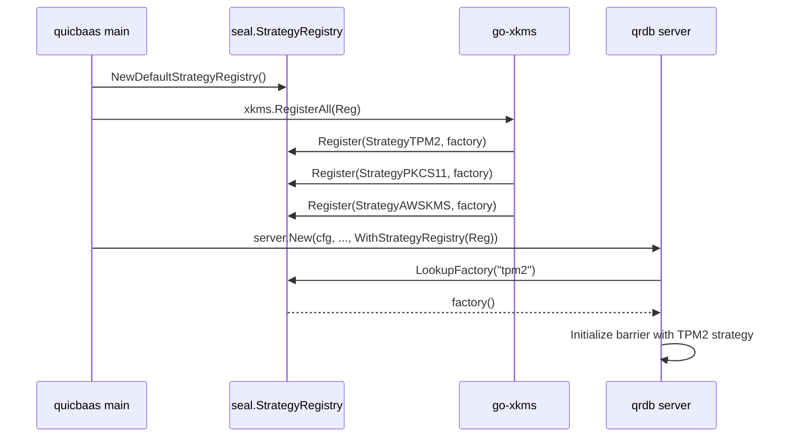

# Barrier and Seal — Architecture

> **Status: NORMATIVE** · Scope: go-qrdb · Last verified: 2026-10-06

The barrier is the at-rest encryption boundary. Everything persistent passes
through it, and when it is sealed the data path refuses every read and write.

Shamir M-of-N custody, Security Officers and recovery keys are a feature of
their own: [../shamir-custody/](../shamir-custody/).

## Problem

At-rest encryption in a database that must also run on a TPM, a PKCS#11 HSM,
AWS KMS, GCP KMS, Azure Key Vault or Vault — without the database importing any
of their SDKs, and without a second implementation per backend.

## Shape chosen

A three-layer split, with **hardware arriving by composition rather than by
import**.

```
go-quicraft/pkg/seal/          Interfaces + go-enclave protected memory + minimal Barrier + Software/None/Shamir primitives
        ↑
go-qrdb/pkg/seal/              StorageBarrier: multi-tenant, storage wrapping, recovery, root tokens,
                               share exchange, StrategyRegistry (Software + None pre-registered)
go-qrdb/pkg/keydelivery/       Per-node tenant root-key transport over mTLS + HPKE
go-qrdb/pkg/clusterkeys/       Node-identity and peer-authentication for key delivery
go-qrdb/pkg/clusterseal/       Replicated seal records, per-node enforcement, the serving lease
        ↑
go-xkms/pkg/seal/              Hardware strategies (TPM2, PKCS#11, AWS KMS, GCP KMS, Azure KV, Vault)
                               registered into a qrdb StrategyRegistry at composition time
```

- **go-quicraft** defines the barrier interfaces (`Barrier`, `SnapshotBarrier`, `EpochTracker`) and a minimal default implementation with AES-256-GCM, epoch rotation, deployment ID isolation, brute-force protection, and go-enclave locked-memory protection. It also owns the baseline software-shape strategies: `SoftwareStrategy` (passphrase-based) and `NoneStrategy` (no encryption).
- **go-qrdb** wraps go-quicraft's barrier in `StorageBarrier`, adding all database-layer features. The `pkg/dek/` package is the per-tenant data encryption keyring: versioned application keys stored in each tenant's own store, wrapped by the tenant's barrier — see [tenant-dek](../tenant-dek/architecture.md).
- **go-xkms** ships hardware `SealingStrategy` implementations and registers them into a qrdb `StrategyRegistry` so qrdb can resolve `--barrier-strategy <name>` at init time without importing any HSM SDK.


That third layer is the point. **qrdb has no compile-time dependency on any
hardware code**; it calls a registered factory by name.

## Strategies

| StrategyID | Constant | Source | When to use |
|------------|----------|--------|-------------|
| `passphrase` | `seal.StrategyPassphrase` | go-quicraft (re-exported) | Single passphrase, FIPS-aware KDF (Argon2id or PBKDF2-SHA256). The default. |
| `shamir`   | `seal.StrategyShamir`   | go-qrdb (`pkg/seal/strategy_shamir.go`) | M-of-N quorum unseal; the Shamir secret is a random unseal key that AEAD-wraps the root key (Vault-style indirection, see [shamir-custody](../shamir-custody/)). |
| `none`     | `seal.StrategyNone`     | go-quicraft (re-exported) | Barrier disabled; data stored plaintext. Dev/test or OS-level FDE deployments. Valid enable-encryption source (plaintext→keyed migration). |
| `system-barrier` | `seal.StrategySystemBarrier` | go-qrdb (tenant strategy only) | Auto-unseal with per-tenant root key wrapped under the system barrier; no per-tenant credential required. System-managed convenience mode for dedicated tenants. Valid enable-encryption source (credential-free→keyed migration). |

Hardware strategies (`tpm2`, `pkcs11`, `aws-kms`, `gcp-kms`, `azure-kv`, `vault`) live in go-xkms and register themselves through `StrategyRegistry.Register` at composition time.

When multiple strategies are registered, the caller must specify which one to use at initialization via `--barrier-strategy <name>`. qrdb returns `ErrNoStrategySpecified` if multiple strategies are available but none was explicitly selected. When only one strategy is registered (e.g., Software or None in development), that strategy is selected unconditionally.


Hardware strategies (`tpm2`, `pkcs11`, `aws-kms`, `gcp-kms`, `azure-kv`,
`vault`) live in go-xkms and register themselves through
`StrategyRegistry.Register` at composition time.

When several strategies are registered the caller must name one at
initialization (`--barrier-strategy <name>`); qrdb returns
`ErrNoStrategySpecified` if it cannot choose. With exactly one registered, that
one is selected unconditionally.

## The strategy registry

`StrategyRegistry` decouples the daemon from concrete strategy implementations. The daemon parses `--barrier-strategy <name>` and calls `LookupFactory` on the registry; the registry returns a `StrategyFactory` that constructs the strategy on demand. (`pkg/seal/strategy_registry.go:39-58`)

```go
type StrategyRegistry interface {
    Register(name StrategyID, factory StrategyFactory) error
    Unregister(name StrategyID)
    LookupFactory(name StrategyID) (StrategyFactory, error)
    ListAvailable() []StrategyID
}

type StrategyFactory func() (SealingStrategy, error)
```

### Defaults — `NewDefaultStrategyRegistry`

`NewDefaultStrategyRegistry()` (`pkg/seal/strategy_registry.go:88-97`) returns a registry pre-populated with the two software strategies qrdb owns outright:

- `StrategyPassphrase` — built via `NewDeferredSoftwareStrategy()` so the passphrase can be supplied at Initialize/Unseal time rather than at construction.
- `StrategyNone` — built via `NewNoneStrategy()`.

`StrategyShamir` is intentionally NOT registered in the default registry because the Shamir strategy requires a `Threshold` and `Shares` configuration that only the daemon's init command can supply; the daemon constructs it inline at init time.

### Hardware injection — `WithStrategyRegistry`

Higher layers add hardware strategies on top by handing qrdb's server constructor a registry through `WithStrategyRegistry`:

```go
// pkg/server/server.go:478-486
func WithStrategyRegistry(reg seal.StrategyRegistry) ServerOption {
    return func(o *serverOptions) { o.strategyRegistry = reg }
}
```

The typical composition flow (driven by go-quicbaas):



The same registry can be used to inject test/fake strategies in integration tests without any hardware coupling. `sealtest.DeviceStrategy` (`pkg/seal/sealtest`) is such a fake: it wraps and unwraps the root key under a device key that never leaves it, takes no passphrase, and counts the operations it served.

### Who consults the registry

- **A tenant barrier** resolves its strategy through the registry (`TenantService` built with `WithStrategyRegistry`).
- **A database barrier** resolves its mode through the same registry first (`database.WithBarrierStrategyRegistry`, fed from `Infra.StrategyRegistry` by `BuildServices`), then falls back to the built-in `passphrase`, empty and `shamir` modes. A mode neither holds is refused with `database.UnsupportedBarrierStrategyError`, never downgraded to a passphrase barrier. So a hardware strategy a composer registers once can seal a tenant barrier and a database barrier, and `database.DatabaseBarrierManager.SupportsMode` and `UpdateBarrier` follow the same answer.
- **The system barrier** resolves its strategies through it too: `seal.NewSystemStrategyRegistry` overlays a composer's registry on the software strategies, and an injected `WithSealStrategy` is registered under its ID. See [extension-seams](../release/extension-seams.md).
- **The seal store** is node-local by design and is not a composition seam: per-node seal keys are the one node-local state the architecture allows.

### The barrier key seam — `BarrierKeyProvider`

Every node seals its own copy of a barrier's key. `seal.BarrierKeyProvider`
(`pkg/seal/barrier_key_provider.go`) is the seam through which one node obtains
the `SealingStrategy` that seals that key. go-qrdb ships one implementation, the
software provider over a `StrategyRegistry`; it ships no HSM, TPM, PKCS#11 or
cloud-KMS code. A composer (go-xkms, composed by go-quicbaas) injects its own
provider, and that provider decides what a key reference means.

```go
type BarrierKeyProvider interface {
    BarrierStrategy(ctx context.Context, req BarrierKeyRequest) (BarrierKeyStrategy, error)
}

type BarrierKeyRequest struct {
    Barrier    string     // "node", "tenant/<tenant>", "database/<tenant>/<database>"
    NodeID     string     // the node whose key this is
    StrategyID StrategyID // the strategy the barrier's owner chose
    KeyRef     string     // the owner's opaque key reference; go-qrdb never parses it
    Epoch      uint64     // 1 at init
}

type BarrierKeyStrategy struct {
    Strategy   SealingStrategy
    Credential CredentialKind // none | passphrase | shares
    Custody    Custody        // none | owner | platform
}
```

The provider answers two questions besides the strategy:

- **`Credential`** — what a client must supply to initialize and unseal. The
  tenant service requires a passphrase when, and only when, the provider says
  `CredentialPassphrase`; it no longer infers that from the strategy's name.
- **`Custody`** — who can release the key without the owner present. It
  records the owner's own choice: an owner that opts into auto-unseal hands
  custody to the platform, and that is the owner's posture to choose. go-qrdb
  cannot inspect a KMS key's policy, so the composer that injects a provider
  vouches for what it declares.

The default provider, `seal.NewBarrierKeyProvider(reg)`, resolves
`req.StrategyID` from `reg` (a nil `reg` is `NewDefaultStrategyRegistry()`) and
reports:

| Strategy | Credential | Custody |
|----------|------------|---------|
| `passphrase` | passphrase | owner |
| `shamir` | shares | owner |
| `system-barrier` | none | platform |
| `none` | none | none |
| any other registered name | none | platform |

It never claims owner custody for a strategy it knows nothing about: a
composer whose strategy wraps under a key the owner controls injects its own
provider to say so. An unregistered name is refused with
`*seal.StrategyNotRegisteredError`, which names what is registered; a factory's
error reaches the caller unchanged.

**Injection.** `server.WithBarrierKeyProvider(p)` (also `sdk.WithBarrierKeyProvider`).
The tenant service is built in `lifecycle.BuildServices`, before `server.New`
runs, so the SDK node builders resolve the option through
`server.ResolveCryptoOptions` and forward it into
`lifecycle.Infra.BarrierKeyProvider`. An injected provider wins; otherwise the
default provider runs over `WithStrategyRegistry`'s registry. The node names
itself by its Raft address, or `local` on a standalone node.

**Scope today.** Tenant barrier initialization resolves through the seam. The
Shamir tenant path keeps its own constructor, because a parameterless factory
cannot carry a threshold and share count. The node barrier and database
barriers move onto the same seam as the
[per-node init decision](../decisions/tenant-barrier-per-node-init.md) lands;
until then they keep `WithSealStrategy` and the registry.


### Alternatives rejected

- **Importing hardware SDKs into qrdb.** Rejected as a hard invariant: **zero
  hardware coupling.** No TPM2 code, no PKCS#11 code, no `pkcs11` build tag in
  any qrdb Go file. qrdb defines the seam; hardware arrives by composition.
- **Registering Shamir in the default registry.** Deliberately not done — the
  Shamir strategy needs a threshold and share count only the daemon's init
  command can supply, so the daemon constructs it inline at init time.
- **A shared cluster-wide DEK.** Rejected in favour of the per-node key model
  below: each node's node barrier has its own key. Tenant raft replicas are
  the exception today — they share the tenant root key (see the correction
  under *Per-node key architecture*).
- **Making `none` invisible.** Rejected: with `none` selected the audit log
  marks every barrier operation `strategy: none`, so the absence of encryption
  is permanently visible in the trail.

## Per-node key architecture

qrdb uses a **per-node-independent key model** (not a shared cluster-wide DEK):

- Each cluster node holds its own **system barrier** with its own **master key (KEK)**. The KEK is never
  shared across nodes and is managed per-node by the system barrier's configured strategy.
- **Per-tenant barriers** in multi-node clusters: when a tenant database replicates across nodes,
  each replica node receives the tenant's key material over a secure channel. A system-managed
  tenant's replica receives the tenant **root key** and re-wraps it under that *node's own node
  barrier*; a self-managed tenant's replica receives the tenant's already-wrapped root-key blob and
  is unsealed on that node with the tenant's own credential.

  > **Correction (2026-10-01):** this section previously said a compromised node key does not
  > expose tenant keys on other nodes. The wrapping key is per node, but the tenant root key — and
  > the keys derived from it — is the **same on every replica**: `ExportRootKeyContext` ships the
  > epoch and salt precisely so replicas derive identical keys (`pkg/seal/import_key.go`). A node
  > whose node key and disk are both compromised therefore yields the tenant key that also
  > decrypts that tenant's data on every other replica. Replacing the shared tenant key with one
  > key per replica waits on a separate design for where a dedicated tenant's identity records
  > are stored: today they are encrypted with the tenant key and replicated through the system
  > shard, so every node that serves the tenant must hold the same key.
  > That design is decided; see [Per-node barrier keys](#per-node-barrier-keys) for what has
  > shipped of it.
- **Key delivery**: `pkg/keydelivery/` implements secure cross-node transport of tenant root keys
  over the cluster mTLS control plane, with HPKE encryption to bind the payload to the recipient
  node's certificate. `pkg/clusterkeys/` handles node-identity authentication — chain validity, the
  node SPIFFE SAN, the placement gate, and **certificate revocation**, on both the receiving and the
  sending side. Revocation is checked separately because the other three are all satisfied by a
  revoked certificate: without it, a node whose certificate an operator has withdrawn keeps taking
  part in key delivery, and a leader keeps sealing tenant root keys to it. See
  [certificate-authority → Where revocation is enforced](../certificate-authority/architecture.md#where-revocation-is-enforced)
  and
  [../multi-tenancy.md → Per-node-independent key design](../multi-tenancy/architecture.md#per-node-independent-key-design).


## Sealing the node barrier seals the whole node

A seal of the node (system) barrier is a seal of **everything that node
holds**. Every path that seals it -- the single-admin seal on every transport
(REST, gRPC, unix, QUIC, MCP, embedded, desktop), a share-holder seal
quorum's completion, and a cluster seal record for the node barrier applied by each node's
monitor -- goes through one whole-node seal (`service.SealWholeNode`, the
same seal shutdown performs): every database barrier, then every tenant
barrier, then the node barrier, so no database or tenant root key or DEK stays
in memory while the node reports sealed. Every
open stream ends with the node's sealed refusal, through the stream registry,
exactly as a tenant seal ends that tenant's. Sealing the node barrier alone, as
before, left every unsealed tenant's keys in memory behind a gate that only
refused requests.

A **cut-off** is not a seal: a node that cannot read the seal records stops
serving and ends its streams, but keeps every key, and resumes on its own once
it can read them again.

**Unseal order.** The node barrier unseals first. A **system-managed**
(auto-unseal) tenant, whose root key the node barrier wraps, is unsealed with
it, credential-free -- but only one **the node seal itself sealed**. The node
seal records each system-managed tenant it moves from unsealed to sealed, and
the node barrier's unseal (`StorageBarrier.OnUnsealed`, by passphrase, Shamir
quorum or recovery keys) brings back exactly those. Databases follow the same rule:
the node unseal brings back only a system-managed database the node seal
sealed, and no database barrier is system-managed today -- a passphrase
database stays sealed until its owner unseals it, a Shamir database until its
holder quorum does, and either unseal then works as it always does. A tenant
or database sealed for its own reasons stays sealed: one its admin sealed, before the node seal or since; one
whose cluster seal record is sealed or cannot be read. The re-unseal runs on a
context detached from the unseal request; a tenant that fails to come back
stays sealed, is retried at the next node unseal, and its own unseal recovers
it at any time. A **self-managed** tenant stays sealed until its own admin
unseals it with the tenant's credential. The operator impact: after a
node seal, the platform operator's unseal restores the node and its
system-managed tenants; every self-managed tenant on the node stays down until
its own admin acts, exactly as after a restart.

## Transparent at-rest encryption

All persistent data is encrypted transparently at rest via the `StorageBarrier`:

- **System data** (KV, MVCC, raft log) is barrier-encrypted under the system barrier's master key.
- **Tenant data** on dedicated isolation modes (volume, raft) is barrier-encrypted under the tenant's
  own master key (which is persisted under the system barrier for system-managed auto-unseal, or
  under the tenant's strategy for self-managed).
- The barrier operates transparently: callers put/get plaintext, the barrier handles encryption/decryption
  automatically.

See [multi-tenant.md](../seal/multi-tenant.md) for the full tenant-barrier lifecycle and key-management modes.


## No cluster auto-unseal

Custody is per node. A Shamir barrier is unsealed only by a quorum of its own
authenticated share holders ([../shamir-custody/](../shamir-custody/)); nodes
never exchange shares.


## Sealing in a cluster

A seal is an incident-response control: the operator wants a key out of every
process that holds it, now. This section is the contract for how a seal at
each barrier level reaches every node of a cluster.

### Three barrier levels

| Level | What it protects | Who may seal it | Who may clear a cluster seal |
|---|---|---|---|
| **Node barrier** | one node's whole data plane: the system shard, the Raft log, the identity plane | the platform operator — an identity of the `system` tenant holding `seal:seal`; a Shamir node barrier needs an M-of-N seal quorum of its share holders | the platform operator, `seal:unseal`, on a node that has unsealed itself |
| **Tenant barrier** | one tenant's dedicated data, on every node that holds it | that tenant's own administrators (`tenant_barrier:seal`); a Shamir tenant barrier needs a seal quorum of its share holders. **The platform operator cannot seal a tenant's barrier** | the tenant's administrators, by unsealing the tenant on a node |
| **Database barrier** | one database's own store | the tenant that owns the database (`databases:seal`) | the owning tenant, by unsealing the database on a node |

No level gives anyone access across tenants. A platform operator acts on node
barriers; a tenant acts on its own tenant and database barriers, and on no
other tenant's. The SO PIN dual factor guards a node seal exactly as it does
on a single node.

### Shape chosen

**A seal is a small replicated record; enforcement is local; unsealing stays
per node.**

```
operator ──seal──▶ any node N (authorizes the caller; Shamir: completes the holder seal quorum)
   N: 1. writes the seal record for the barrier: epoch + 1, sealed      (system shard, guarded write)
      2. seals itself: closes the gate, ends open streams,
         stops the barrier's shards, wipes ITS OWN key from memory
every other node M (seal monitor, reads the records every poll interval):
      3. sees the new epoch sealed → performs step 2 on itself
```

The record carries **who, when, which node accepted it, and an epoch — and no
key material**: never a key, a share, a credential or an envelope. No key
crosses the network to seal or unseal anything, and none enters the Raft log.
Each node seals and unseals its own data with its own key; hardware strategies
composed in from go-xkms or go-quicbaas through the `StrategyRegistry` keep
working unchanged, because nothing here touches how a node holds its key.

The receiving node writes the record **first** and seals itself second,
because the node barrier's key also protects that node's own Raft log: a node
that wiped it first could not take part in committing the record.

### The seal record

One record per barrier, in the replicated system store:

```
__sys:cluster/seal/records/node                          node barrier (every node's)
__sys:cluster/seal/records/tenant/<tenant>               one tenant's barrier
__sys:cluster/seal/records/database/<tenant>/<database>  one database's barrier
__sys:cluster/seal/acks/<node>                           node-barrier seal acknowledgements
```

```json
{"barrier":"tenant/acme","epoch":7,"sealed":true,
 "principal":"alice","principal_tenant":"acme",
 "node":"192.0.2.11:5000","at":"2026-10-01T12:00:00Z"}
```

A record is written only with a guarded write — create-if-absent for the first
epoch, compare-and-swap against the exact record read before it after that —
so two concurrent seal or clear requests serialize and the loser is refused
with `SealEpochConflictError` rather than lost. The epoch only increases. A
seal raises it with `sealed: true`; a clear raises it with `sealed: false`.

### Enforcement on each node

Every node runs a **seal monitor**. It reads every record with one
linearizable range read per poll interval (default 1 s). For each barrier
whose epoch has advanced to `sealed`, it seals that barrier **on this node**,
in this order:

1. **Close the gate.** New requests for the barrier are refused from here on.
   For the node barrier this is the sealed-window gate on every transport,
   the in-process embedded client included -- it refuses exactly what the
   network listeners refuse, from the same allowlist, on every request method
   and on every method of every sub-client it hands out (login, session,
   factor, RBAC, permission, audit, volume pool);
   for a tenant or database barrier it is the sealed-barrier refusal at
   request resolution.
2. **End open streams.** Every watch on every transport — REST, gRPC, Unix,
   QUIC, MCP, embedded and the etcd listener — opened against the barrier's
   data ends with the barrier's sealed error, as do the etcd watch and lease
   keep-alive streams themselves. Before this, a stream was checked only when
   it opened. Every one subscribes to the node's one stream registry: the
   network listeners' watches through the server's service registry, and the
   embedded client's unscoped watches directly (as the caller's tenant's
   default database), both through `clusterseal.Streams.GuardWatcher`.
   A stream subscribes **before** it asks whether it may open
   (`clusterseal.Streams.SubscribeServing`), and the order is what makes a seal
   unmissable: a seal closes its gate before it ends streams, so one that
   lands before the subscription is refused by the check, and one that lands
   after it ends the subscription. Checking first and subscribing second left
   a window in which a stream opened as the seal landed outlived it. A missed
   seal is enforced on a clear record, so its gate is the wipe itself: streams
   are ended once more after the wipe, and a stream opening after that finds
   the barrier sealed.
3. **Stop the barrier's shards.** A tenant seal closes the tenant's dedicated
   Raft shards and its volume host on this node (closed, not purged), so no
   apply ever runs against a sealed barrier. They are rebuilt on first use
   once the tenant is unsealed again.
4. **Wipe the key.** The barrier is sealed, which destroys its key in memory.

A **node-barrier** seal also wipes every tenant and database key held on that
node: once a node is sealed nothing on it can be served, and leaving tenant
keys resident there serves nobody. The tenant and database records are not
changed. When the node is unsealed, the system-managed (auto-unseal) tenants
that the node seal itself sealed come back unsealed with it; a self-managed
tenant, a database, and any tenant sealed for its own reasons come back
sealed, as after a restart (see *Sealing the node barrier seals the whole
node*).

The monitor tracks, per barrier, the last epoch it acted on, so a missed poll
converges on the next one and a record is never enforced twice.

#### The node barrier waits for every node before wiping

When a node seals its node barrier it stops taking part in the system shard,
because the key it wipes protects its Raft log. If the first nodes to see the
record wiped at once, the cluster could lose its quorum before the rest had
read the record, and those would never see it. So every node that sees a
node-barrier seal closes its gate and ends its streams at once, writes an
acknowledgement (`__sys:cluster/seal/acks/<node>`), and wipes its key only
when **every** current member of the system shard has acknowledged the epoch,
or when the acknowledgement timeout (default 5 s) runs out — whichever comes
first. Requests are refused throughout the wait; only the moment the key
leaves memory is held back.

go-quicraft marks a shard failed shortly after a log write fails against a
sealed barrier, so a node whose node barrier has been sealed while running
does not rejoin the system shard by being unsealed in place. **It is
restarted, and unsealed at boot as usual** (see *Restart* below).

### Unseal stays per node

Each node unseals with its own credential — a passphrase, a Shamir quorum
submitted to that node by the holders through the unified holder model, or a
hardware strategy. A clear record is the authorized statement that the
cluster seal is over; it never unseals anything by itself. **A node serves a
barrier only when its record is clear and that node has unsealed the barrier
itself.**

- **Tenant and database barriers.** Unsealing on a node — passphrase,
  completing the share quorum, or the database secret — first unseals that
  node's barrier; if the barrier's record says sealed, the same call then
  writes the clear record. If that write fails, the node seals the barrier
  again and the call fails, so a node never keeps serving a barrier whose
  record is still sealed. Every other node holding the barrier stays sealed
  until it is unsealed there.
- **Node barrier.** A node whose node barrier is sealed in the cluster
  record comes back from its restart and boot-time unseal **held**: its key is
  in memory and its Raft log runs, so the cluster can form a quorum, but it
  refuses every request except the sealed-window allowlist. `qrdb barrier
  cluster-unseal` — the platform operator, on any node that has unsealed
  itself — writes the clear record, and every held node then serves. A held
  node does not seal itself again for the epoch it is held at; only a newer
  sealed epoch does that.

### Cut-off nodes: the serving lease

A node that cannot read the records would never see a seal. To bound that,
**a node serves only while it holds a fresh lease on the seal records.**

- Every successful read renews the lease for `seal.cluster_lease` (default
  15 s), measured from *before* the read was issued, so a slow read shortens
  the lease rather than extending it.
- When the lease runs out, the node **stops serving**: the gate closes for
  every request outside the sealed-window allowlist and every open stream ends
  with `SealStateUnconfirmedError` (`503` / `UNAVAILABLE`, retryable). **Its
  keys stay in memory.**
- When it can read the records again it resumes **without a re-unseal**. If a
  barrier was sealed in the meantime, it enforces that seal first, before it
  serves anything.

Under the bounded clock-drift assumption Raft lease reads already make, no
node serves a barrier later than `seal.cluster_lease` after its seal record
commits.

### Restart

A node reads the records **before it serves anything**: until its first
successful read it holds no lease and refuses every request outside the
sealed-window allowlist. On that first read, a tenant or database barrier whose
record is sealed is sealed on this node — including a system-managed tenant
that auto-unsealed at boot — and the node barrier, if its record is sealed,
comes up held as described above. The tenant shard reconciler does not start
a tenant's shards while the tenant's record is sealed.

### Rollout — the `cluster-seal` feature

A node running a binary that does not read the records would keep serving
after a cluster seal. Cluster sealing is therefore gated on the cluster
feature gate: this release advertises the `cluster-seal` feature, and records
are written and enforced only once the feature is **activated** — every
member of the system shard advertises it. Activation, not per-group
enablement, is the right test, because enforcement is per node, not per Raft
group. Once activated, a binary without the feature refuses to start, which
is the gate's existing downgrade rule.

**Until the feature is activated, a seal acts on the receiving node only** —
the behaviour of every earlier release — and every barrier status reports
`cluster_seal.active: false`, so an operator can see that a seal did not
reach the other nodes. Each node still reads the records on every poll,
acting on none of them, so that it holds a fresh read when the feature turns
on: activation interrupts nothing. A standalone node, and a raft node with no transport,
has no other node to reach: its seals are node-local and its status reports
`active: false`.

### Ordering against in-flight writes

A write acknowledged to its client before the gate closed on the node that
accepted it is durable. A write not yet acknowledged has an indeterminate
outcome — the outcome of any leader loss in Raft: its entry may be applied
when the barrier is next unsealed, because it may already be committed, but it
is never applied while the barrier is sealed on that node, because the
barrier's shards stop before its key is wiped.

### Threat model

| Actor | Can | Cannot |
|---|---|---|
| Holder of a barrier's seal permission, on any node | seal that barrier on every node in one call | read data; unseal without the credential; seal another tenant's barrier |
| Platform operator | seal and clear the node barrier cluster-wide | seal, unseal or clear a tenant's or database's barrier |
| Network attacker between nodes | delay record reads and so cut nodes off (availability) | read or inject key material: none travels |
| Root on one node | read the keys that node holds; ignore a seal locally | stop the other nodes enforcing it |
| A member able to write any replicated record | write a false `sealed` record (denial of service) | — such a member is outside this design's protection, as it is for every replicated record |

A partition that outlasts the lease refuses service on the side that cannot
read the records, even when nothing was sealed. That is the price of the
bound, and it falls on nodes that already cannot serve linearizable reads.

### Alternatives rejected

- **Pushing keys between nodes** — the node that verified an unseal delivering
  a root key or unseal credential to the others so that one unseal covers the
  cluster. Rejected: no key material crosses the network, and no single key
  unlocks every node.
- **Broadcasting the seal over the cluster mTLS channel.** No ordering, no
  durable record for a restarting node, and no way to tell a missed message
  from a refused one.
- **A new Raft opcode.** A replicated KV record already gives a totally
  ordered, durable record without per-group gating.
- **Self-sealing a cut-off node after a grace period.** The chosen rule is
  *stop serving, keep the key*: a cut-off node refuses requests and resumes
  without a re-unseal once it can read the records again.
- **A plaintext "sealed" latch file per node.** A restarting node already
  refuses until it reads the replicated records, and a file an attacker with
  disk access can delete is no control.

## CA key lifecycle

The CA private key is one of the things the barrier GATES, and its
lifecycle is the clearest illustration of what sealing means — though, per
the owner's CA-at-rest ruling, the barrier no longer ENCRYPTS the stored
record itself the way an earlier revision did; see
[../certificate-authority/architecture.md](../certificate-authority/architecture.md)
for the normative description and this section's own correction below.

Both CA keys — Key A (the cluster CA, `__sys:cluster_ca/`) and Key B (the
per-tenant login CA, `__sys:cert_ca/{tenantID}/`, resolved lazily by
`pkg/cert.DefaultCertProvider`) — are `cakey.SoftwareProvider` instances
now, not key material `pkg/cert` or `pkg/clusterca` holds directly: neither
package has a `caKey` field of its own any more. `cakey.SoftwareProvider`
caches the live key as a `*secure.Secret` — a go-enclave `SealedEnclave`,
AES-256-GCM under the process Sealer — never as a bare `*ecdsa.PrivateKey`
on the ordinary Go heap. Signing opens it into a `secure.Buffer` (mlocked,
guard-paged) for exactly the duration of one `Sign` call and destroys the
Buffer before returning; `Seal` destroys the `Secret` outright. The one
thing go-enclave protection cannot reach is the `*ecdsa.PrivateKey`
`crypto/ecdsa` itself parses the DER bytes into for the duration of that
one `Sign` call — Go 1.26 deprecated reaching into
`(*ecdsa.PrivateKey).D` to scrub it by hand, so this is left to the
garbage collector like any other `crypto/ecdsa` caller's ephemeral key,
exactly as it was before this fix; what changed is that the key no longer
sits cached in the clear BETWEEN signatures.

### Bootstrap

1. Generate ECDSA P-256 CA key pair (`crypto/rand`)
2. Encode the key as the `material` record and the self-signed certificate
   for it as the SEPARATE `certificate` record (two records, not one
   combined one — see
   [../certificate-authority/architecture.md](../certificate-authority/architecture.md#the-ca-key-provider-seam-pkgcakey)
   for why)
3. `kvStore.PutAllIfAllUnchanged(__sys:cert_ca/{tenantID}/material,
   __sys:cert_ca/{tenantID}/certificate)` — ONE atomic guarded batch,
   guarded on BOTH being absent, the primitive that makes two callers
   racing a brand-new tenant's first-ever boot converge on exactly one CA
4. Seal the key into a `secure.Secret`; cache the certificate in the clear
   (public data)

### Unseal to Operational

1. Load BOTH the material and certificate records from KVStore
2. Decode the key from material, the cert from certificate
3. Seal the key into a `secure.Secret`; cache the certificate in the clear

### Seal

1. Destroy the cached `secure.Secret` outright (wipes the sealed key)
2. The cached certificate (public data) is NOT cleared
3. Every `Signer`/`Certificate` call returns `BarrierSealedError` until
   `Unseal` runs again


## Per-replica tenant keys — ruled

> **Status: RULED (2026-10-01) — not implemented.** The multi-tenancy design
> [Strict tenant isolation](../multi-tenancy/architecture.md#per-replica-tenant-keys)
> replaces the shared tenant root key of a `raft` tenant's replicas with an
> **independent replica key per node**:
>
> - Each key is born on its node, under the tenant's credential presented to
>   that node, and never leaves it.
> - `ExportRootKeyContext`, `ImportRootKey`, `ImportSealedBlob` and the
>   tenant-key modes of `pkg/clusterkeys` are removed. `clusterkeys` keeps
>   node-identity checks and delivers only a credential verifier to a new
>   replica.
> - Init, unseal and rekey of a tenant barrier are sent by the client to every
>   node in the tenant's serving set (client fan-out). No node relays a
>   credential, share or key to another.
> - A per-node tenant bootstrap record (sealed replica-key blob, credential
>   verifier, unseal roster, SO PIN commitment) sits beside the sealed blob in
>   the tenant's node-local barrier store. It is MAC-bound to the replica key.
>
> This constrains the cluster-wide sealing design: its unseal model for the
> tenant scope must be per node, with client fan-out, rather than delivery of
> a root-key context from the unsealing node.

## Per-node barrier keys

> **Status: DECIDED (owner, 2026-10-08) — partly implemented.** The design is
> [../decisions/tenant-barrier-per-node-init.md](../decisions/tenant-barrier-per-node-init.md).
> Shipped: the init statement, its verification, its record and the watcher
> (`pkg/barrierinit`); the definition of the `per-node-barrier-keys`
> feature; the first admin pinned as a tenant barrier's epoch-1 anchor at
> onboarding; the owner's signed statement on every tenant barrier init
> transport, claimed by the tenant service through the init book; the watcher
> composed into every node, which initialises the node's own key for a tenant
> it serves from a claimed statement; and the feature, advertised by every
> binary and wired as the gate on isolated tenants and on the claim (see
> **Feature gate** below). Not yet: per-node init of a passphrase or Shamir
> tenant barrier on the nodes that did not take the owner's call; database and
> node barriers; the owner-CA anchor a later epoch verifies against; and the
> removal of key delivery (`DistributeTenantKey`), which still runs beside the
> watcher — a node keeps whichever key reaches it first, and never replaces
> one.

Every node that serves a barrier — an isolated tenant's, a database's, and the
node barrier, all through one `BarrierKeyProvider` seam — initialises **its
own** key from one replicated, signed, keyless **init statement**. No key is
carried between nodes.

**The statement** (`barrierinit.InitStatement`) names the barrier
(`clusterseal.Barrier`: `node`, `tenant/<t>`, `database/<t>/<d>`), an epoch
(1 at init, one more per re-key or strategy change), the sealing strategy, the
strategy's opaque `KeyRef`, and the strategy's public parameters: a Shamir
threshold, roster hash and unseal-key check value, or a passphrase KDF salt.
It carries no key, no share and no passphrase check value, which would be an
offline-guessing oracle.

- **`KeyRef` is opaque to qrdb.** qrdb ships no hardware, HSM or cloud KMS
  code. An injected strategy — go-xkms supplies those — reads the reference;
  qrdb only carries it.
- **The encoding signed** is the context `qrdb-barrier-init-statement-v1`
  followed by every field but the signature, each byte or string field
  prefixed with its uint32 big-endian length and each integer as a uint64
  big-endian: the `initproof.Message` pattern with its own context, so a
  signature over a statement can never be replayed as an init proof or an
  mTLS challenge, and no two statements share an encoding. Every
  variable-length field is capped at 16 KiB.

**Who may sign.** The barrier's owner, and only the owner:

| Epoch | Signer | Anchor the node verifies against |
|---|---|---|
| 1 | the pending first admin | the SPKI thumbprint recorded at tenant create (at first boot, for the node barrier) |
| 2 and later | a holder of a client certificate from the owner's CA | the owner's CA certificate, pinned in the system tenant; the certificate must be valid when verified |

The statement carries the signer's whole DER `SubjectPublicKeyInfo`, and
after epoch 1 its certificate. *(Deviation from the decision draft, which
carried a SHA-256 of the SPKI: a thumbprint cannot verify a signature, and
the epoch-1 anchor is itself a thumbprint, so the key has to travel with the
statement.)* Signing goes through a `crypto.Signer`, the same seam the init
proof uses, so a device-held key signs without leaving its device. A
statement the platform, or one compromised node, writes — naming a key the
platform controls, say — fails on every honest node with
`*barrierinit.InitStatementError`.

**The record.** One per barrier, in the system store under
`__sys:cluster/barrier/init/<barrier>`, beside the cluster seal records and,
like them, holding only public fields. It keeps every epoch, epoch 1 first,
so a joiner can verify the chain.

- **Epoch 1 is a guarded create-if-absent.** Of two concurrent claims exactly
  one is stored; the other gets `*BarrierAlreadyInitializedError` before any
  key exists. A retry of the stored statement succeeds, signed again or not:
  the record is compared by what the statement says, its signer among it, not
  by its signature bytes.
- **Later epochs are a guarded compare-and-set** over the record read. A
  statement that skips, repeats or rewinds an epoch, or lost a race, gets
  `*EpochConflictError` naming the recorded epoch.
- Both are the existing guarded write (`protocol.OpGuarded`), evaluated by the
  state machine on every replica: **no Raft opcode of its own.** A standalone
  node keeps the same record in its own store.
- A cluster that has not activated `guarded-writes` refuses the write with
  `*GuardedWritesUnavailableError` rather than propose it unguarded.

**The watcher** (`barrierinit.Watcher`) runs on every node. It polls the
records, and for each barrier the node serves delivers the latest epoch it
has not yet delivered — once, and only if it verifies against the node's own
anchors — to the node's barrier initialisation. A statement that does not
verify is logged and never delivered; a delivery that fails is retried on the
next poll; one corrupt record does not hold up the others.

### How a node takes part (tenant barriers)

1. **Onboarding pins the anchor.** When a tenant is created with its first
   admin, the admin's SPKI thumbprint is pinned under
   `__sys:cluster/barrier/anchor/tenant/<t>` with a guarded create-if-absent.
   The pending-admin record is consumed once the admin's account exists; the
   pin is not, because a node that initialises its key later (one that was
   down, a joiner) still verifies epoch 1 against it. Pinning the same
   thumbprint again succeeds, so a re-run onboarding completes; any other is
   refused (`*barrierinit.AnchorConflictError`). A tenant ID is retired on
   delete and never reused, so a pin never names a stale tenant.
2. **The owner's client signs the statement.** The client that initialises
   the barrier signs the epoch-1 statement — the tenant's barrier, the
   strategy (empty means `passphrase`), no key reference — with the same
   `crypto.Signer` that signs the init proof, and sends it with the init
   request on every transport. A client without a signer sends none.
3. **The node that takes the call claims it first.** Before it generates its
   own key, it checks that the statement names exactly the barrier, strategy
   and key reference the request initialises, verifies it against the pinned
   anchor, and records it. Every strategy is admitted this way, Shamir
   included: a Shamir init claims its statement before it registers a roster
   officer or splits a share, so a statement naming another strategy refuses
   it with nothing written. A raft-isolated tenant, whose barrier every node of
   its groups serves, is refused without a statement
   (`*tenant.InitStatementRequiredError`): the other nodes could never
   initialise. A `barrier` or `volume` tenant, served by one node, may still
   be initialised without one.
4. **Every other node initialises its own key.** On a clustered node with
   dedicated Raft groups, the watcher delivers the claimed statement for each
   tenant one of whose groups — its home group or a dedicated database — has a
   replica placed on the node, and the node initialises its own key through
   its own `BarrierKeyProvider` from the statement's strategy and key
   reference. Only a strategy whose key needs no caller credential (`none`,
   or an injected strategy reading its `KeyRef`) is initialised this way: a
   passphrase key needs the owner's passphrase on each node and a Shamir key
   the holders' ceremony, and both wait for the client fan-out.
5. **A restarted node reattaches from the statement.** After a restart a
   tenant barrier comes back as a sealed shell carrying the node's system
   strategies, which need not include the tenant's — a passphrase-sealed
   node has no `none`, and an injected strategy is keyed by the tenant's
   `KeyRef`, not by its ID alone. So an unseal reads the barrier's latest
   claimed statement, verifies it against the pinned anchor, asks the node's
   `BarrierKeyProvider` for the strategy, key reference and epoch it names,
   and unseals with exactly that strategy. A root key sealed with another
   strategy is refused (`*seal.UnsealStrategyMismatchError`) rather than
   opened, and a system strategy that merely shares the stated ID is never
   used. A raft-isolated tenant with no statement is refused
   (`*tenant.InitStatementMissingError`): it could not have been initialised
   without one. Three cases unseal through the shell's registrations as
   before: a Shamir barrier, whose shares are the credential; a `barrier` or
   `volume` tenant initialised without a statement; and a tenant whose
   statement names `none` but whose root key `enable-encryption` has since
   re-sealed with a passphrase, because that migration records no later
   statement.

**The first admin's account is completed once, by the owner's call.** The
barrier-ready step that creates the pending first admin's roles, account and
certificate binding runs on the node that took the owner's init, as the owner,
on a 15-second clock of its own rather than the request's deadline: the writes
it makes are replicated, and a Raft election in a freshly created group can
use most of a request's deadline. A node that initialised its key from the
statement does not run it — it has no caller to run it as; a later status read
or unseal on any node runs it as that caller should anything remain.

**Guarded writes are not a separate prerequisite.** The record and the anchor
are written only through the guarded write, and a cluster that has not
activated `guarded-writes` refuses them with
`*barrierinit.GuardedWritesUnavailableError` (`Unavailable`, retryable) rather
than write unguarded. Both features activate automatically once every member
runs a binary that knows them, and a binary that knows `per-node-barrier-keys`
knows `guarded-writes`; an isolated tenant cannot be created until
`per-node-barrier-keys` is active. So on a cluster where a claim can be
reached at all, guarded writes are already enforced, and the error is seen
only transiently during a rolling upgrade. Nothing activates it by hand.

**Custody is the tenant's choice.** A platform-sealed key — one that
auto-unseals because the platform holds what wraps it — is not refused under
any isolation policy. The statement's strategy records the tenant's opt-in,
and the barrier status will show it, so the choice is auditable.

**Shared tenants have no keys of their own.** The shared Raft group is one
more tenant with its own barrier, which the platform manages. A shared
(`prefix`) tenant's data is therefore readable by the platform; a tenant that
needs confidentiality from the platform chooses an isolated type.

**The serving set** is the tenant's replica count: a tenant quota the system
owner or a system admin sets through the existing quota and entitlement
records, never the tenant's own admin.

**Feature gate.** `per-node-barrier-keys` is activation-based, built like
`cluster-seal`. Until every member advertises it, an isolated tenant is not
created (nor a tenant changed to an isolated type) and no statement is
recorded: `*featuregate.NotActiveError`. See
[../multi-tenancy/architecture.md](../multi-tenancy/architecture.md#feature-gate-and-upgrade).
A single-member cluster activates it at its first check. A standalone node
holds only its own binary and gates nothing.

Every node composes the watcher: a clustered node with its tenant placements
as the barriers it serves, a standalone node with every tenant barrier.

## Trust boundaries

- **Sealed means refused, not degraded.** Once sealed, the data path returns
  `ErrBarrierSealed` for every read and write until unsealed.
- **Only an allowlisted set of endpoints is reachable while sealed** — see
  [seal/sealed-window.md](../seal/sealed-window.md).
- **The `none` strategy stores plaintext.** It is for development, test
  fixtures, and deployments where the device already provides authenticated
  full-disk encryption. The go-xkms `--require-encryption` compliance gate
  refuses to come up against a `none`-mode barrier.
- **Key material is memory-protected where the holder uses `pkg/secure`** —
  `secure.Buffer` / `secure.Secret` (go-enclave-backed), mlocked
  and wiped on seal. The system barrier's own root key and tenant DEKs
  (`pkg/dek`, `pkg/seal`'s tenant key manager) go through `pkg/secure`. The
  CA private key, for both Key A and Key B (`cakey.SoftwareProvider`), does
  too — see its own lifecycle section above: it is sealed in a
  `secure.Secret` whenever established, opened into an mlocked
  `secure.Buffer` only for the duration of one `Sign` call, and destroyed
  on `Seal`.
- **Protected memory is not readable from outside the process.** `qrdbd
  start` and the `qrdb` desktop/CLI binary mark themselves non-dumpable (Linux) or denies debugger attach (macOS)
  before it holds any key, so a same-user process cannot read the mlocked pages
  through ptrace, `/proc/<pid>/mem` or a core file. The environment opt-out for
  debugging logs a warning; see
  [../deployment/architecture.md](../deployment/architecture.md#process-inspection-hardening).
- **PINs follow dual control**: supplying `--so-pin` requires `--user-pin` and
  vice versa, so the resulting pair satisfies FIPS 140-3 and PCI-DSS v4 dual
  control. PINs are rejected outright with `--barrier-strategy=none`.

## What this feature deliberately does not do

- **No hardware crypto of its own.** TPM2, PKCS#11 and cloud KMS all live in
  go-xkms and reach qrdb through `WithStrategyRegistry`.
- **No strategy change without a migration.** The strategy is fixed at
  initialization; moving off `none` is `barrier enable-encryption`, which is a
  real re-encryption, not a config flip.
- **No per-tenant barrier on a shared store, and no per-database barrier off
  the database's data path.** A per-database barrier is accepted only where it
  wraps the store the database is served from, and a sealed database is refused
  at request resolution on every engine. Once the `cluster-seal` feature is
  activated, a database seal is a cluster seal record that every node holding
  the database's barrier enforces (see *Sealing in a cluster*). Until
  per-database storage bindings land, only the system tenant can create one.
  See [../databases/](../databases/architecture.md).
- **No key moves between nodes when sealing or unsealing.** A seal record holds
  no key material, and every node unseals itself with its own credential.
- **No custody model.** Officers, shares, quorum, recovery and root tokens are
  [../shamir-custody/](../shamir-custody/).

## Companion documents

- [seal/sealed-window.md](../seal/sealed-window.md) — the sealed-window endpoint
  allowlist, the format-version sentinel, and the pre-host listener boot
  sequence.
- [seal/enabling-encryption.md](../seal/enabling-encryption.md) — the
  encryption-at-rest lifecycle.
- [seal/compliance.md](../seal/compliance.md) — FIPS, FedRAMP, PCI-DSS and
  HIPAA mapping.
- [seal/multi-tenant.md](../seal/multi-tenant.md) — per-tenant barrier
  isolation; see also [../multi-tenancy/](../multi-tenancy/).
