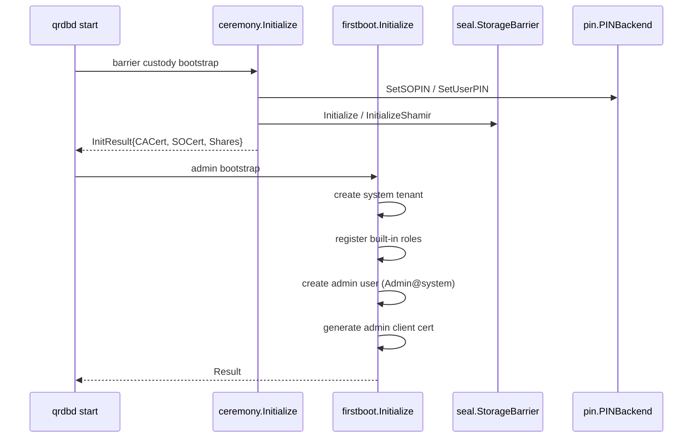

<!--
Copyright 2026 Jeremy Hahn
Licensed under the Apache License, Version 2.0
-->

# Ceremony Package

The `pkg/ceremony/` package implements the **barrier-only** initialization ceremony for go-qrdb. It manages a three-state machine that secures the system bootstrap process with M-of-N Shamir secret sharing, officer enrollment via certificate claims, and challenge-response authentication.

## Why this exists

Splitting a single barrier root key across multiple humans is the textbook FIPS 140-3 AS10.05 "split knowledge" procedure. The ceremony package owns the state machine, the challenge nonces, and the sealed share envelopes that make that procedure work in practice without ever persisting raw key material to disk.

It is intentionally narrow: ceremony handles barrier custody only. Admin user / role / tenant bootstrap lives in `pkg/firstboot` (see [`pkg/firstboot/firstboot.go`](../../pkg/firstboot/firstboot.go)). PIN management lives in `pkg/pin` (see [../pin/README.md](../pin/README.md)). The two run in sequence at daemon startup; neither depends on the other.

## Three-State Machine

```
awaiting_init  ──Initialize()──>  enrolling  ──allClaimsComplete()──>  operational
```

- **awaiting_init**: System is freshly deployed, no ceremony has been performed.
- **enrolling**: Ceremony in progress. Officers claim certificates and Shamir shares.
- **operational**: All officers have claimed their artifacts. System is ready.

In **single-admin mode** (`threshold < 2`) the state transitions directly from `awaiting_init` to `operational`. In **M-of-N mode** (`threshold >= 2`) the daemon stays in `enrolling` until every custodian has claimed.

## PIN handling — never raw bytes

The ceremony never stores raw PIN bytes inside the credential store any more. PIN material is owned by a `pin.PINBackend` (see `pkg/pin/backend.go:33-84` and [../pin/README.md](../pin/README.md)) injected through the qrdb server option:

```go
// pkg/server/server.go:488-495
func WithPINBackend(backend pin.PINBackend) ServerOption { ... }
```

At bootstrap the ceremony does the following with each PIN it receives from the caller:

1. `pin.Service.SetSOPIN(currentSOPIN, newSOPIN)` — hashes (Argon2id / PBKDF2 depending on FIPS mode) and persists through the backend.
2. `pin.Service.SetUserPIN(soPIN, newUserPIN)` — same, gated by SO verification.
3. The raw byte buffers used to receive the PIN material are wiped (`secure.Wipe`) before the bootstrap call returns.

For an M-of-N initialisation the User PIN is **also** the Shamir secret. The User PIN bytes are split via `shamir.Split` and the original bytes are wiped from local memory once the shares are produced; the PIN itself is never persisted in plaintext anywhere.

When no `WithPINBackend` is supplied the daemon constructs a default `pin.SoftwareBackend` (Argon2id / PBKDF2 auto-selected by `crypto/fips140.Enabled()`) backed by the barrier-protected storage. Hardware deployments inject TPM2 / PKCS#11 backends from go-xkms through the same option without ceremony needing to know which backend it is talking to.

> **Migration note**: The legacy `credentialSOPin` / `credentialUserPin` storage keys remain readable for in-place upgrades from older deployments. New writes go exclusively through the `pin.PINBackend`; the legacy keys are wiped on first successful PIN backend write.

## Share Lifecycle (memguard)

Shares are **never persisted to disk**. During M-of-N enrollment:

1. `Initialize()` calls `shamir.Split()` on the user PIN
2. Each share is stored in a `memguard.LockedBuffer` (mlock'd, guard-paged memory)
3. Officer connects via mTLS, calls `BeginClaimCert()` to get a challenge nonce
4. Officer signs nonce with CSR private key, calls `CompleteClaimCert()` to receive certificate
5. Officer calls `ClaimShare()` to retrieve their share bytes
6. The `LockedBuffer` is `Destroy()`'d (secure wipe) immediately upon claim
7. When all claims complete, the state transitions to `operational`

If the ceremony is abandoned (e.g., server restart), all shares are lost and the ceremony must be re-run. This is intentional: shares are secrets that belong to custodians, not the system.

**Invariants, pinned by tests in `pkg/ceremony/share_store_test.go`:**

- `Store` **consumes** the caller's slice, wiping it. A copy left on the heap would survive in a core dump or a swapped page, defeating the enclave the share was just placed in.
- `Claim` **destroys** the enclave and retains only the fact that a claim occurred, so a second attempt is refused rather than served. Once a custodian retrieves their share, they alone hold it.
- What persists is the officer **record** (`ceremony/officers/<name>`): certificate thumbprint or public key, share **index**, auth factor, timestamps. **Never share bytes.**

Recovering the root key later therefore requires a threshold of holders to bring their shares back — the server cannot do it alone, which is the property an M-of-N ceremony is chosen for.

### Officer enrollment kinds

An officer supplies key material one of three ways, parsed by `ceremony.ParseEnrollmentSpec` (`<username>:<kind>:<path>`, the same vocabulary the platform admin uses):

| Kind | Entry point | Trust |
|------|-------------|-------|
| `csr` | `RegisterOfficer` | Derived — the ceremony CA signs it |
| `cert` | `EnrollExternalOfficer` | Verified — parsed, in-validity, chains to the configured external CA pool |
| `pubkey` | `EnrollExternalOfficer` | Asserted by the administrator running the ceremony; a bare key has no chain |

The two-field form `<username>:<path>` means `csr`.

Share sealing picks an envelope from the officer's key algorithm: RSA-OAEP for
RSA, ECIES over P-256 / P-384 for ECDSA, and X25519 (via the birational map
from the Ed25519 public key) for Ed25519. **In FIPS 140-3 mode the Ed25519 form
is refused** with `ErrAlgorithmNotFIPSApproved`: X25519 is not an approved
algorithm and there is no approved substitute for an Ed25519 recipient, so such
an officer must enrol an RSA or NIST-curve key instead. See
[seal/fips140-mode.md](../seal/fips140-mode.md).

## CeremonyCA Interface

The ceremony requires a narrow CA interface that decouples it from any specific CA implementation:

```go
type CeremonyCA interface {
    SignCSR(csrPEM []byte, opts *SignCSROptions) (*x509.Certificate, error)
    CACertificate() (*x509.Certificate, error)
    CABundle() ([]byte, error)
    IssueCertificate(req *IssueCertRequest) (*IssuedCert, error)
}
```

Both qrdb's `cert.CertProvider` and xkms's `ca.TrustedCA` can satisfy this via thin adapters.

## ThresholdInitializer

The `ThresholdInitializer` interface supports hardware-backed threshold ceremonies (e.g., HSM-native threshold). Implementations are registered via `ThresholdRegistry` and ship in go-xkms. qrdb itself ships only a `NoopThresholdInitializer` (`pkg/ceremony/threshold_noop.go`) for environments without hardware support.

## Relationship to firstboot

`ceremony.Initialize` is barrier-only. It is **NOT** the canonical admin bootstrap. Admin user / tenant / role bootstrap is owned by `firstboot.Initialize`:

| Concern | Package | Function |
|---------|---------|----------|
| Barrier custody (M-of-N split, custodian enrolment, Shamir share lifecycle) | `pkg/ceremony` | `ceremony.Initialize` |
| System tenant + built-in roles + platform admin user + admin client cert | `pkg/firstboot` | `firstboot.Initialize` |

Daemon startup runs them in order:



Both are idempotent and safe to re-run on cluster nodes: leader writes propagate via Raft, follower runs are no-ops.

### Admin credential paths (firstboot)

`firstboot.Initialize` binds the admin's SPKI thumbprint by one of three mutually-exclusive paths, selected by which `Dependencies` inputs it receives:

| Path | Input | What happens | Key custody |
|------|-------|--------------|-------------|
| **A** generate-and-distribute | `CA` | `CertProvider.GenerateAdminCert` issues a key + cert bundle | CA emits the bundle |
| **B** CSR-sign | `AdminCSRPEM` + `Signer` | `CertSigner.SignAdminCSR` signs the admin's CSR | Key never leaves the admin |
| **C** adopt-presented | `AdminCertPEM` + `AdminCertPool` | The certificate the admin **already holds** (PIV card, security key) is validated and adopted; nothing is issued | Key never leaves the operator's token |

Path C is checked **first**, because it is the only path that issues nothing: a deployment that presents a certificate has already decided which identity the admin authenticates as, so falling through to a configured CA would mint a second, unrelated credential and bind that instead — leaving the operator holding a certificate the server has never heard of.

Refusals:

- `AdminCSRPEM` **and** `AdminCertPEM` together → `ConflictingAdminCertInputsError`. Signing the CSR would leave the presented certificate unbound; adopting the certificate would silently discard the CSR. Neither is choosable on the operator's behalf.
- `AdminCertPEM` without `AdminCertPool` → `MissingAdminCertPoolError`. An absent pool is refused rather than treated as "trust anything".
- Parse failure, expiry, or no chain to the pool → `AdminCertRejectedError`.

`AdminCertPool` is deliberately **not** the platform CA: a certificate the operator already holds was issued by something else (corporate PKI, card vendor), so validating against the CA this deployment is about to create would reject every legitimate input.

This makes admin enrolment the mirror of `EnrollExternalOfficer` — the admin and every security officer enrol by the same rule, and an operator who can bring their own credential to one role can bring it to the other.

## Authenticator Types

The ceremony service is **authenticator-agnostic at the cryptographic layer** — it only verifies signatures over challenge nonces. Officer credentials may therefore be backed by any technology that produces a `crypto.Signer`. The ceremony exposes the backing authenticator kind as metadata so higher layers (go-xkms, platformctl, etc.) can route signing requests to the correct backend.

`OfficerConfig` (in `pkg/ceremony/types.go`) carries two fields:

- `AuthenticatorType` — one of the `AuthenticatorType` constants below. Empty string defaults to `AuthenticatorSoftware` via `Normalized()`.
- `AuthenticatorRef` — opaque reference to the credential within the backing authenticator (for example a PIV slot id or a FIDO2 credential id).

The supported values are:

| Constant | Value | Description |
|----------|-------|-------------|
| `AuthenticatorPIV` | `piv` | PIV (Personal Identity Verification) smart card per NIST SP 800-73. `AuthenticatorRef` is the PIV slot identifier (for example `9a`). |
| `AuthenticatorFIDO2` | `fido2` | FIDO2 authenticator using CTAP2 (USB-HID / NFC). `AuthenticatorRef` is the base64url-encoded credential id. |
| `AuthenticatorSoftware` | `software` | Software-backed key (no hardware authenticator). `AuthenticatorRef` is unused. |

`AuthenticatorType.Validate()` returns `ErrInvalidAuthenticatorType` for any value outside this set. The empty string is considered valid and maps to `AuthenticatorSoftware`, so existing callers that do not set the field keep working unchanged.

The authenticator metadata is preserved on the server-side `PendingCert` record for each enrolled officer, but it is not used during challenge verification — both `BeginClaimCert` and `CompleteClaimCert` operate on the officer's CSR public key regardless of which authenticator produced the signing key. The concrete authenticator implementations (FIDO2, PIV, PKCS#11 signing chains, attestation, UX) live in go-xkms and are injected through the `authfactors.FactorRegistry` server option — qrdb itself only ships the `Factor` framework and software-mTLS factor.

## Custodian-Based Ceremony

Phase 4 custodian model invariants:

- **Shares NEVER persisted server-side**: Only during ceremony, in memguard buffers, zeroed the instant the custodian receives their share.
- **Custodian metadata (public) replicated via Raft** at `__sys:custodian/<id>`. Share ciphertext held by custodian, not the server.
- **Auth factors** (FIDO2, PIV, PKCS#11, software mTLS) are pluggable through `authfactors.FactorRegistry`. Hardware factor implementations ship in go-xkms; qrdb provides the `Factor` framework and the software mTLS reference factor.
- **Challenge-response with nonce**: Each unseal requires proof of possession (signature with private key in HSM) preventing offline attacks.

See [custodians.md](../seal/custodians.md) for the full protocol.

## REST API

| Method | Path | Description |
|--------|------|-------------|
| POST | `/v1/ceremony/initialize` | SO: Initialize ceremony; requires threshold and officer count (M-of-N mode) or threshold=1 (single-admin) |
| GET | `/v1/ceremony/status` | Get ceremony state: awaiting_init, enrolling, or operational |
| POST | `/v1/ceremony/enroll-custodian` | SO: Enroll custodian with auth factor enrollment |
| POST | `/v1/ceremony/revoke-custodian` | SO: Revoke a custodian from the active ceremony |
| POST | `/v1/ceremony/claim-cert/begin` | Begin certificate claim challenge; returns a nonce for the officer to sign |
| POST | `/v1/ceremony/claim-cert/complete` | Complete claim with signed nonce; returns the signed certificate PEM |
| POST | `/v1/ceremony/claim-share/begin` | Custodian: Request challenge (nonce) for share claim |
| POST | `/v1/ceremony/claim-share/complete` | Custodian: Submit signed response; receive sealed share envelope |
| POST | `/v1/barrier/unseal-share` | Custodian: Submit a Shamir share toward the unseal quorum (factor-verified) |
| POST | `/v1/ceremony/sign-csr` | SO: Sign a CSR during/after ceremony for additional certificates |

The custodian flow (`claim-share/begin` → `claim-share/complete` →
`unseal-share`) is exposed with full parity across REST, gRPC, QUIC, MCP, Unix,
and the embedded transport, and via the `qrdb ceremony` CLI
(`claim-share-begin`, `claim-share-complete`, `submit-unseal-share`).

## SDK Usage

```go
client, _ := sdk.NewClient(transport)
client.Connect(ctx)

// Initialize (single-admin)
resp, _ := client.Security().Ceremony().CeremonyInitialize(ctx, &transport.CeremonyInitializeRequest{
    SOPin:     "so-pin-value",
    UserPin:   "user-pin-value",
    Threshold: 1,
})

// Check status
status, _ := client.Security().Ceremony().CeremonyStatus(ctx)
// status.State == "operational"
```

The SO and User PIN values supplied in `CeremonyInitializeRequest` are handed straight to the configured `pin.PINBackend` — they leave the wire encrypted by TLS and never hit disk in raw form.

## See Also

- [../pin/README.md](../pin/README.md) — Canonical PIN backend contract used during ceremony
- [../seal/README.md](../seal/README.md) — Barrier that the ceremony initialises
- [../seal/shamir.md](../seal/shamir.md) — M-of-N share splitting details
- [../seal/custodians.md](../seal/custodians.md) — Custodian record schema and share-delivery protocol
- [../credentials/README.md](../credentials/README.md) — Credential service used for non-PIN secrets (rotation, grace periods)
- `pkg/firstboot/firstboot.go` — Admin user / tenant / role bootstrap that runs after the ceremony
