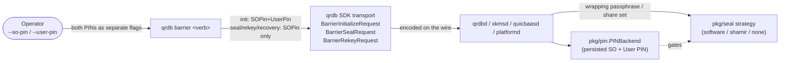

<!--
Copyright 2026 Jeremy Hahn
Licensed under the Apache License, Version 2.0
-->

# `qrdb barrier` — Canonical Barrier CLI Surface

`qrdb barrier` is the **gold-standard** verb tree for cryptographic
barrier administration. The same nine verbs, the same flags, and the
same validation rules are reproduced byte-for-byte in
[`xkmsctl barrier`](../../../go-xkms/docs/cli/barrier.md),
[`quicbaas barrier`](../../../go-quicbaas/docs/cli/barrier.md), and
[`platformctl barrier`](../../../go-trusted-platform/docs/cli/barrier.md).
Operators learn the surface once and apply it across the entire stack.

Implementation: [`cmd/qrdb/barrier.go`](../../cmd/qrdb/barrier.go).
Wire types: [`sdk/go/transport/barrier_types.go`](../../sdk/go/transport/barrier_types.go).

---

## 1. The locked 9-verb tree

```
barrier status
barrier init           --barrier-strategy <none|software|shamir>
                       [--secret <pp>]               (required for software/shamir; rejected for none)
                       [--so-pin <pin>]              (optional; rejected when --barrier-strategy=none)
                       [--user-pin <pin>]            (optional; requires --so-pin)
barrier init-shamir    --secret <pp>
                       --threshold N
                       --total M
                       [--so-pin <pin>]
                       [--user-pin <pin>]            (requires --so-pin)
barrier unseal         --secret <pp>                 (software / single-secret only)
barrier unseal-shares  --share <s1> [--share <s2> ...]   (repeatable)
                       | --shares-file <path>        ('-' = stdin)
barrier seal           [--so-pin <pin>]
                       [-y | --assume-yes]
barrier rekey          --secret <new-pp>
                       [--so-pin <pin>]              (NO --user-pin on rekey)
                       [--threshold N --total M]     (paired; Shamir share regeneration)
barrier recovery generate
                       --threshold N
                       --total M
                       [--so-pin <pin>]
barrier recovery recover
                       --share <s1> [--share <s2> ...]   (repeatable; at least one)
```

### Root persistent flag

| Flag | Default | Allowed values |
|------|---------|----------------|
| `--transport` | `unix` | `rest`, `grpc`, `quic`, `mcp`, `unix`, `embedded` |

`unix` is the default across **all four** CLIs (`qrdb`, `xkmsctl`,
`quicbaas`, `platformctl`); local operator workflows talk to the
co-located daemon over the gRPC-over-Unix socket without any extra
flags. Override via the root flag or, where supported, env vars
(`PLATFORMCTL_TRANSPORT`, etc.).

---

## 2. Architectural concept: `--secret` is **not** a PIN

This is the single most important distinction in the barrier surface.
Two completely separate credential classes share the verb tree and
they must never be conflated.

| Concern | Flag | Purpose | Backend |
|---------|------|---------|---------|
| **Strategy wrapping passphrase** | `--secret` | Material the barrier strategy uses to derive (software → Argon2id) or seed (shamir) the master key. The `none` strategy ignores it entirely. | `pkg/seal` strategies |
| **Compliance-gating PIN** | `--so-pin`, `--user-pin` | Two-PIN administrative-authorisation primitive aligned with FIPS 140-3 IG / PCI-DSS v4. Gates rekey, seal, and recovery operations. | `pkg/pin.PINBackend` |

The two concerns are orthogonal:

* The `software` strategy with `--secret=<pp>` and no PIN backend is a
  valid (dev / single-operator) configuration.
* The `software` strategy with `--secret=<pp>` **and** `--so-pin` +
  `--user-pin` is the FIPS-aligned production posture.
* The `none` strategy intentionally forbids **both** `--secret` and
  `--so-pin`/`--user-pin` because the barrier is a passthrough — there
  is nothing to wrap and nothing to gate.

The dual-control rule on the PIN pair (`--so-pin` requires
`--user-pin`, and vice versa) is enforced **at the CLI** before any RPC
is dispatched. The single exception is `barrier rekey`, which carries
only `--so-pin` because the wire request
([`BarrierRekeyRequest`](../../sdk/go/transport/barrier_types.go))
has no `UserPin` field — user-PIN rotation is a separate ceremony.

---

## 3. Verbs in detail

### 3.1 `barrier status`

Read-only; safe against a sealed barrier. Honours `--output`
(`table` | `json` | `yaml`).

```bash
qrdb barrier status
qrdb --output json barrier status
```

Returns
[`BarrierStatusResponse`](../../sdk/go/transport/barrier_types.go):
`Sealed`, `Strategy`, `HardwareBacked`, `InitializedAt`.

### 3.2 `barrier init`

Initialises only the barrier subsystem. Distinct from the root `qrdb
init` ceremony, which provisions the barrier *plus* the CA, the admin
client cert, and IAM bootstrap roles.

```bash
qrdb barrier init --barrier-strategy software --secret '<passphrase>'
qrdb barrier init --barrier-strategy none
qrdb barrier init --barrier-strategy software --secret '<pp>' \
                  --so-pin SO12345 --user-pin USR12345
```

Validation (see `validateBarrierInitFlags` in
[`cmd/qrdb/barrier.go`](../../cmd/qrdb/barrier.go)):

| Rule | Error |
|------|-------|
| `--barrier-strategy` unset or unknown | `InvalidArgError` |
| `--secret` empty for `software`/`shamir` | `MissingArgError` |
| `--secret` supplied with `--barrier-strategy=none` | `InvalidArgError` |
| `--so-pin`/`--user-pin` with `--barrier-strategy=none` | `PINsNotAllowedError` |
| `--user-pin` without `--so-pin` | `InvalidArgError` |

### 3.3 `barrier init-shamir`

Splits the master secret into `--total` shares with `--threshold`
required to unseal. Shares are printed once; capture them out-of-band.

```bash
qrdb barrier init-shamir --secret '<seed>' --threshold 3 --total 5
```

| Rule | Error |
|------|-------|
| `--threshold < 2` | `InvalidArgError` |
| `--total < --threshold` | `InvalidArgError` |
| `--user-pin` without `--so-pin` | `InvalidArgError` |

### 3.4 `barrier unseal`

Replay the strategy passphrase for the **software / single-secret**
case. Shamir unseal lives on the next verb.

```bash
qrdb barrier unseal --secret '<passphrase>'
```

### 3.5 `barrier unseal-shares`

Submit one or more Shamir shares. Two mutually exclusive input modes:

```bash
qrdb barrier unseal-shares --share aaa --share bbb --share ccc
qrdb barrier unseal-shares --shares-file /etc/qrdb/shares.txt
cat shares.txt | qrdb barrier unseal-shares --shares-file -
```

`--shares-file` accepts blank lines and `#` comments. Submitting
`< threshold` shares accumulates progress; submitting `>= threshold`
completes the unseal in one round trip.

### 3.6 `barrier seal`

Destructive. Reads stop returning until the next unseal. Prompts on a
TTY; pass `-y` / `--assume-yes` from runbooks.

```bash
qrdb barrier seal -y
qrdb barrier seal --so-pin SO12345 --assume-yes
```

`--so-pin` is verified against the
[`pkg/pin.PINBackend`](../pin/README.md) when one is configured. Older
deployments without a PIN backend ignore the field.

### 3.7 `barrier rekey`

Rotate the master key. `--secret` carries the **new** wrapping
passphrase; the server replaces the previously sealed material.

```bash
qrdb barrier rekey --secret '<new-pp>' --so-pin SO12345
qrdb barrier rekey --secret '<new-pp>' --threshold 3 --total 5
```

The Shamir flags are **paired**: supplying one without the other is an
error. When omitted, the existing share layout is preserved and only
the wrapping material rotates. **Note**: `barrier rekey` accepts only
`--so-pin`; user-PIN rotation is a separate ceremony because the wire
request has no `UserPin` field.

### 3.8 `barrier recovery generate`

Generate a fresh M-of-N recovery key set. Recovery keys live in a
parallel KMS slot — they are **not** the same as Shamir unseal shares.

```bash
qrdb barrier recovery generate --threshold 3 --total 5 --so-pin SO12345
```

### 3.9 `barrier recovery recover`

Restore the barrier by submitting M-of-N recovery keys.

```bash
qrdb barrier recovery recover --share key-a --share key-b --share key-c
```

---

## 4. PIN flow through the stack



Two routes share the same operator-facing flags but reach different
server subsystems:

* `--secret` → `Strategy` (Argon2id-derived wrapping key or Shamir
  seed; `none` ignores it).
* `--so-pin` / `--user-pin` → `PINBackend` (compliance gating for
  rekey / seal / recovery-generate).

---

## 5. Operational sub-trees (not part of the canonical surface)

`qrdb` retains two operational sub-trees for parity with the legacy
ops workflow. These are **deliberately** not mirrored into the other
three CLIs:

```
barrier shamir list-shares
barrier shamir delete-share --index <i>
barrier shamir delete-all-shares
barrier shamir verify
barrier root-token --share <s> [--share <s> ...]
```

`barrier recovery` also exposes operational `delete` and `status`
subcommands. The canonical surface is `generate | recover`; the others
are clearly labelled as operational.

---

## 6. Cross-references

* Canonical spec: [`08-bootstrap-auth-architecture.md §6`](https://github.com/automatethethings/software/blob/main/docs/08-bootstrap-auth-architecture.md#6-cli-surface-convergence)
* Strategy taxonomy: [`docs/seal/README.md`](../seal/README.md)
* PIN backend interface: [`docs/pin/README.md`](../pin/README.md)
* Sibling CLI docs:
  [`xkmsctl barrier`](../../../go-xkms/docs/cli/barrier.md) ·
  [`quicbaas barrier`](../../../go-quicbaas/docs/cli/barrier.md) ·
  [`platformctl barrier`](../../../go-trusted-platform/docs/cli/barrier.md)
