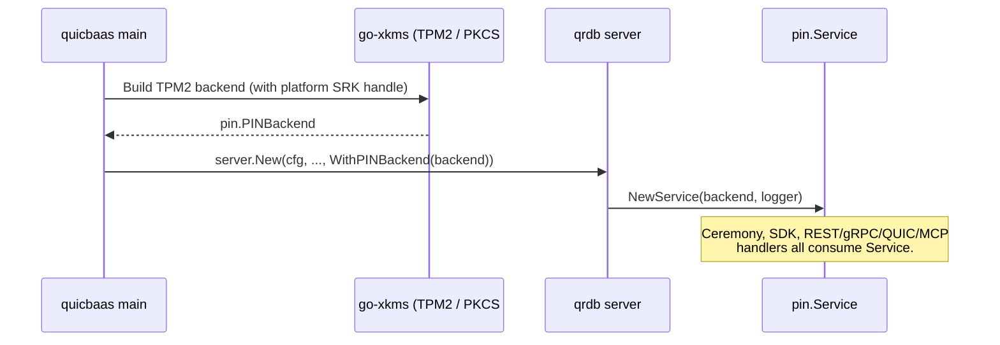

<!--
Copyright 2026 Jeremy Hahn
Licensed under the Apache License, Version 2.0
-->

# PIN Management (`pkg/pin`)

`pkg/pin/` is the canonical PIN management surface for the QuicRaft / QRDB stack. Every PIN flow in the stack — qrdb's ceremony, go-xkms hardware bring-up, go-quicbaas SDK callers, go-trusted-platform CLI — programs against the `PINBackend` interface defined in this package.

## Why this exists

Before Phase 2 every binary had its own PIN flow: qrdb had ceremony-local credentials, xkms had its own backend, and the trusted-platform CLI had a third path. They drifted; the same PIN format was decoded three slightly different ways. Phase 2 collapses all three onto one canonical contract owned by qrdb and pluggable through composition.

The result:

- **One interface** (`PINBackend`) — twelve methods, the same on every binary.
- **One software implementation** (`SoftwareBackend`) — Argon2id / PBKDF2 with FIPS-aware auto-selection, persistence via a narrow `Storage` interface.
- **One Service entry-point** (`pin.Service`) — used by every transport (REST / gRPC / QUIC / MCP / SDK / CLI).
- **One injection point** (`server.WithPINBackend`) — hardware deployments hand qrdb a TPM2 / PKCS#11 backend from go-xkms here.

## Interfaces

### `PINBackend` — the canonical contract

`pkg/pin/backend.go:33-84`

```go
type PINBackend interface {
    Strategy() StrategyID

    SetSOPIN(currentSOPIN, newSOPIN string) error
    SetUserPIN(soPIN, newUserPIN string) error

    ChangeSOPIN(currentSOPIN, newSOPIN string) error
    ChangeUserPIN(currentUserPIN, newUserPIN string) error

    VerifySOPIN(pin string) error
    VerifyUserPIN(pin string) error

    IsInitialized() bool
    SOPINSet() bool
    UserPINSet() bool

    GetLockoutStatus() *LockoutStatus
    ResetLockout(soPIN string) error
}
```

Twelve methods, no more. Backends fall into two categories:

- **Software** (`pkg/pin/SoftwareBackend`) — Argon2id or PBKDF2 hashing, persistence via the `Storage` interface, no native lockout (the hash is the protection).
- **Hardware** (`go-xkms`) — TPM2 uses PlatformSRK password auth with native dictionary-attack protection; PKCS#11 uses token-native `C_Login` / `C_SetPIN` with the HSM's lockout policy.

### `Service` — the consumer entry point

`pkg/pin/service.go:41-194`

```go
type Service struct { /* unexported */ }

func NewService(backend PINBackend, log *slog.Logger) *Service
func (s *Service) Backend() PINBackend
func (s *Service) Strategy() StrategyID

func (s *Service) SetSOPIN(currentSOPIN, newSOPIN string) error
func (s *Service) SetUserPIN(soPIN, newUserPIN string) error
func (s *Service) ChangeSOPIN(currentSOPIN, newSOPIN string) error
func (s *Service) ChangeUserPIN(currentUserPIN, newUserPIN string) error
func (s *Service) VerifySOPIN(pin string) error
func (s *Service) VerifyUserPIN(pin string) error

func (s *Service) IsInitialized() bool
func (s *Service) IsPINSet() bool                                  // alias for UserPINSet
func (s *Service) SOPINSet() bool
func (s *Service) UserPINSet() bool

func (s *Service) GetLockoutStatus() *LockoutStatus
func (s *Service) ResetLockout(soPIN string) error

func (s *Service) SetFIDO2HashSetter(setter FIDO2PINHashSetter)    // CTAP2 PIN hash propagation
func (s *Service) VerifyFIDO2Hash(hash []byte) bool
```

`Service` enforces the uniform minimum-PIN-length policy (6 characters, `pkg/pin/pin.go:46-48`) before delegating to the backend. It also propagates the CTAP2 `SHA-256(PIN)[:16]` PIN hash to a registered authenticator setter on every set / change / verify, so FIDO2 authenticator firmware can stay in sync without a separate PIN-change round trip.

### `Storage` — narrow persistence contract

`pkg/pin/storage.go:31-43`

```go
type Storage interface {
    Get(ctx context.Context, key string) ([]byte, error) // MUST return ErrNotFound when absent
    Put(ctx context.Context, key string, value []byte) error
}

var ErrNotFound = errors.New("pin/storage: key not found")
```

Intentionally minimal so any backing store — an in-memory map for tests, qrdb's barrier-protected storage, a Raft-backed KV — can be supplied without coupling `pkg/pin` to a concrete persistence layer.

## Strategies

`pkg/pin/pin.go:31-48`

| StrategyID | Constant | Owner | Lockout |
|------------|----------|-------|---------|
| `software` | `pin.StrategySoftware` | qrdb (`pkg/pin/software_backend.go`) | None — hashing strength is the protection |
| `tpm2`     | `pin.StrategyTPM2`     | go-xkms (`pkg/pin/tpm2_backend.go`)  | TPM 2.0 dictionary-attack protection |
| `pkcs11`   | `pin.StrategyPKCS11`   | go-xkms (`pkg/pin/pkcs11_backend.go`) | Token-native policy via `C_Login` |

Uniform minimum PIN length: 6 characters. Enforced before delegation in `Service`.

## `SoftwareBackend`

`pkg/pin/software_backend.go:43-217`

The canonical software implementation. Concurrent reads use atomic pointers (no locks). Persistence is optional: pass `nil` for the `Storage` argument to get in-memory-only operation (tests).

```go
func NewSoftwareBackend(store Storage, hashConfig HashConfig) (*SoftwareBackend, error)
```

Key behaviours:

- Loads existing PIN records from `Storage` at construction so the backend reports its prior state to subsequent `SOPINSet` / `UserPINSet` calls.
- Re-derives PIN hashes on every `Verify*` call and compares in constant time (`crypto/subtle`).
- Caches the CTAP2 `SHA-256(PIN)[:16]` hash in an atomic pointer so the authenticator can answer CTAP2 PIN verifications without a separate set call after process restart. Wiped on `Close`.
- `GetLockoutStatus()` returns `nil` (no native lockout); `ResetLockout()` is a no-op. Callers wanting attempt-counter lockout must inject a hardware backend.

Storage layout (keys under whatever `Storage` impl is supplied):

| Key | Value |
|-----|-------|
| `so-pin`   | JSON-encoded `PINRecord` for the Security Officer PIN |
| `user-pin` | JSON-encoded `PINRecord` for the user PIN |

`PINRecord` (`pkg/pin/hash.go:110-115`):

```go
type PINRecord struct {
    Algorithm string          `json:"algorithm"` // "argon2id" or "pbkdf2"
    Hash      []byte          `json:"hash"`
    Salt      []byte          `json:"salt"`
    Params    json.RawMessage `json:"params,omitempty"`
}
```

## Hashing — FIPS-aware auto-selection

`pkg/pin/hash.go:73-104` defines three `HashConfig` factories:

```go
func DefaultHashConfig() HashConfig  // Argon2id (3 passes, 64 MiB, 4 threads, 32-byte key, 16-byte salt)
func FIPSHashConfig() HashConfig     // PBKDF2-SHA256, 600 000 iterations, NIST SP 800-132
func AutoDetectHashConfig() HashConfig
```

`AutoDetectHashConfig()` calls `crypto/fips140.Enabled()` and returns `FIPSHashConfig` when the Go runtime is in FIPS 140 mode (`GOFIPS=on` or equivalent build), `DefaultHashConfig` otherwise. The `Algorithm` field is persisted inside each `PINRecord`, so a FIPS binary can verify a PIN that was originally hashed by a non-FIPS binary, and vice-versa — the algorithm is resolved from the record at verification time, not from the runtime config.

Supported PBKDF2 hashes (`pkg/pin/hash.go:46-51`, `pkg/pin/hash.go:216-230`): `sha256`, `sha384`, `sha512`, `sha512_256`.

## `LockoutStatus` types

`pkg/pin/pin.go:53-93`

```go
type LockoutStatus struct {
    FailedAttempts  int       `json:"failed_attempts"`
    MaxAttempts     int       `json:"max_attempts"`
    IsLocked        bool      `json:"is_locked"`
    LockoutUntil    time.Time `json:"lockout_until,omitempty"`
    RecoverySeconds int       `json:"recovery_seconds"`
}

type LockoutConfig struct {
    MaxAttempts     int           `json:"max_attempts"`
    LockoutDuration time.Duration `json:"lockout_duration"`
    Backoff         bool          `json:"backoff"`
}

func DefaultLockoutConfig() LockoutConfig // 5 attempts / 5 minutes / exponential backoff
```

Hardware backends populate `LockoutStatus` from native counters (TPM2 `dictionary-attack` registers, PKCS#11 `CKA_LOGIN_ATTEMPTS_LEFT`). `SoftwareBackend.GetLockoutStatus()` returns `nil` so callers can distinguish "absent" from "cleared".

Two typed errors carry the status back to the operator:

- `ErrTPMLocked{Status: *LockoutStatus}` — TPM is currently locked; `RecoverySeconds` indicates how long until auto-unlock.
- `ErrPINInvalidWithStatus{Status: *LockoutStatus}` — wrong PIN; `MaxAttempts - FailedAttempts` indicates how many tries remain.

## Composition flow — injecting a hardware backend



Server option (`pkg/server/server.go:488-495`):

```go
func WithPINBackend(backend pin.PINBackend) ServerOption {
    return func(o *serverOptions) { o.pinBackend = backend }
}
```

When `WithPINBackend` is not supplied the daemon constructs a default `pin.SoftwareBackend` at init time backed by the barrier-protected storage. The default is sufficient for non-compliance deployments; FIPS / FedRAMP deployments inject a hardware backend.

## Canonical flows

### First-boot SO PIN provisioning

```go
backend, _ := pin.NewSoftwareBackend(store, pin.AutoDetectHashConfig())
svc := pin.NewService(backend, slog.Default())

// Initial setup — currentSOPIN must be empty
if err := svc.SetSOPIN("", "operator-chosen-so-pin"); err != nil {
    return err
}
// Now the SO PIN is configured; SetUserPIN requires the SO PIN
if err := svc.SetUserPIN("operator-chosen-so-pin", "user-chosen-pin"); err != nil {
    return err
}
```

### Verifying a User PIN (e.g., on every authenticated request)

```go
if err := svc.VerifyUserPIN(suppliedPIN); err != nil {
    switch {
    case errors.Is(err, pin.ErrPINNotSet):
        // Ceremony incomplete — push the caller through bootstrap.
    case errors.Is(err, pin.ErrPINInvalid):
        // Wrong PIN — log + audit, deny.
    default:
        var locked *pin.ErrTPMLocked
        if errors.As(err, &locked) {
            // Hardware lockout active. Surface RecoverySeconds to the operator.
        }
        return err
    }
}
```

### Changing the User PIN

```go
if err := svc.ChangeUserPIN(currentPIN, newPIN); err != nil {
    // ErrInvalidCurrentPIN -> current PIN didn't verify
    // ErrPINTooShort       -> new PIN < 6 chars
    return err
}
```

The new CTAP2 PIN hash is automatically propagated to any registered `FIDO2PINHashSetter`.

### FIPS deployment

```go
cfg := pin.FIPSHashConfig() // PBKDF2-SHA256, 600 000 iterations
backend, _ := pin.NewSoftwareBackend(store, cfg)
// ...or simply use AutoDetectHashConfig() and run with GOFIPS=on.
```

## Errors

`pkg/pin/errors.go`

| Sentinel | Meaning |
|----------|---------|
| `ErrPINNotSet` | PIN has not been configured yet. |
| `ErrPINInvalid` | Supplied PIN does not match the stored hash. |
| `ErrPINTooShort` | PIN is shorter than the 6-char minimum. |
| `ErrPINAlreadySet` | `Set*PIN` invoked when the PIN is already configured; caller should `Change*PIN`. |
| `ErrInvalidCurrentPIN` | `Change*PIN` failed because the current PIN did not verify. |
| `ErrSOPINRequired` | An operation needed SO authorisation but none was supplied. |
| `ErrPINLocked` | Backend is locked out (software counter exhausted). |
| `ErrHierarchyAuthMismatch` | TPM hierarchy auth came from a session whose local state was lost; factory reset required. |
| `ErrStrategyNotSet` | `Service` invoked with no backend configured. |
| `ErrStateCorrupted` | Persisted `PINRecord` did not decode. |
| `ErrUnsupportedHashAlgorithm` | `HashConfig.Algorithm` is neither `argon2id` nor `pbkdf2`. |

Typed errors with extra payload:

| Type | Payload | Purpose |
|------|---------|---------|
| `ErrTPMLocked` | `*LockoutStatus` | Hardware lockout; carries recovery time. |
| `ErrPINInvalidWithStatus` | `*LockoutStatus` | Wrong PIN with attempt-counter info. |
| `ErrStoragePersistFailed` | `Key`, wrapped cause | `Storage.Put` failed. |
| `ErrStorageLoadFailed` | `Key`, wrapped cause | `Storage.Get` failed for reasons other than not-found. |
| `ErrUnsupportedPBKDF2Hash` | `Hash` name | PBKDF2 hash name not in the supported set. |

## CTAP2 PIN hash interop

`pkg/pin/service.go:25-39, 167-181`

```go
const FIPO2PINHashSize = 16 // CTAP2 mandate: SHA-256(PIN)[:16]

func ComputeFIDO2PINHash(pin string) []byte
func VerifyFIDO2PINHash(expected, actual []byte) bool
```

Backends that can verify a CTAP2 hash directly (notably `SoftwareBackend`) implement the optional `FIDO2HashVerifier` interface (`pkg/pin/service.go:37-39`). `Service.VerifyFIDO2Hash` performs a constant-time comparison and returns `false` when the backend does not implement the verifier or the supplied hash is the wrong length.

## Test coverage

- `pkg/pin/software_backend_test.go` exercises every code path of `SoftwareBackend` including FIPS / non-FIPS algorithm selection, persistence round-trip, FIDO2 hash propagation, and storage error injection.
- `pkg/pin/service_test.go` (in the same package) covers `Service`-level policy enforcement and FIDO2 setter propagation.
- Hardware backend tests live in go-xkms; they share the same `PINBackend` contract so the same conformance harness validates every backend.

## See Also

- [../seal/README.md](../seal/README.md) — Barrier strategies including the SoftwareStrategy that the SO PIN protects.
- [../ceremony/README.md](../ceremony/README.md) — How the ceremony delegates PIN provisioning to this package.
- [../auth/README.md](../auth/README.md) — Authentication middleware that consumes PIN verification.
- [go-xkms docs/pin/](https://github.com/jeremyhahn/go-xkms/tree/main/docs/pin) — TPM2 / PKCS#11 backend implementations.
