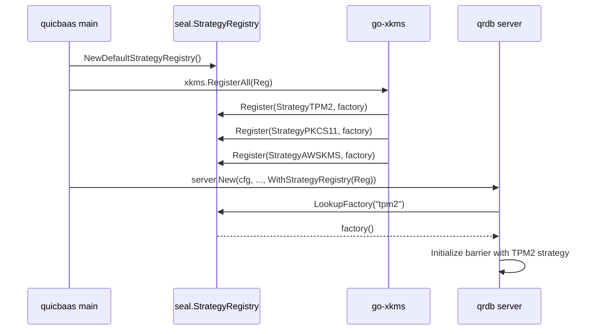

# Seal Package — StorageBarrier

> **Status: REFERENCE** · Scope: go-qrdb · Last verified: 2026-10-13
> Companion to `docs/barrier-seal/`, which is the contract.

<!--
Copyright 2026 Jeremy Hahn
Licensed under the Apache License, Version 2.0
-->

The `pkg/seal/` package provides transparent at-rest encryption for go-qrdb's storage layer. It extends go-quicraft's minimal barrier with database-layer features: Shamir threshold unsealing, multi-tenant barriers, storage wrapping, recovery keys, rekey, and root token generation.

## Why this exists

go-qrdb runs in three distinct deployment shapes:

1. **Software only** — single passphrase or Shamir M-of-N, no hardware. The default. The barrier itself is fully self-contained.
2. **None** — barrier disabled entirely, data stored in plaintext for dev/test or where the operator already provides full-disk encryption.
3. **Hardware-backed** — TPM2, PKCS#11, AWS KMS, GCP KMS, Azure Key Vault, or HashiCorp Vault as root of trust.

The first two ship inside qrdb. The third ships in go-xkms and is **registered into qrdb at composition time** through a `seal.StrategyRegistry`. qrdb has no compile-time dependency on any hardware code; it just calls a registered factory by name.

## Related pages

- [sealed-window.md](sealed-window.md) — Sealed-window endpoint allowlist, format-version sentinel, pre-host listener boot sequence.
- [shamir-custody](../shamir-custody/) — share holders (Security Officers and key custodians), the authenticated quorum, rekey, revocation and recovery.
- [multi-tenant.md](multi-tenant.md) — Per-tenant barrier isolation via `NamespacedBackend`.
- [compliance.md](compliance.md) — FIPS, FedRAMP, PCI-DSS, HIPAA mapping.
- [enabling-encryption.md](enabling-encryption.md) — Encryption-at-rest lifecycle: transparent decryption, strategy-fixed-at-init, enabling encryption on an existing `none` deployment via backup/restore, and how encrypted backups are recovered.
- [../pin/README.md](../auth-factors/architecture.md) — PIN backend used by the SO/User PIN ceremony.

## Three-Layer Architecture

```
go-quicraft/pkg/seal/          Interfaces + go-enclave + minimal Barrier + Software/None/Shamir primitives
        ↑
go-qrdb/pkg/seal/              StorageBarrier: multi-tenant, storage wrapping, recovery, root tokens,
                               share exchange, StrategyRegistry (Software + None pre-registered)
go-qrdb/pkg/keydelivery/       Per-node tenant root-key transport over mTLS + HPKE
go-qrdb/pkg/clusterkeys/       Node-identity and peer-authentication for key delivery
        ↑
go-xkms/pkg/seal/              Hardware strategies (TPM2, PKCS#11, AWS KMS, GCP KMS, Azure KV, Vault)
                               registered into a qrdb StrategyRegistry at composition time
```

- **go-quicraft** defines the barrier interfaces (`Barrier`, `SnapshotBarrier`, `EpochTracker`) and a minimal default implementation with AES-256-GCM, epoch rotation, deployment ID isolation, brute-force protection, and go-enclave locked-memory protection. It also owns the baseline software-shape strategies: `SoftwareStrategy` (passphrase-based) and `NoneStrategy` (no encryption).
- **go-qrdb** wraps go-quicraft's barrier in `StorageBarrier`, adding all database-layer features. The `pkg/dek/` package is the per-tenant data encryption keyring: versioned application keys stored in each tenant's own store, wrapped by the tenant's barrier — see [tenant-dek](../tenant-dek/architecture.md).
- **go-xkms** ships hardware `SealingStrategy` implementations and registers them into a qrdb `StrategyRegistry` so qrdb can resolve `--barrier-strategy <name>` at init time without importing any HSM SDK.

## Strategies owned by qrdb

| StrategyID | Constant | Source | When to use |
|------------|----------|--------|-------------|
| `passphrase` | `seal.StrategyPassphrase` | go-quicraft (re-exported) | Single passphrase, FIPS-aware KDF (Argon2id or PBKDF2-SHA256). The default. |
| `shamir`   | `seal.StrategyShamir`   | go-qrdb (`pkg/seal/strategy_shamir.go`) | M-of-N quorum unseal; the Shamir secret is a random unseal key that AEAD-wraps the root key (Vault-style indirection, see [shamir-custody](../shamir-custody/)). |
| `none`     | `seal.StrategyNone`     | go-quicraft (re-exported) | Barrier disabled; data stored plaintext. Dev/test or OS-level FDE deployments. Valid enable-encryption source (plaintext→keyed migration). |
| `system-barrier` | `seal.StrategySystemBarrier` | go-qrdb (tenant strategy only) | Auto-unseal with per-tenant root key wrapped under the system barrier; no per-tenant credential required. System-managed convenience mode for dedicated tenants. Valid enable-encryption source (credential-free→keyed migration). |

Hardware strategies (`tpm2`, `pkcs11`, `aws-kms`, `gcp-kms`, `azure-kv`, `vault`) live in go-xkms and register themselves through `StrategyRegistry.Register` at composition time.

When multiple strategies are registered, the caller must specify which one to use at initialization via `--barrier-strategy <name>`. qrdb returns `ErrNoStrategySpecified` if multiple strategies are available but none was explicitly selected. When only one strategy is registered (e.g., Software or None in development), that strategy is selected unconditionally.

## StrategyRegistry — the canonical lookup table

`StrategyRegistry` decouples the daemon from concrete strategy implementations. The daemon parses `--barrier-strategy <name>` and calls `LookupFactory` on the registry; the registry returns a `StrategyFactory` that constructs the strategy on demand. (`pkg/seal/strategy_registry.go:39-58`)

```go
type StrategyRegistry interface {
    Register(name StrategyID, factory StrategyFactory) error
    Unregister(name StrategyID)
    LookupFactory(name StrategyID) (StrategyFactory, error)
    ListAvailable() []StrategyID
}

type StrategyFactory func() (SealingStrategy, error)
```

### Defaults — `NewDefaultStrategyRegistry`

`NewDefaultStrategyRegistry()` (`pkg/seal/strategy_registry.go:88-97`) returns a registry pre-populated with the two software strategies qrdb owns outright:

- `StrategyPassphrase` — built via `NewDeferredSoftwareStrategy()` so the passphrase can be supplied at Initialize/Unseal time rather than at construction.
- `StrategyNone` — built via `NewNoneStrategy()`.

`StrategyShamir` is intentionally NOT registered in the default registry because the Shamir strategy requires a `Threshold` and `Shares` configuration that only the node's configuration can supply; `seal.NewSystemStrategyRegistry` adds it, with those parameters, for the system barrier.

### Hardware injection — `WithStrategyRegistry`

Higher layers add hardware strategies on top by handing qrdb's server constructor a registry through `WithStrategyRegistry`:

```go
// pkg/server/server.go:478-486
func WithStrategyRegistry(reg seal.StrategyRegistry) ServerOption {
    return func(o *serverOptions) { o.strategyRegistry = reg }
}
```

The typical composition flow (driven by go-quicbaas):



The same registry can be used to inject test/fake strategies in integration tests without any hardware coupling.

### The system barrier resolves through the registry

The system barrier is built from `seal.NewSystemStrategyRegistry(composer, threshold, total)` — qrdb's software strategies overlaid by the composer's registry — and `seal.ResolveSystemStrategies`. The embedded node (`sdk/go/node`) passes the `WithStrategyRegistry` registry as the composer; its `WithSealStrategy` node option registers a pre-built strategy under its own ID, selected unless `seal.strategy` names `shamir` or `none`. The former `server.WithSealStrategy` option was consumed by nothing and is deleted; see [../barrier-seal/engineering.md](../barrier-seal/engineering.md).

## StorageBarrier

For field documentation and the complete struct definition, see `pkg/seal/barrier.go:113-160`. The key fields are:
- `state` (atomic): 0 = sealed, 1 = unsealed
- `activeStrategy` (atomic.Value): StrategyID that sealed the root key
- `persistedStrategyCache` (atomic.Value): cached strategy ID from sealed root key blob
- `accumulator` (atomic.Value): Shamir share accumulator for quorum unsealing
- `initializedAt` (atomic.Value): initialization timestamp
- `strategies` (map, RW-locked): all registered strategies
- `strategiesMu`, `accumulatorMu` (sync.RWMutex, sync.Mutex): synchronization for concurrent access

### Dual-Mode Operation

| Mode | Strategy Type | Encrypt/Decrypt | Key Rotation |
|------|--------------|-----------------|--------------|
| **Software / Shamir** | `SoftwareStrategy`, `ShamirStrategy` | Epoch-based HKDF DEKs via embedded barrier | `Rotate()` generates new epoch DEK |
| **None** | `NoneStrategy` | Passthrough (no encryption) | n/a |
| **Hardware** (xkms-registered) | TPM2, PKCS#11, cloud KMS, Vault | Delegates to `BarrierEncryptor` from strategy | Hardware manages key lifecycle |

### Storage Wrapping

When `base` is set, the barrier transparently encrypts all `Put` operations and decrypts all `Get` operations. When nil, the barrier operates as pure crypto (go-quicraft behavior for Raft WAL).

## StrategyNone — the no-encryption mode

`StrategyNone` (`pkg/seal/strategy.go:147,150-154`) selects the no-encryption barrier shape. All `Put` / `Get` operations bypass encryption and store data in plaintext. The barrier still maintains state machinery (sealed/unsealed) so callers and audit logs do not need to special-case it.

Use cases:

- Local development without a passphrase prompt
- Test fixtures that exercise the storage path without crypto overhead
- Deployments where the storage device already provides authenticated full-disk encryption (LUKS+integrity, BitLocker with TPM-bound VMK, etc.)

`StrategyNone` is registered in the default registry alongside `StrategySoftware`. Operators opt in with `qrdbd init --barrier-strategy none` or with `seal.strategy: none` in the node's configuration.

> **Operational note**: When `none` is selected, the audit log marks every barrier operation with `strategy: none` so the absence of encryption is permanently visible in the trail. The xkms `--require-encryption` compliance gate refuses to come up against a `none`-mode barrier.

> **Enabling encryption later**: the sealing strategy is fixed at initialization, so a `none` deployment cannot flip to `passphrase`/`shamir` in place — doing so is a planned backup/restore migration into a freshly-keyed instance. The Seal Manager GUI reflects this: a `none` (or unconfigured) barrier shows an **"Encryption Not Configured"** panel with no Seal/Unseal controls (there is nothing to seal). See [enabling-encryption.md](enabling-encryption.md).

## Features

| Feature | Description | Documentation |
|---------|-------------|---------------|
| Shamir threshold unsealing | M-of-N unseal by a quorum of authenticated share holders | [shamir-custody](../shamir-custody/) |
| Multi-tenant barriers | Independent barrier per tenant via BarrierRegistry, with per-node-independent key custody | [multi-tenant.md](multi-tenant.md) |
| Recovery key | An independent key wrapping the root key, split to its own recovery holders | [shamir-custody](../shamir-custody/) |
| Rekey | Quorum-gated redistribution; cryptographically revokes all prior shares without rotating the root key | [shamir-custody](../shamir-custody/) |
| Root token generation | One-time admin token minted by a holder quorum | [shamir-custody](../shamir-custody/) |
| Audit logging | Structured audit events for all barrier operations | Inline below |
| Per-node key custody | Each node holds its own system barrier KEK; tenant keys securely transported via mTLS+HPKE | [Per-Node Key Architecture](#per-node-key-architecture) |
| Tenant key delivery | Secure cross-node transport of tenant root keys with per-node re-wrapping | [../multi-tenancy.md](../multi-tenancy/architecture.md#per-node-independent-key-design) |

## Per-Node Key Architecture

qrdb uses a **per-node-independent key model** (not a shared cluster-wide DEK):

- Each cluster node holds its own **system barrier** with its own **master key (KEK)**. The KEK is never
  shared across nodes and is managed per-node by the system barrier's configured strategy.
- **Per-tenant barriers** in multi-node clusters: when a tenant database replicates across nodes,
  each replica node receives the tenant's root key over a secure channel and re-wraps it under that
  *node's own system barrier* for storage. **Correction (2026-10-01):** this previously said a
  compromised node key does not expose tenant keys on other nodes. The wrapping KEK is per node, but
  the tenant root key is the same on every replica of a raft tenant — see
  [../barrier-seal/architecture.md](../barrier-seal/architecture.md#per-node-key-architecture).
- **Key delivery**: `pkg/keydelivery/` implements secure cross-node transport of tenant root keys
  over the cluster mTLS control plane, with HPKE encryption to bind the payload to the recipient
  node's certificate. `pkg/clusterkeys/` handles node-identity authentication — chain validity, the
  node SPIFFE SAN, the placement gate, and **certificate revocation**, on both the receiving and the
  sending side. Revocation is checked separately because the other three are all satisfied by a
  revoked certificate. See
  [certificate-authority → Where revocation is enforced](../certificate-authority/architecture.md#where-revocation-is-enforced)
  and
  [../multi-tenancy.md → Per-node-independent key design](../multi-tenancy/architecture.md#per-node-independent-key-design).

## Transparent At-Rest Encryption via StorageBarrier

All persistent data is encrypted transparently at rest via the `StorageBarrier`:

- **System data** (KV, MVCC, raft log) is barrier-encrypted under the system barrier's master key.
- **Tenant data** on dedicated isolation modes (volume, raft) is barrier-encrypted under the tenant's
  own master key (which is persisted under the system barrier for system-managed auto-unseal, or
  under the tenant's strategy for self-managed).
- The barrier operates transparently: callers put/get plaintext, the barrier handles encryption/decryption
  automatically.

See [multi-tenant.md](multi-tenant.md) for the full tenant-barrier lifecycle and key-management modes.

## No cross-node share exchange

Custody is per node. A Shamir barrier is unsealed only by a quorum of its own
authenticated share holders; nodes never exchange shares.

## CA Key Lifecycle

Both CA keys — Key A (the cluster CA) and Key B (the per-tenant login CA,
resolved lazily by `pkg/cert.DefaultCertProvider`) — are
`cakey.SoftwareProvider` instances. Per the owner's CA-at-rest ruling, the
stored record carries no additional barrier encryption of its own; the
barrier GATES whether this process will touch the key at all
(`IsSealed()`), not an AEAD wrap of the record. The IN-MEMORY cache is a
different matter: while unsealed, the key is held as a `*secure.Secret` —
a go-enclave `SealedEnclave`, AES-256-GCM under the process Sealer — never
as a bare `*ecdsa.PrivateKey`. Signing opens it into an mlocked
`secure.Buffer` for exactly the duration of one `Sign` call and destroys
the Buffer before returning. `Seal()` destroys the `Secret` outright. See
[../barrier-seal/architecture.md](../barrier-seal/architecture.md#ca-key-lifecycle)
and
[../certificate-authority/architecture.md](../certificate-authority/architecture.md#the-ca-key-provider-seam-pkgcakey)
for the normative description.

### Bootstrap

1. Generate ECDSA P-256 CA key pair (`crypto/rand`)
2. Encode the key as the "material" record and the self-signed cert as the
   SEPARATE "certificate" record
3. `kvStore.PutAllIfAllUnchanged(__sys:cert_ca/{tenantID}/material,
   __sys:cert_ca/{tenantID}/certificate)` — ONE atomic guarded batch,
   guarded on both being absent, the primitive that makes two callers
   racing a brand-new tenant's first-ever boot converge on exactly one CA
4. Seal the key into a `secure.Secret`; cache the certificate in the clear

### Unseal to Operational

1. Load BOTH the material and certificate records from KVStore
2. Decode the key from material, the cert from certificate
3. Seal the key into a `secure.Secret`; cache the certificate in the clear

### Seal

1. Destroy the cached `secure.Secret` outright (wipes the sealed key)
2. The cached certificate (public data) is NOT cleared
3. Every `Signer`/`Certificate` call returns `BarrierSealedError` until
   `Unseal` runs again

## Audit Logging

All barrier operations emit audit events when an `AuditLogger` is configured:

| Action | Resource | Outcome |
|--------|----------|---------|
| `initialize` | `barrier` | `allow` / `deny` |
| `unseal` | `barrier` | `allow` / `deny` |
| `seal` | `barrier` | `allow` |
| `rotate` | `barrier` | `allow` / `deny` |
| `rekey` | `barrier` | `allow` / `deny` |
| `recovery_generate` | `barrier` | `allow` / `deny` |
| `tenant_init` | `tenant:{id}` | `allow` / `deny` |

## SDK Client Usage

The barrier is accessible through the Go SDK via `client.Security().Barrier()`, which returns a `transport.BarrierClient`. All transports (REST, gRPC, UNIX, MCP, embedded) implement this interface.

### Setup

```go
import (
    sdk "github.com/jeremyhahn/go-qrdb/sdk/go"
    "github.com/jeremyhahn/go-qrdb/sdk/go/transport"
    "github.com/jeremyhahn/go-qrdb/sdk/go/transport/rest"
)

t, err := rest.New(
    transport.WithAddress("https://localhost:63002"),
    transport.WithTLSCAFile("/etc/qrdb/ca.pem"),
)
if err != nil {
    return err
}
client, err := sdk.NewClient(t)
if err != nil {
    return err
}
if err := client.Connect(ctx); err != nil {
    return err
}
defer client.Close()

barrier := client.Security().Barrier()
```

### Common Workflows

#### Initialize with Password

Initialize the barrier with a single master secret on first boot.

```go
err := barrier.BarrierInitialize(ctx, &transport.BarrierInitializeRequest{
    Secret: "my-master-secret",
})
```

After initialization the barrier remains sealed. Unseal it to allow data access:

```go
err = barrier.BarrierUnseal(ctx, &transport.BarrierUnsealRequest{
    Secret: "my-master-secret",
})
```

#### Initialize with `none` strategy

Selecting `none` skips secret prompting entirely. The barrier is immediately operational with no encryption applied to user data.

```bash
qrdbd init --barrier-strategy none
```

There is no `BarrierInitialize` call required for `none`; the daemon transitions to operational on startup. Audit events still fire with `strategy: none`.

#### Initialize with Shamir M-of-N

Shares are **never returned in any response**. The administrator enrols each
share holder — Security Officer or key custodian — from a CSR; the barrier
splits its unseal key to exactly those holders and seals one HPKE envelope to
each; each holder claims its own envelope once, over a connection presenting
its certificate. See [shamir-custody](../shamir-custody/).

```go
// 1. Enrol each holder (the CA assigns the certificate identity).
reg, err := barrier.OfficerRegister(ctx, &transport.OfficerRegisterRequest{
    Username: "alice", Role: transport.RoleSecurityOfficer, CSRPEM: aliceCSR,
})
// reg.CertPEM: the holder's CA-issued certificate — deliver it to alice.

// 2. Initialize: TotalShares must equal the number of enrolled holders.
resp, err := barrier.BarrierInitializeShamir(ctx, &transport.BarrierInitializeShamirRequest{
    Threshold: 3, TotalShares: 5, Policy: transport.PolicyDesignated,
})
// resp.Threshold: 3, resp.TotalShares: 5, resp.ShareCount: 5

// 3. Each holder, on its own connection, claims its sealed envelope once.
ch, err := barrier.ShareClaimBegin(ctx, &transport.ShareClaimBeginRequest{Username: "alice"})
claim, err := barrier.ShareClaimComplete(ctx, &transport.ShareClaimCompleteRequest{
    Username: "alice", NonceHex: ch.NonceHex, Signature: sig,
})
// claim.Envelope is sealed to alice's key; only alice can open it.
```

#### Unseal, seal and root token — the holder quorum

Every Shamir operation is a quorum round. Each holder asks for a challenge,
answers it with an admitted factor, opens its envelope and submits:

```go
chal, err := barrier.BarrierQuorumBegin(ctx, &transport.QuorumBeginRequest{
    Domain: transport.DomainUnseal, Op: transport.OpUnseal, Username: "alice",
})
out, err := barrier.BarrierQuorumSubmit(ctx, &transport.QuorumSubmitRequest{
    Domain: transport.DomainUnseal, Op: transport.OpUnseal, Username: "alice",
    ChallengeID: chal.ChallengeID, Factor: chal.Factor,
    // mtls: mtls.SignChallenge(key, chal.ChallengeID, chal.MethodData[mtls.MethodDataPurpose], chal.Nonce)
    Response: answer,
    Share: shareFromEnvelope,
})
// out.Submitted / out.Required / out.Complete
```

`OpSeal` seals, `OpRootToken` mints a root token (`out.RootToken`), and
`OpRekey` completes an open rekey round. Each holder counts once per round.

#### Check Status

```go
status, err := barrier.BarrierStatus(ctx)
if err != nil {
    return err
}
fmt.Printf("sealed=%v strategy=%s hardware=%v\n",
    status.Sealed, status.Strategy, status.HardwareBacked)
```

#### Rekey and revocation

```go
round, err := barrier.BarrierRekeyStart(ctx, &transport.RekeyStartRequest{
    Domain: transport.DomainUnseal, Threshold: 3, SOPin: soPIN,
})
round, err = barrier.BarrierOfficerRevoke(ctx, &transport.OfficerRevokeRequest{
    Domain: transport.DomainUnseal, Username: "erin", SOPin: soPIN,
})
// Either round completes only when M current holders submit with OpRekey.
```

#### Recovery key

```go
reg, err := barrier.RecoveryOfficerRegister(ctx, &transport.OfficerRegisterRequest{
    Username: "ro-bob", CSRPEM: bobCSR,
})
keys, err := barrier.BarrierGenerateRecoveryKeys(ctx, &transport.BarrierGenerateRecoveryKeysRequest{
    Threshold: 2, SOPin: soPIN,
})
// keys.Threshold / keys.Total / keys.ShareCount — no key material returned.
// Recovery holders claim with RecoveryShareClaimBegin/Complete and unseal a
// sealed barrier with BarrierQuorumSubmit{Domain: DomainRecovery, Op: OpRecover}.
status, err := barrier.BarrierHasRecoveryKeys(ctx)
err = barrier.BarrierDeleteRecoveryKeys(ctx)
```

#### Seal

```go
err := barrier.BarrierSeal(ctx)
```

For a **Shamir-strategy** barrier, single-admin `BarrierSeal` is rejected
(`ErrShamirBarrierRequiresQuorum`); M holders seal it through the quorum
with `OpSeal`.

## REST API Reference

All endpoints are under the `/v1/barrier/` prefix. Mutation endpoints require an authenticated session with admin privileges.

| Method | Path | Description |
|--------|------|-------------|
| `POST` | `/v1/barrier/initialize` | Initialize with a single master key |
| `POST` | `/v1/barrier/unseal` | Unseal with the master key |
| `POST` | `/v1/barrier/seal` | Seal the barrier |
| `GET` | `/v1/barrier/status` | Return barrier state |
| `POST` | `/v1/barrier/shamir/initialize` | Initialize Shamir custody over the enrolled holders |
| `POST` | `/v1/barrier/recovery/generate` | Generate the recovery key |
| `DELETE` | `/v1/barrier/recovery` | Delete the recovery key |
| `GET` | `/v1/barrier/recovery/status` | Check if a recovery key exists |
| `POST` | `/v1/barrier/officers` | Enrol a share holder (CSR) |
| `GET` | `/v1/barrier/officers` | List share holders and claim state |
| `POST` | `/v1/barrier/officers/{username}/claim/begin` | Issue a claim nonce |
| `POST` | `/v1/barrier/officers/{username}/claim/complete` | Deliver the sealed envelope, once |
| `POST` | `/v1/barrier/recovery/officers` | Enrol a recovery holder (CSR) |
| `POST` | `/v1/barrier/recovery/officers/{username}/claim/begin` | Recovery claim nonce |
| `POST` | `/v1/barrier/recovery/officers/{username}/claim/complete` | Deliver the recovery envelope, once |
| `POST` | `/v1/barrier/quorum/begin` | Issue a holder's factor challenge |
| `POST` | `/v1/barrier/quorum/submit` | Submit a holder's share to a quorum round |
| `POST` | `/v1/barrier/rekey/start` | Open a quorum-gated rekey round |
| `POST` | `/v1/barrier/officers/revoke` | Revoke a holder (quorum-gated rekey) |

Successful mutation endpoints return `204 No Content`. Endpoints that return data respond with `200 OK` and a JSON body.

Notes on specific endpoints:

- `POST /v1/barrier/shamir/initialize` honors the request's `threshold` and `total_shares`; `total_shares` must equal the number of enrolled holders. The response is **share-free** (`{threshold, total_shares, share_count}`). No root token is minted at initialization; a holder quorum mints one (`op: root-token`) on an unsealed barrier; a sealed barrier refuses that round.
- The claim endpoints require the caller's **mTLS client certificate** to be the holder's enrolled certificate; claim/complete is the only response in the API that carries share material, sealed to the holder. Claims and quorum submissions are **identity-gated** (`permission.IdentityGated`): the handler's certificate, signature and factor checks are the authorization.
- `POST /v1/barrier/seal` returns `422 Unprocessable Entity` for Shamir-strategy barriers (`ErrShamirBarrierRequiresQuorum`); M holders seal through `/v1/barrier/quorum/submit` with `op: seal`.
- `POST /v1/barrier/shamir/initialize` **auto-unseals** the barrier and triggers the sealed-window → full-server listener swap. Clients should expect a brief connection gap (~seconds) immediately after a successful initialize and poll `/health` until it returns `200`.
- A completed rekey redistributes the unseal key and **cryptographically revokes every earlier share**; the root key is not rotated. See [shamir-custody](../shamir-custody/architecture.md#rekey-and-revocation).
- `GET /v1/barrier/status` includes `shamir_threshold` and `shamir_total` when the active strategy is `shamir` (absent otherwise), so clients can display the M-of-N scheme. A sealed node answers the unseal call and status and nothing else: its status is `sealed: true` and `initialized` alone, before its first boot (`false`) and after it (`true`), and every other MCP barrier tool but the unseal call is refused with the same typed sealed refusal as `/health`. A node held or cut off by a cluster seal refuses status too; see [sealed-window.md](sealed-window.md).
- `GET /health` returns `503 {"error":"barrier sealed","code":"SEALED"}` while the barrier is sealed and `200` once unsealed and bootstrapped.
- The **MCP barrier tools** (`qrdb_barrier_status`, `qrdb_barrier_shamir_initialize`, `qrdb_barrier_recovery_generate`, `qrdb_barrier_quorum_submit`, …) return the same canonical snake_case wire shapes as the REST endpoints above: status is `{sealed, initialized, strategy, hardware_backed, initialized_at (RFC3339, omitted when never initialized), shamir_threshold/shamir_total (when > 0)}`; Shamir initialize returns the share-free `{threshold, total_shares, share_count}`; recovery generate returns `{threshold, total, share_count}`; a completed root-token round carries `root_token` and `root_token_created_at`. SDK clients on every transport decode these shapes — handlers must never marshal Go service structs directly (PascalCase fields do not survive a snake_case round-trip).

### Barrier HTTP status mapping

All `/v1/barrier/*` handlers share one error mapper. Seal/ceremony errors map as follows; anything unrecognized falls through to the generic service mapper (e.g. `BarrierSealedError` → `503`), and unknown errors return `500`.

| Error | HTTP status |
|-------|-------------|
| share-holder, quorum and envelope errors | by class — see [../shamir-custody/api.md](../shamir-custody/api.md#error-classes) |
| `seal.ErrShamirBarrierRequiresQuorum`, `seal.ErrShamirUnsealRequiresQuorum` | `422 Unprocessable Entity` |
| `seal.ErrAlreadyUnsealed` | `409 Conflict` |
| `seal.ErrAlreadyInitialized` | `409 Conflict` |
| `seal.ErrNotInitialized` | `409 Conflict` |
| `seal.ErrInvalidCredentials` | `403 Forbidden` |
| barrier sealed (service error) | `503 Service Unavailable` |

## Web UI administration

The browser admin UI (`cmd/qrdb/frontend`) drives the barrier entirely over the REST API above:

- **Bootstrap.** When the UI connects to a sealed, *uninitialized* server it routes to the Server Initialization wizard (none / passphrase / Shamir). **No share material is ever displayed.**
- **Shamir share holders.** The web UI's holder screens have not yet moved to the share-holder API. Until they do, Shamir enrolment, claims and quorum submissions are driven from the CLI (`qrdb barrier officer …`, `qrdb barrier quorum …`), the SDKs or the desktop application.
- **Sealed connectivity.** A sealed daemon serves only the `/v1/barrier/*` (and ceremony/credential) endpoints via its pre-host sealed-window listener — it does **not** serve the SPA itself (see [sealed-window.md](sealed-window.md)). In production the embedded UI is therefore reachable only once unsealed; for development the Vite dev server serves the SPA and proxies the API to the daemon (`QRDB_PROXY_TARGET`), so the init/unseal screens are reachable against a sealed backend.

### Desktop (Wails) seal flow

The desktop GUI's `SealBinding` (`cmd/qrdb/bindings_seal.go`) is a thin delegate over the Go SDK's `BarrierClient` on the active connection — it performs **no local share splitting or barrier simulation**. `InitializeShamir(threshold, total, policy)` returns the same share-free result as the REST endpoint; `Unseal` unseals credential strategies and refuses a Shamir barrier, which its holders unseal. `OfficerBinding` (`cmd/qrdb/bindings_officer.go`) drives the holder operations — `RegisterHolder`, `ListHolders`, `ClaimEnvelope`, `SubmitShare`, `StartRekey`, `RevokeHolder` — for the system barrier and tenant barriers; the holder's keys are used in the application process and wiped after each call. For embedded servers, only `none`-mode barriers auto-initialize/auto-unseal at startup.

### Per-tenant barriers in the UI

The Tenants admin view lets the **tenant admin choose the barrier strategy** — `none` / `passphrase` / `shamir` — defaulting to `passphrase`. A cryptographic barrier requires a storage **volume pool** configured on the daemon (`storage.volume_pools`); without one, `POST /v1/tenants/{id}/barrier/init/begin` + `/init/complete` returns `volume pool not configured`. New tenants default to `prefix` isolation (no pool needed). Per-tenant `shamir` follows the same share-holder model as the system barrier: holders are enrolled per tenant (`POST /v1/tenants/{id}/barrier/officers`), init responses are share-free, each holder claims its envelope once via the tenant claim endpoints, and the tenant barrier is unsealed and sealed only by a holder quorum (`POST /v1/tenants/{id}/barrier/quorum/submit`). See [multi-tenant.md](multi-tenant.md).

## Compliance Documentation

- **[../auth/roles.md](../auth/roles.md)** — Five-role model (SO, Admin, Operator, User, Auditor) with FIPS 140-3 AS10.03 separation of duties
- **[compliance.md](compliance.md)** — FIPS 140-3, FedRAMP, PCI-DSS v4, HIPAA requirement cross-reference
- **[shamir-custody](../shamir-custody/)** — share holders, the two domains (unseal and recovery), envelope delivery and the authenticated quorum

## See Also

- [go-quicraft docs/06-crypto.md](https://github.com/jeremyhahn/go-quicraft/blob/main/docs/06-crypto.md) — Minimal barrier, go-enclave, epoch rotation, software/none/shamir primitives
- [go-xkms docs/seal/README.md](https://github.com/jeremyhahn/go-xkms/blob/main/docs/seal/README.md) — Hardware sealing strategies that register into qrdb's `StrategyRegistry`
- [../pin/README.md](../auth-factors/architecture.md) — PIN backend interface (canonical PIN contract for the stack)
- [../credentials/README.md](../credentials/architecture.md) — Versioned credential rotation backed by the barrier
- [../audit/README.md](../audit/architecture.md) — Audit event logging and query API
