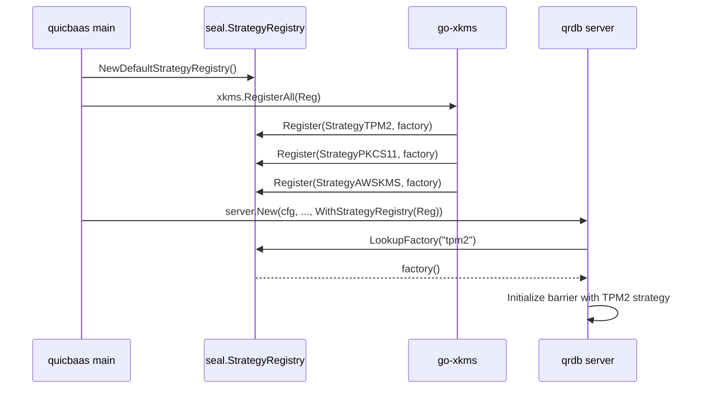

<!--
Copyright 2026 Jeremy Hahn
Licensed under the Apache License, Version 2.0
-->

# Seal Package — StorageBarrier

The `pkg/seal/` package provides transparent at-rest encryption for go-qrdb's storage layer. It extends go-quicraft's minimal barrier with database-layer features: Shamir threshold unsealing, multi-tenant barriers, storage wrapping, recovery keys, rekey, and root token generation.

## Why this exists

go-qrdb runs in three distinct deployment shapes:

1. **Software only** — single passphrase or Shamir M-of-N, no hardware. The default. The barrier itself is fully self-contained.
2. **None** — barrier disabled entirely, data stored in plaintext for dev/test or where the operator already provides full-disk encryption.
3. **Hardware-backed** — TPM2, PKCS#11, AWS KMS, GCP KMS, Azure Key Vault, or HashiCorp Vault as root of trust.

The first two ship inside qrdb. The third ships in go-xkms and is **registered into qrdb at composition time** through a `seal.StrategyRegistry`. qrdb has no compile-time dependency on any hardware code; it just calls a registered factory by name.

## Related pages

- [sealed-window.md](sealed-window.md) — Sealed-window endpoint allowlist, format-version sentinel, pre-host listener boot sequence.
- [shamir.md](shamir.md) — M-of-N share split, threshold unsealing, share lifecycle.
- [custodians.md](custodians.md) — Custodian registration, revocation, dual-factor auth.
- [multi-tenant.md](multi-tenant.md) — Per-tenant barrier isolation via `NamespacedBackend`.
- [compliance.md](compliance.md) — FIPS, FedRAMP, PCI-DSS, HIPAA mapping.
- [../pin/README.md](../pin/README.md) — PIN backend used by the SO/User PIN ceremony.

## Three-Layer Architecture

```
go-quicraft/pkg/seal/          Interfaces + memguard + minimal Barrier + Software/None/Shamir primitives
        ↑
go-qrdb/pkg/seal/              StorageBarrier: multi-tenant, storage wrapping, recovery, root tokens,
                               share exchange, StrategyRegistry (Software + None pre-registered)
go-qrdb/pkg/dek/               ClusterDEKManager, TenantDEKManager
        ↑
go-xkms/pkg/seal/              Hardware strategies (TPM2, PKCS#11, AWS KMS, GCP KMS, Azure KV, Vault)
                               registered into a qrdb StrategyRegistry at composition time
```

- **go-quicraft** defines the barrier interfaces (`Barrier`, `SnapshotBarrier`, `EpochTracker`) and a minimal default implementation with AES-256-GCM, epoch rotation, deployment ID isolation, brute-force protection, and memguard memory protection. It also owns the three software-shape strategies: `SoftwareStrategy`, `ShamirStrategy`, `NoneStrategy`.
- **go-qrdb** wraps go-quicraft's barrier in `StorageBarrier`, adding all database-layer features. The `pkg/dek/` package provides cluster and tenant DEK management using `seal.EncryptionBarrier` for key wrapping.
- **go-xkms** ships hardware `SealingStrategy` implementations and registers them into a qrdb `StrategyRegistry` so qrdb can resolve `--barrier-strategy <name>` at init time without importing any HSM SDK.

## Strategies owned by qrdb

| StrategyID | Constant | Source | When to use |
|------------|----------|--------|-------------|
| `passphrase` | `seal.StrategyPassphrase` | go-quicraft (re-exported) | Single passphrase, FIPS-aware KDF (Argon2id or PBKDF2-SHA256). The default. |
| `shamir`   | `seal.StrategyShamir`   | go-qrdb (`pkg/seal/strategy_shamir.go`) | M-of-N quorum unseal; the root key is the Shamir secret. |
| `none`     | `seal.StrategyNone`     | go-quicraft (re-exported) | Barrier disabled; data stored plaintext. Dev/test or OS-level FDE deployments. |

> **Config alias:** the YAML `seal.strategy` field accepts `software` as a **deprecated alias** for `passphrase`. It is canonicalized once at config load (`SealConfig.CanonicalStrategy()`), so every consumer sees the canonical `passphrase` ID — the software/passphrase strategy reports `ID() == "passphrase"`.

Hardware strategies (`tpm2`, `pkcs11`, `aws-kms`, `gcp-kms`, `azure-kv`, `vault`) live in go-xkms and register themselves through `StrategyRegistry.Register` at composition time.

The runtime selection priority for **active strategy** when multiple are registered:

```
TPM2 > PKCS#11 > Software
```

(see `pkg/seal/strategy.go:73-83` and `DefaultPreferenceOrder`). When only Software (or only None) is registered, that strategy is selected unconditionally.

## StrategyRegistry — the canonical lookup table

`StrategyRegistry` decouples the daemon from concrete strategy implementations. The daemon parses `--barrier-strategy <name>` and calls `LookupFactory` on the registry; the registry returns a `StrategyFactory` that constructs the strategy on demand. (`pkg/seal/strategy_registry.go:39-58`)

```go
type StrategyRegistry interface {
    Register(name StrategyID, factory StrategyFactory) error
    Unregister(name StrategyID)
    LookupFactory(name StrategyID) (StrategyFactory, error)
    ListAvailable() []StrategyID
}

type StrategyFactory func() (SealingStrategy, error)
```

### Defaults — `NewDefaultStrategyRegistry`

`NewDefaultStrategyRegistry()` (`pkg/seal/strategy_registry.go:88-97`) returns a registry pre-populated with the two software strategies qrdb owns outright:

- `StrategySoftware` — built via `NewDeferredSoftwareStrategy()` so the passphrase can be supplied at Initialize/Unseal time rather than at construction.
- `StrategyNone` — built via `NewNoneStrategy()`.

`StrategyShamir` is intentionally NOT registered in the default registry because the Shamir strategy requires a `Threshold` and `Shares` configuration that only the daemon's init command can supply; the daemon constructs it inline at init time.

### Hardware injection — `WithStrategyRegistry`

Higher layers add hardware strategies on top by handing qrdb's server constructor a registry through `WithStrategyRegistry`:

```go
// pkg/server/server.go:478-486
func WithStrategyRegistry(reg seal.StrategyRegistry) ServerOption {
    return func(o *serverOptions) { o.strategyRegistry = reg }
}
```

The typical composition flow (driven by go-quicbaas):



The same registry can be used to inject test/fake strategies in integration tests without any hardware coupling.

### Direct injection — `WithSealStrategy`

For deployments that know the strategy at construction time (typical software-only setups, embedded SDK callers) `WithSealStrategy` bypasses the registry and hands the constructor a pre-built `SealingStrategy`:

```go
// pkg/server/server.go:469-476
func WithSealStrategy(strategy seal.SealingStrategy) ServerOption {
    return func(o *serverOptions) { o.sealStrategy = strategy }
}
```

Pick one or the other; the registry is for name-based dispatch at `qrdbd init --barrier-strategy <name>`, the direct injector is for compile-time decisions.

## StorageBarrier

```go
type StorageBarrier struct {
    logger         *slog.Logger
    base           StorageBackend     // optional storage wrapping
    barrier        *quicraftseal.Barrier // embedded go-quicraft barrier
    config         BarrierConfig
    strategies     map[StrategyID]SealingStrategy
    prefOrder      []StrategyID

    state          atomic.Int32       // 0 = sealed, 1 = unsealed
    activeStrategy atomic.Value       // StrategyID that sealed the root key
    accumulator    atomic.Value       // *shamirAccumulator for quorum unsealing
}
```

### Dual-Mode Operation

| Mode | Strategy Type | Encrypt/Decrypt | Key Rotation |
|------|--------------|-----------------|--------------|
| **Software / Shamir** | `SoftwareStrategy`, `ShamirStrategy` | Epoch-based HKDF DEKs via embedded barrier | `Rotate()` generates new epoch DEK |
| **None** | `NoneStrategy` | Passthrough (no encryption) | n/a |
| **Hardware** (xkms-registered) | TPM2, PKCS#11, cloud KMS, Vault | Delegates to `BarrierEncryptor` from strategy | Hardware manages key lifecycle |

### Storage Wrapping

When `base` is set, the barrier transparently encrypts all `Put` operations and decrypts all `Get` operations. When nil, the barrier operates as pure crypto (go-quicraft behavior for Raft WAL).

## StrategyNone — the no-encryption mode

`StrategyNone` (`pkg/seal/strategy.go:147,150-154`) selects the no-encryption barrier shape. All `Put` / `Get` operations bypass encryption and store data in plaintext. The barrier still maintains state machinery (sealed/unsealed) so callers and audit logs do not need to special-case it.

Use cases:

- Local development without a passphrase prompt
- Test fixtures that exercise the storage path without crypto overhead
- Deployments where the storage device already provides authenticated full-disk encryption (LUKS+integrity, BitLocker with TPM-bound VMK, etc.)

`StrategyNone` is registered in the default registry alongside `StrategySoftware`. Operators opt in with `qrdbd init --barrier-strategy none` or by selecting it explicitly via `WithSealStrategy(NewNoneStrategy())`.

> **Operational note**: When `none` is selected, the audit log marks every barrier operation with `strategy: none` so the absence of encryption is permanently visible in the trail. The xkms `--require-encryption` compliance gate refuses to come up against a `none`-mode barrier.

## Features

| Feature | Description | Documentation |
|---------|-------------|---------------|
| Shamir threshold unsealing | M-of-N quorum-based unseal with share accumulation | [shamir.md](shamir.md) |
| Multi-tenant barriers | Independent DEK per tenant via BarrierRegistry | [multi-tenant.md](multi-tenant.md) |
| Recovery keys | Independent Shamir split of the DEK for disaster recovery | [shamir.md](shamir.md) |
| Rekey | Generate new shares without changing the root key | [shamir.md](shamir.md) |
| Root token generation | One-time admin token via share reconstruction | [shamir.md](shamir.md) |
| Audit logging | Structured audit events for all barrier operations | Inline below |
| Cluster auto-unseal | ShareExchangeCoordinator for distributed share exchange | Inline below |
| Cluster DEK management | Cluster-wide DEK with envelope encryption | [DEK Package](#dek-package) |
| Tenant DEK management | Per-tenant DEK isolation | [DEK Package](#dek-package) |

## DEK Package

The `pkg/dek/` package manages Data Encryption Keys at the cluster and tenant level. It keeps all encryption logic in the database layer, with no transitive xkms dependency.

### ClusterDEKManager

Manages the cluster-wide DEK used for encrypting data at rest across all nodes.

- Uses `seal.EncryptionBarrier` to wrap/unwrap the cluster DEK
- Supports key rotation with version tracking
- Background re-encryption after rotation with configurable batch size and concurrency
- Per-node synchronization state tracking
- Depends only on `*slog.Logger` and `seal.EncryptionBarrier`

```
Key Hierarchy:
  Master Key (per node, in-memory only)
      └── seal.EncryptionBarrier wraps Cluster DEK
              └── Cluster DEK wraps Tenant DEKs
```

### TenantDEKManager

Manages per-tenant DEKs, each isolated and wrapped by the cluster DEK.

- Creates, retrieves, rotates, and deletes per-tenant DEKs
- Wraps tenant DEKs using stdlib `crypto/aes` + `crypto/cipher` (AES-256-GCM)
- Pure Go stdlib cryptography
- Stores wrapped DEKs at `__sys:dek/tenant/{tenantID}` in a `StorageBackend`

```go
type TenantDEKManager interface {
    GetOrCreateTenantDEK(ctx context.Context, tenantID string) ([]byte, error)
    GetTenantDEK(ctx context.Context, tenantID string) ([]byte, error)
    RotateTenantDEK(ctx context.Context, tenantID string) error
    DeleteTenantDEK(ctx context.Context, tenantID string) error
    GetTenantDEKStatus(ctx context.Context, tenantID string) (*TenantDEKStatus, error)
}
```

### SDK Access

Both DEK managers are accessible through the Go SDK via `client.DEK()`, which returns a `transport.DEKClient`. All transports (REST, gRPC, UNIX, MCP, embedded) implement this interface.

```go
dekClient := client.DEK()

// Cluster DEK
err := dekClient.InitializeClusterDEK(ctx, &transport.InitClusterDEKRequest{
    Algorithm: "AES-256-GCM",
    KeyBytes:  32,
})

// Tenant DEK
tenantDEK, err := dekClient.GetOrCreateTenantDEK(ctx, "tenant-123")
```

## ShareExchangeCoordinator

The `ShareExchangeCoordinator` enables cluster-level auto-unseal by exchanging Shamir shares between nodes. It is transport-agnostic — callers inject a `ShareTransport` implementation.

```go
type ShareTransport interface {
    SendShare(ctx context.Context, toNodeID uint64, msg *ShareExchangeMessage) error
    BroadcastShareRequest(ctx context.Context, fromNodeID uint64) error
}
```

### Flow

1. Each node starts a coordinator with its `nodeID`, threshold, and transport
2. On boot, `CollectSharesWithTimeout` broadcasts a share request to peers
3. Peers respond with their encrypted shares via `OnShareReceived`
4. When the quorum threshold is met, the `UnsealHandler` callback fires
5. The handler calls `StorageBarrier.UnsealWithShares()` to reconstruct the root key

### Key Design

- **Lock-free state**: `started` and `quorumCalled` use `sync/atomic.Bool`
- **Exactly-once unseal**: `CompareAndSwap` ensures the handler fires once
- **Map-based dispatch**: Message routing uses `map[ShareMessageType]handler` for O(1) lookup
- **No `time.Sleep`**: Uses `time.NewTimer` + `select` for timeouts

## CA Key Lifecycle

The `DefaultCertProvider` (`pkg/cert/default_provider.go`) stores its ECDSA P-256 CA private key using the encryption barrier for at-rest protection and `memguard.LockedBuffer` for in-memory protection.

### Bootstrap

1. Generate ECDSA P-256 CA key pair (`crypto/rand`)
2. Encrypt private key via `EncryptionBarrier.Encrypt()`
3. Store wrapped blob in KVStore at `__sys:cert_ca/{tenantID}/wrapped_key`
4. Store CA cert PEM in KVStore at `__sys:cert_ca/{tenantID}/cert_pem`
5. Zero plaintext key (`memguard.WipeBytes`)

### Unseal to Operational

1. Load wrapped blob from KVStore
2. Decrypt via `EncryptionBarrier.Decrypt()`
3. Store plaintext key in `memguard.NewLockedBuffer()` (secure enclave)
4. Parse ECDSA private key from LockedBuffer bytes
5. Cache parsed signer (`crypto.Signer`) for signing operations

### Seal

1. `LockedBuffer.Destroy()` (securely zeroes and destroys memory)
2. Nil the cached signer
3. All `GenerateClientCert()` calls return `CAKeyNotAvailableError`

## Audit Logging

All barrier operations emit audit events when an `AuditLogger` is configured:

| Action | Resource | Outcome |
|--------|----------|---------|
| `initialize` | `barrier` | `allow` / `deny` |
| `unseal` | `barrier` | `allow` / `deny` |
| `seal` | `barrier` | `allow` |
| `rotate` | `barrier` | `allow` / `deny` |
| `rekey` | `barrier` | `allow` / `deny` |
| `recovery_generate` | `barrier` | `allow` / `deny` |
| `tenant_init` | `tenant:{id}` | `allow` / `deny` |

## SDK Client Usage

The barrier is accessible through the Go SDK via `client.Security().Barrier()`, which returns a `transport.BarrierClient`. All transports (REST, gRPC, UNIX, MCP, embedded) implement this interface.

### Setup

```go
import (
    sdk "github.com/jeremyhahn/go-qrdb/sdk/go"
    "github.com/jeremyhahn/go-qrdb/sdk/go/transport"
    "github.com/jeremyhahn/go-qrdb/sdk/go/transport/rest"
)

t, err := rest.New(
    transport.WithAddress("https://localhost:8443"),
    transport.WithTLSCAFile("/etc/qrdb/ca.pem"),
)
if err != nil {
    return err
}
client, err := sdk.NewClient(t)
if err != nil {
    return err
}
if err := client.Connect(ctx); err != nil {
    return err
}
defer client.Close()

barrier := client.Security().Barrier()
```

### Common Workflows

#### Initialize with Password

Initialize the barrier with a single master secret on first boot.

```go
err := barrier.BarrierInitialize(ctx, &transport.BarrierInitializeRequest{
    Secret: "my-master-secret",
})
```

After initialization the barrier remains sealed. Unseal it to allow data access:

```go
err = barrier.BarrierUnseal(ctx, &transport.BarrierUnsealRequest{
    Secret: "my-master-secret",
})
```

#### Initialize with `none` strategy

Selecting `none` skips secret prompting entirely. The barrier is immediately operational with no encryption applied to user data.

```bash
qrdbd init --barrier-strategy none
```

There is no `BarrierInitialize` call required for `none`; the daemon transitions to operational on startup. Audit events still fire with `strategy: none`.

#### Initialize with Shamir M-of-N

Initialize with Shamir secret sharing. The returned shares must be distributed to key holders and stored securely.

```go
resp, err := barrier.BarrierInitializeShamir(ctx, &transport.BarrierInitializeShamirRequest{
    Secret:      "root-secret",
    Threshold:   3,
    TotalShares: 5,
})
if err != nil {
    return err
}
for i, share := range resp.Shares {
    fmt.Printf("Share %d: %s\n", i, share)
}
```

#### Unseal with Shamir Shares (Quorum)

Submit shares one at a time. Each call returns progress toward the threshold. The barrier unseals automatically once the threshold is met.

```go
shares := []string{"share-A", "share-B", "share-C"}

for _, share := range shares {
    progress, err := barrier.BarrierUnsealWithShare(ctx, &transport.BarrierUnsealShareRequest{
        Share: share,
    })
    if err != nil {
        return err
    }
    fmt.Printf("Progress: %d/%d\n", progress.Submitted, progress.Required)
    if progress.Complete {
        fmt.Println("Barrier unsealed")
        break
    }
}
```

To submit all shares in one call:

```go
err := barrier.BarrierUnsealWithShares(ctx, &transport.BarrierUnsealSharesRequest{
    Shares: shares,
})
```

#### Check Status

```go
status, err := barrier.BarrierStatus(ctx)
if err != nil {
    return err
}
fmt.Printf("sealed=%v strategy=%s hardware=%v\n",
    status.Sealed, status.Strategy, status.HardwareBacked)
```

#### Rekey

```go
resp, err := barrier.BarrierRekey(ctx, &transport.BarrierRekeyRequest{
    Threshold: 2,
    Total:     3,
})
```

#### Recovery Keys

```go
keys, err := barrier.BarrierGenerateRecoveryKeys(ctx, &transport.BarrierGenerateRecoveryKeysRequest{
    Threshold: 2,
    Total:     3,
})

status, err := barrier.BarrierHasRecoveryKeys(ctx)

err = barrier.BarrierRecoverWithKeys(ctx, &transport.BarrierRecoverWithKeysRequest{
    Keys: []string{"key-A", "key-B"},
})

err = barrier.BarrierDeleteRecoveryKeys(ctx)
```

#### Root Token Generation

```go
resp, err := barrier.BarrierGenerateRootToken(ctx, &transport.BarrierGenerateRootTokenRequest{
    Shares: []string{"share-A", "share-B", "share-C"},
})
```

#### Seal

```go
err := barrier.BarrierSeal(ctx)
```

#### Shamir Share Management

```go
shares, err := barrier.BarrierShamirListShares(ctx)
err = barrier.BarrierShamirVerify(ctx)
err = barrier.BarrierShamirDeleteShare(ctx, &transport.BarrierShamirDeleteShareRequest{Index: 2})
err = barrier.BarrierShamirDeleteAllShares(ctx)
```

## REST API Reference

All endpoints are under the `/v1/barrier/` prefix. Mutation endpoints require an authenticated session with admin privileges.

| Method | Path | Description |
|--------|------|-------------|
| `POST` | `/v1/barrier/initialize` | Initialize with a single master key |
| `POST` | `/v1/barrier/unseal` | Unseal with the master key |
| `POST` | `/v1/barrier/seal` | Seal the barrier |
| `GET` | `/v1/barrier/status` | Return barrier state |
| `POST` | `/v1/barrier/shamir/initialize` | Initialize with Shamir M-of-N |
| `POST` | `/v1/barrier/shamir/unseal-share` | Submit one Shamir share |
| `POST` | `/v1/barrier/shamir/unseal-shares` | Submit multiple Shamir shares |
| `GET` | `/v1/barrier/shamir/shares` | List Shamir share metadata |
| `DELETE` | `/v1/barrier/shamir/shares/{index}` | Delete share by index |
| `DELETE` | `/v1/barrier/shamir/shares` | Delete all shares |
| `POST` | `/v1/barrier/shamir/verify` | Verify share integrity |
| `POST` | `/v1/barrier/rekey` | Rekey with new shares |
| `POST` | `/v1/barrier/recovery/generate` | Generate recovery keys |
| `POST` | `/v1/barrier/recovery/recover` | Unseal using recovery keys |
| `DELETE` | `/v1/barrier/recovery` | Delete recovery keys |
| `GET` | `/v1/barrier/recovery/status` | Check if recovery keys exist |
| `POST` | `/v1/barrier/root-token` | Generate a root token |

Successful mutation endpoints return `204 No Content`. Endpoints that return data respond with `200 OK` and a JSON body.

Notes on specific endpoints:

- `POST /v1/barrier/shamir/initialize` honors the **request's** `threshold` and `total_shares` (the operator/UI-chosen M-of-N scheme). When omitted (zero), the daemon's configured `seal.shamir_threshold` / `seal.shamir_total` are used. It returns the generated shares; the administrative root token is a separate call (`POST /v1/barrier/root-token`).
- `GET /v1/barrier/status` includes `shamir_threshold` and `shamir_total` when the active strategy is `shamir` (absent otherwise), so clients can display the M-of-N scheme.
- `GET /health` returns `503 {"error":"barrier sealed","code":"SEALED"}` while the barrier is sealed and `200` once unsealed and bootstrapped.

## Web UI administration

The browser admin UI (`cmd/qrdb/frontend`) drives the barrier entirely over the REST API above:

- **Bootstrap.** When the UI connects to a sealed, *uninitialized* server it routes to the Server Initialization wizard (none / passphrase / Shamir). For Shamir, the generated key shares **and** root token are displayed exactly once with a save-acknowledgement gate before the app proceeds — they cannot be recovered later.
- **Unseal.** When the UI connects to a sealed, *initialized* server it shows an unseal screen; the Seal Manager also seals/unseals an already-loaded server. The unseal control adapts to the active strategy (passphrase entry vs Shamir share submission).
- **Sealed connectivity.** A sealed daemon serves only the `/v1/barrier/*` (and ceremony/credential) endpoints via its pre-host sealed-window listener — it does **not** serve the SPA itself (see [sealed-window.md](sealed-window.md)). In production the embedded UI is therefore reachable only once unsealed; for development the Vite dev server serves the SPA and proxies the API to the daemon (`QRDB_PROXY_TARGET`), so the init/unseal screens are reachable against a sealed backend.

### Per-tenant barriers in the UI

Per-tenant barriers (Tenants admin view) use the **passphrase** strategy only — per-tenant Shamir is not supported (`strategy: "shamir"` is rejected). They also require a storage **volume pool** to be configured on the daemon (`storage.volume_pools`); without one, `POST /v1/tenants/{id}/barrier/init` returns `volume pool not configured`. The init form collects a passphrase (required) and new tenants default to `prefix` isolation, which needs no volume pool. See [multi-tenant.md](multi-tenant.md).

## Compliance Documentation

- **[../auth/roles.md](../auth/roles.md)** — Six-role model (SO, Admin, Operator, User, Auditor, Custodian) with FIPS 140-3 AS10.03 separation of duties
- **[compliance.md](compliance.md)** — FIPS 140-3, FedRAMP, PCI-DSS v4, HIPAA requirement cross-reference
- **[custodians.md](custodians.md)** — Custodian lifecycle, two-tier share model (operational Shamir + recovery keys), share-delivery protocol

## See Also

- [go-quicraft docs/06-crypto.md](https://github.com/jeremyhahn/go-quicraft/blob/main/docs/06-crypto.md) — Minimal barrier, memguard, epoch rotation, software/none/shamir primitives
- [go-xkms docs/seal/README.md](https://github.com/jeremyhahn/go-xkms/blob/main/docs/seal/README.md) — Hardware sealing strategies that register into qrdb's `StrategyRegistry`
- [../pin/README.md](../pin/README.md) — PIN backend interface (canonical PIN contract for the stack)
- [../credentials/README.md](../credentials/README.md) — Versioned credential rotation backed by the barrier
- [../audit/README.md](../audit/README.md) — Audit event logging and query API
