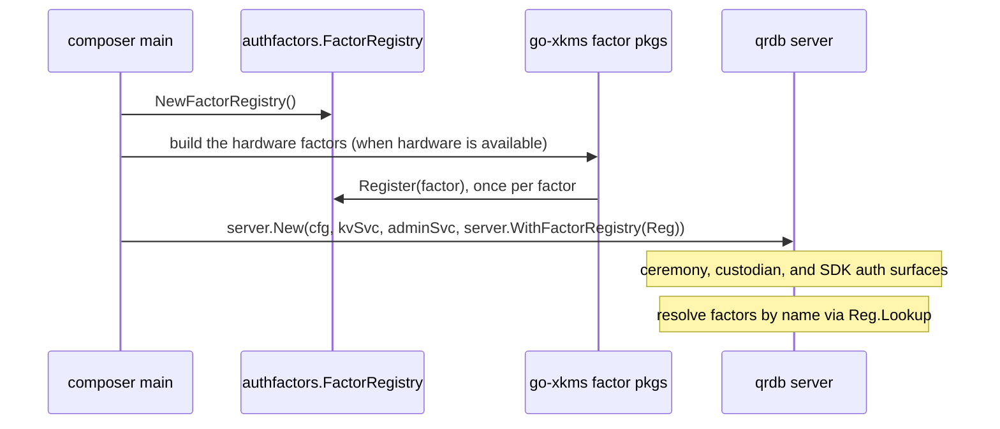

# Authentication Factor Framework

> **Status: REFERENCE** · Scope: go-qrdb · Last verified: 2026-10-22
> Companion reference; the feature folders under `docs/` are the contract and win on any disagreement.

<!--
Copyright 2026 Jeremy Hahn
Licensed under the Apache License, Version 2.0
-->

`pkg/authfactors/` defines the **Factor** interface and the **FactorRegistry** lookup table that hold the qrdb authentication-factor framework together. It is the contract every concrete factor (FIDO2, PIV, PKCS#11, software mTLS) implements; concrete hardware implementations ship in go-xkms and are registered into qrdb at composition time.

## Why this exists

Custodians, officers, and any future challenge/response participant in qrdb has to prove possession of a private key without that key leaving its trust boundary. The qrdb daemon does not care which device provides that proof — it cares that there is a well-typed `Factor` interface it can call. Keeping the interface in qrdb and the implementations out of it lets the same daemon code drive a software-only deployment, an HSM-backed deployment, or a hybrid mix without any conditional compilation.

## Scope — qrdb owns the framework only

```
go-qrdb/pkg/authfactors/      <-- THIS PACKAGE
  ├─ factors.go               Factor interface, EnrollParams, Enrollment, Challenge, Response
  ├─ registry.go              FactorRegistry (name -> Factor lookup, safe for concurrent use)
  ├─ ids.go                   NewEnrollmentID / NewChallengeID (UUID v4)
  ├─ errors.go                Typed errors: FactorNotFoundError, FactorAlreadyRegisteredError, ...
  └─ mtls/                    the software mTLS factor (Name "mtls")

go-xkms (downstream, optional)
  └─ pkg/authfactors/
     ├─ fido2/                CTAP2 / WebAuthn factor
     ├─ piv/                  NIST SP 800-73-4 PIV smart-card factor
     └─ pkcs11/               PKCS#11 / Cryptoki HSM factor
     Each ships a type implementing Factor; the composer registers it in a
     FactorRegistry and passes the registry with server.WithFactorRegistry.
```

qrdb ships no hardware factor. See the [composition flow](#composition-flow) below for how a composer wires the xkms-supplied factors into qrdb at startup.

## Factor Interface

```go
// pkg/authfactors/factors.go:30-47
type Factor interface {
    Name() string                                                                          // "fido2", "piv", "pkcs11", "mtls", ...
    Enroll(ctx context.Context, params *EnrollParams) (*Enrollment, error)
    Challenge(ctx context.Context, enrollment *Enrollment) (*Challenge, error)
    Verify(ctx context.Context, challenge *Challenge, response *Response) error
}
```

`Enroll` returns only public credential material. `Challenge` issues a nonce with a TTL. `Verify` confirms the response proves possession of the private key without ever seeing the private key.

### Wire types

```go
type EnrollParams struct {
    UserID       string
    MethodParams map[string]any   // factor-specific (slot, attestation_type, ...)
    TenantID     string
}

type Enrollment struct {
    EnrollmentID string
    UserID       string
    FactorName   string
    TenantID     string
    PublicKey    []byte           // DER public key or WebAuthn serialised credential
    Metadata     map[string]string
    EnrolledAt   time.Time
    RevokedAt    time.Time        // zero == still active
}

type Challenge struct {
    ChallengeID  string
    EnrollmentID string
    Nonce        []byte           // 32 bytes minimum
    ExpiresAt    time.Time        // default 5 minutes
    MethodData   map[string]any
}

type Response struct {
    Value    []byte                 // signature / WebAuthn assertion
    Metadata map[string]string
}
```

See `pkg/authfactors/factors.go:71-192` for the canonical wire-type definitions and field-by-field encoding rules per factor.

## FactorRegistry

`FactorRegistry` (`pkg/authfactors/registry.go`) is the canonical name -> `Factor` lookup. Names are case-insensitive (`NormalizeName` lower-cases them). It is safe for concurrent use: `Register` / `Unregister` take a short write lock; `Lookup` / `List` / `All` take a short read lock.

```go
type FactorRegistry struct { ... }

func NewFactorRegistry() *FactorRegistry
func (r *FactorRegistry) Register(f Factor) error             // name comes from f.Name()
func (r *FactorRegistry) Unregister(name string)
func (r *FactorRegistry) Lookup(name string) (Factor, error)  // FactorNotFoundError if absent
func (r *FactorRegistry) List() []string                      // lexicographic
func (r *FactorRegistry) All() []Factor                       // lexicographic-by-name snapshot
```

## Composition flow

qrdb is composed with whatever factor set the deployment needs. The composer (go-quicbaas, for one) builds the registry:



Server option: `pkg/server/server.go:1239-1241`

```go
func WithFactorRegistry(reg *authfactors.FactorRegistry) ServerOption {
    return func(o *serverOptions) { o.factorRegistry = reg }
}
```

The registry starts empty; qrdb registers no default factor. When `WithFactorRegistry` is supplied and no `WithAuthFactorService` is, the server builds a `service.AuthFactorServicer` from the registry, so every transport serves enrollment, challenge and verify; that needs `WithTenantStoreResolver` too, and the server refuses to start without it (`ErrAuthFactorTenantRoutingRequired`). Without a registry there is no auth-factor service, and share-holder factor resolution (`ceremony.HolderDeps`) still finds the software `mtls` factor by name: enough for a software-only ceremony, not for a FIPS-grade custodian deployment.

## Extension points

To add a new factor (e.g., an SSH-agent factor for development environments) outside go-xkms:

1. Implement the `Factor` interface in a new package.
2. Hand `Register` a constructed instance during application startup.
3. Custodian enrolment, ceremony challenge issuance, and SDK callers route to it by `Name()` automatically.

```go
type sshFactor struct{ agent agent.Agent }

func (s *sshFactor) Name() string { return "ssh" }
func (s *sshFactor) Enroll(ctx context.Context, p *authfactors.EnrollParams) (*authfactors.Enrollment, error) { ... }
func (s *sshFactor) Challenge(ctx context.Context, e *authfactors.Enrollment) (*authfactors.Challenge, error) { ... }
func (s *sshFactor) Verify(ctx context.Context, c *authfactors.Challenge, r *authfactors.Response) error { ... }

reg := authfactors.NewFactorRegistry()
if err := reg.Register(&sshFactor{agent: agent}); err != nil { ... }

srv := server.New(cfg, kvSvc, adminSvc, server.WithFactorRegistry(reg))
```

## Compliance Mapping

| Standard | Requirement | Coverage |
|----------|-------------|----------|
| FIPS 140-3 | AS10.27 (Identification & Authentication) | Factor framework + xkms-supplied PIV (NIST SP 800-73-4), PKCS#11 v2.40, FIDO2 (CTAP2) implementations |
| PCI-DSS v4 | Req 8 (User ID & Authentication) | Dual-factor capable (mTLS cert + factor-signed challenge) |
| FedRAMP | IA-2 (Authentication) | Multi-factor authentication via the registry's named factors |
| HIPAA | 164.312(a)(2)(i) | Hardware-backed key storage with challenge-response |

## See Also

- [../auth/roles.md](../auth/roles.md) — roles, and why a key custodian is a share holder rather than a role
- [shamir-custody](../shamir-custody/) — share holders and the factors that authenticate their quorum submissions
- [../ceremony/architecture.md](../ceremony/architecture.md) — How the ceremony consumes factors during enrolment
- [go-xkms docs](https://github.com/jeremyhahn/go-xkms/tree/main/docs/authfactors) — Hardware factor implementations (FIDO2, PIV, PKCS#11) with attestation
- [NIST SP 800-73-4](https://csrc.nist.gov/publications/detail/sp/800-73/4/final) — PIV standard
- [PKCS#11 v2.40](http://docs.oasis-open.org/pkcs11/pkcs11-base/v2.40/os/pkcs11-base-v2.40-os.html) — Cryptoki standard
- [FIDO2 CTAP Specification](https://fidoalliance.org/specs/fido-v2.0-ps-20190130/) — WebAuthn and CTAP protocols
