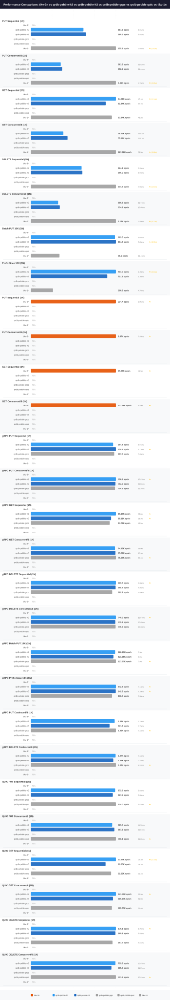

# QRDB KV Performance Comparison

> **Status: ARCHIVE — historical record. Do NOT build from this document.**
> Last verified: 2026-10-13 · measurements taken 2026-03-26; re-run the benchmark before citing them.

**Date**: 2026-03-26 17:23:51

## Configuration

| Parameter | Value |
|---|---|
| Payload Size | 128 bytes |
| Concurrent Writers | 8 |
| TLS | true |

## Systems

| System | Version |
|---|---|
| qrdb-pebble-h2 | dev |
| qrdb-pebble-h3 | dev |
| tikv-3n | v8.5.0 |

## Comparison

## Results

| Scenario | System | Ops/sec | P50 | P99 | Mean |
|---|---|---|---|---|---|
| PUT Sequential (1N) | qrdb-pebble-h2 | 162.3 | 6.02ms | 8.51ms | 6.16ms |
|  | qrdb-pebble-h3 | 163.3 | 5.94ms | 8.53ms | 6.12ms |
| PUT Concurrent/8 (1N) | qrdb-pebble-h2 | 654.8 | 11.85ms | 14.88ms | 12.20ms |
|  | qrdb-pebble-h3 | 667.7 | 11.76ms | 15.31ms | 11.98ms |
| GET Sequential (1N) | qrdb-pebble-h2 | 13.32K | 45.9us | 385.2us | 74.6us |
|  | qrdb-pebble-h3 | 12.12K | 56.0us | 360.6us | 82.1us |
| GET Concurrent/8 (1N) | qrdb-pebble-h2 | 48.02K | 158.1us | 369.0us | 166.1us |
|  | qrdb-pebble-h3 | 54.84K | 132.7us | 378.1us | 145.5us |
| DELETE Sequential (1N) | qrdb-pebble-h2 | 159.0 | 6.30ms | 8.67ms | 6.28ms |
|  | qrdb-pebble-h3 | 162.0 | 6.13ms | 8.26ms | 6.17ms |
| DELETE Concurrent/8 (1N) | qrdb-pebble-h2 | 698.4 | 11.45ms | 15.37ms | 11.44ms |
|  | qrdb-pebble-h3 | 725.6 | 10.78ms | 14.01ms | 11.01ms |
| Batch PUT 10K (1N) | qrdb-pebble-h2 | 161.9 | 6.05ms | 8.60ms | 6.17ms |
|  | qrdb-pebble-h3 | 160.5 | 6.12ms | 8.62ms | 6.23ms |
| Prefix Scan 10K (1N) | qrdb-pebble-h2 | 775.7 | 1.22ms | 2.54ms | 1.29ms |
|  | qrdb-pebble-h3 | 679.5 | 1.41ms | 2.64ms | 1.47ms |
| PUT Sequential (3N) | tikv-3n | 231.2 | 3.92ms | 8.44ms | 4.32ms |
| PUT Concurrent/8 (3N) | tikv-3n | 962.9 | 8.13ms | 12.52ms | 8.30ms |
| GET Sequential (3N) | tikv-3n | 6.70K | 52.2us | 724.2us | 148.8us |
| GET Concurrent/8 (3N) | tikv-3n | 131.30K | 57.3us | 161.1us | 60.6us |

---
*Generated by kvcompare*
