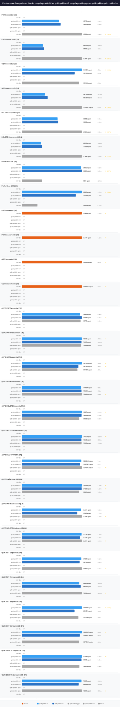

# QRDB KV Performance Comparison

**Date**: 2026-03-26 23:21:03

## Configuration

| Parameter | Value |
|---|---|
| Payload Size | 128 bytes |
| Concurrent Writers | 8 |
| TLS | true |

## Systems

| System | Version |
|---|---|
| qrdb-pebble-h2 | dev |
| qrdb-pebble-h3 | dev |
| qrdb-pebble-grpc | dev |

## Comparison

## Results

| Scenario | System | Ops/sec | P50 | P99 | Mean |
|---|---|---|---|---|---|
| PUT Sequential (1N) | qrdb-pebble-h2 | 171.4 | 5.74ms | 8.04ms | 5.83ms |
|  | qrdb-pebble-h3 | 158.4 | 6.18ms | 8.77ms | 6.31ms |
| PUT Concurrent/8 (1N) | qrdb-pebble-h2 | 666.3 | 11.75ms | 14.68ms | 11.99ms |
|  | qrdb-pebble-h3 | 676.4 | 11.67ms | 14.74ms | 11.82ms |
| GET Sequential (1N) | qrdb-pebble-h2 | 12.72K | 46.4us | 410.7us | 78.2us |
|  | qrdb-pebble-h3 | 11.92K | 53.0us | 391.3us | 83.5us |
| GET Concurrent/8 (1N) | qrdb-pebble-h2 | 47.73K | 158.9us | 379.1us | 167.2us |
|  | qrdb-pebble-h3 | 54.43K | 133.4us | 387.1us | 146.6us |
| DELETE Sequential (1N) | qrdb-pebble-h2 | 166.5 | 5.86ms | 8.15ms | 6.00ms |
|  | qrdb-pebble-h3 | 155.2 | 6.35ms | 8.43ms | 6.44ms |
| DELETE Concurrent/8 (1N) | qrdb-pebble-h2 | 693.8 | 11.37ms | 15.11ms | 11.51ms |
|  | qrdb-pebble-h3 | 715.1 | 11.06ms | 13.94ms | 11.18ms |
| Batch PUT 10K (1N) | qrdb-pebble-h2 | 159.3 | 6.06ms | 11.04ms | 6.27ms |
|  | qrdb-pebble-h3 | 160.5 | 6.11ms | 8.72ms | 6.23ms |
| Prefix Scan 10K (1N) | qrdb-pebble-h2 | 780.7 | 1.23ms | 2.49ms | 1.28ms |
|  | qrdb-pebble-h3 | 692.6 | 1.39ms | 2.66ms | 1.44ms |
| gRPC PUT Sequential (1N) | qrdb-pebble-h2 | 158.7 | 6.14ms | 8.72ms | 6.29ms |
|  | qrdb-pebble-h3 | 159.7 | 6.13ms | 8.53ms | 6.25ms |
|  | qrdb-pebble-grpc | 163.1 | 6.05ms | 8.68ms | 6.13ms |
| gRPC PUT Concurrent/8 (1N) | qrdb-pebble-h2 | 718.2 | 10.91ms | 14.05ms | 11.13ms |
|  | qrdb-pebble-h3 | 677.7 | 11.71ms | 15.83ms | 11.79ms |
|  | qrdb-pebble-grpc | 693.5 | 11.50ms | 14.48ms | 11.52ms |
| gRPC GET Sequential (1N) | qrdb-pebble-h2 | 18.73K | 36.9us | 273.9us | 52.5us |
|  | qrdb-pebble-h3 | 18.34K | 36.5us | 289.2us | 53.6us |
|  | qrdb-pebble-grpc | 18.32K | 36.9us | 283.3us | 53.7us |
| gRPC GET Concurrent/8 (1N) | qrdb-pebble-h2 | 76.09K | 95.1us | 299.5us | 104.3us |
|  | qrdb-pebble-h3 | 75.35K | 95.6us | 314.8us | 105.3us |
|  | qrdb-pebble-grpc | 75.12K | 96.2us | 301.0us | 105.7us |
| gRPC DELETE Sequential (1N) | qrdb-pebble-h2 | 160.7 | 6.14ms | 8.58ms | 6.22ms |
|  | qrdb-pebble-h3 | 165.9 | 5.96ms | 8.03ms | 6.02ms |
|  | qrdb-pebble-grpc | 162.8 | 6.13ms | 8.49ms | 6.14ms |
| gRPC DELETE Concurrent/8 (1N) | qrdb-pebble-h2 | 713.0 | 10.84ms | 14.08ms | 11.20ms |
|  | qrdb-pebble-h3 | 710.9 | 10.88ms | 14.23ms | 11.24ms |
|  | qrdb-pebble-grpc | 729.8 | 10.65ms | 13.45ms | 10.94ms |
| gRPC Batch PUT 10K (1N) | qrdb-pebble-h2 | 145.04K | 7.2us | 9.7us | 6.8us |
|  | qrdb-pebble-h3 | 143.72K | 7.4us | 9.3us | 6.8us |
|  | qrdb-pebble-grpc | 140.08K | 7.8us | 9.7us | 7.0us |
| gRPC Prefix Scan 10K (1N) | qrdb-pebble-h2 | 141.2 | 7.16ms | 11.57ms | 7.08ms |
|  | qrdb-pebble-h3 | 141.1 | 7.02ms | 11.74ms | 7.08ms |
|  | qrdb-pebble-grpc | 142.3 | 7.07ms | 11.44ms | 7.03ms |

---
*Generated by kvcompare*
