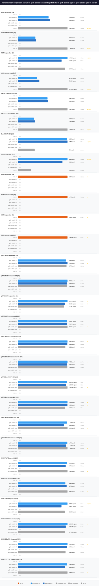

# QRDB KV Performance Comparison

> **Status: ARCHIVE — historical record. Do NOT build from this document.**
> Last verified: 2026-10-13 · measurements taken 2026-03-29; re-run the benchmark before citing them.

**Date**: 2026-03-29 04:29:56  
**Payload**: 128 bytes  
**TLS**: true  

## System Configuration

| | QRDB | TiKV |
|---|---|---|
| Storage Engine | PebbleDB (Go-native LSM) | RocksDB (C++ LSM via CGO) |
| Consensus | Multi-group Raft (QUIC transport) | Multi-group Raft (gRPC transport) |
| Client APIs | REST (HTTP/2, HTTP/3), gRPC, gRPC coalesced, native QUIC | gRPC (rawkv) |
| Version | dev | v8.5.0 |

## Throughput Comparison (ops/sec, higher is better)

| Scenario | QRDB REST | QRDB gRPC | QRDB Coalesced | QRDB QUIC | TiKV | Winner |
|---|---|---|---|---|---|---|
| PUT Sequential | 165.3 | 170.4 | — | 174.0 | 255.2 | TiKV 1.5x |
| PUT Concurrent/8 | 692.2 | 716.2 | 1.05K | 700.1 | 1.89K | **TiKV 1.8x** |
| GET Sequential | 14.01K | 19.17K | — | 23.54K | 13.34K | **QRDB 1.8x** |
| GET Concurrent/8 | 55.11K | 75.68K | N/A | 123.39K | 127.62K | TiKV 1.0x |
| DELETE Sequential | 166.2 | 169.5 | — | 170.1 | 274.7 | **TiKV 1.6x** |
| DELETE Concurrent/8 | 734.6 | 740.2 | 1.08K | 723.9 | 2.16K | **TiKV 2.0x** |
| Batch PUT 10K | 164.8 | 127.33K | — | — | 55.6 | **QRDB 2291.9x** |
| Prefix Scan 10K | 803.0 | 142.9 | — | — | 208.9 | **QRDB 3.8x** |

**Throughput**: 3 scenarios won by QRDB, 5 scenarios won by TiKV

## Latency P50 Comparison (lower is better)

| Scenario | QRDB REST | QRDB gRPC | QRDB Coalesced | QRDB QUIC | TiKV | Winner |
|---|---|---|---|---|---|---|
| PUT Sequential | 5.91ms | 5.72ms | — | 5.61ms | 3.64ms | **TiKV 1.5x** |
| PUT Concurrent/8 | 11.44ms | 10.97ms | 7.22ms | 11.28ms | 3.76ms | **TiKV 1.9x** |
| GET Sequential | 45.1us | 36.3us | — | 29.3us | 45.2us | **QRDB 1.5x** |
| GET Concurrent/8 | 133.1us | 95.4us | N/A | 59.9us | 59.5us | TiKV 1.0x |
| DELETE Sequential | 5.93ms | 5.80ms | — | 5.79ms | 3.55ms | **TiKV 1.6x** |
| DELETE Concurrent/8 | 10.65ms | 10.57ms | 6.97ms | 10.81ms | 3.55ms | **TiKV 2.0x** |
| Batch PUT 10K | 5.85ms | 7.8us | — | — | 16.43ms | **QRDB 2097.9x** |
| Prefix Scan 10K | 1.20ms | 7.10ms | — | — | 4.75ms | **QRDB 4.0x** |

## QRDB Protocol Comparison

| Scenario | QRDB (H2) | QRDB (H3) | QRDB (gRPC) | QRDB (QUIC) | Best |
|---|---|---|---|---|---|
| PUT Sequential (1N) | 157.8 | 165.3 | N/A | N/A | QRDB (H3) |
| PUT Concurrent/8 (1N) | 661.6 | 692.2 | N/A | N/A | QRDB (H3) |
| GET Sequential (1N) | 14.01K | 12.34K | N/A | N/A | QRDB (H2) |
| GET Concurrent/8 (1N) | 48.72K | 55.11K | N/A | N/A | QRDB (H3) |
| DELETE Sequential (1N) | 164.1 | 166.2 | N/A | N/A | QRDB (H3) |
| DELETE Concurrent/8 (1N) | 690.8 | 734.6 | N/A | N/A | QRDB (H3) |
| Batch PUT 10K (1N) | 163.0 | 164.8 | N/A | N/A | QRDB (H3) |
| Prefix Scan 10K (1N) | 803.0 | 721.2 | N/A | N/A | QRDB (H2) |
| gRPC PUT Sequential (1N) | 164.8 | 170.4 | 167.0 | N/A | QRDB (H3) |
| gRPC PUT Concurrent/8 (1N) | 716.2 | 712.0 | 708.1 | N/A | QRDB (H2) |
| gRPC GET Sequential (1N) | 19.17K | 18.11K | 17.79K | N/A | QRDB (H2) |
| gRPC GET Concurrent/8 (1N) | 74.85K | 75.27K | 75.68K | N/A | QRDB (gRPC) |
| gRPC DELETE Sequential (1N) | 169.5 | 168.9 | 162.1 | N/A | QRDB (H2) |
| gRPC DELETE Concurrent/8 (1N) | 740.2 | 735.1 | 736.9 | N/A | QRDB (H2) |
| gRPC Batch PUT 10K (1N) | 126.21K | 123.55K | 127.33K | N/A | QRDB (gRPC) |
| gRPC Prefix Scan 10K (1N) | 142.9 | 142.6 | 136.4 | N/A | QRDB (H2) |
| gRPC PUT Coalesced/8 (1N) | 1.03K | 971.6 | 1.05K | N/A | QRDB (gRPC) |
| gRPC DELETE Coalesced/8 (1N) | 1.07K | 1.04K | 1.08K | N/A | QRDB (gRPC) |
| QUIC PUT Sequential (1N) | 172.5 | 167.5 | N/A | 174.0 | QRDB (QUIC) |
| QUIC PUT Concurrent/8 (1N) | 669.5 | 687.6 | N/A | 700.1 | QRDB (QUIC) |
| QUIC GET Sequential (1N) | 23.54K | 20.65K | N/A | 22.23K | QRDB (H2) |
| QUIC GET Concurrent/8 (1N) | 123.39K | 119.13K | N/A | 117.63K | QRDB (H2) |
| QUIC DELETE Sequential (1N) | 170.1 | 169.1 | N/A | 163.3 | QRDB (H2) |
| QUIC DELETE Concurrent/8 (1N) | 719.6 | 685.8 | N/A | 723.9 | QRDB (QUIC) |

## Full Results

| Scenario | System | Ops/sec | P50 | P99 | Mean |
|---|---|---|---|---|---|
| PUT Sequential (1N) | QRDB (H2) | 157.8 | 6.01ms | 11.60ms | 6.33ms |
|  | QRDB (H3) | 165.3 | 5.91ms | 8.41ms | 6.05ms |
|  | tikv-1n | 255.2 | 3.64ms | 7.73ms | 3.92ms |
| PUT Concurrent/8 (1N) | QRDB (H2) | 661.6 | 11.92ms | 16.22ms | 12.09ms |
|  | QRDB (H3) | 692.2 | 11.44ms | 14.93ms | 11.55ms |
|  | tikv-1n | 1.89K | 3.76ms | 6.59ms | 4.24ms |
| GET Sequential (1N) | QRDB (H2) | 14.01K | 45.1us | 404.2us | 71.0us |
|  | QRDB (H3) | 12.34K | 57.7us | 347.1us | 80.7us |
|  | tikv-1n | 13.34K | 45.2us | 513.2us | 74.6us |
| GET Concurrent/8 (1N) | QRDB (H2) | 48.72K | 155.4us | 375.0us | 163.8us |
|  | QRDB (H3) | 55.11K | 133.1us | 384.4us | 144.8us |
|  | tikv-1n | 127.62K | 59.5us | 129.8us | 62.3us |
| DELETE Sequential (1N) | QRDB (H2) | 164.1 | 5.99ms | 8.39ms | 6.09ms |
|  | QRDB (H3) | 166.2 | 5.93ms | 8.34ms | 6.02ms |
|  | tikv-1n | 274.7 | 3.55ms | 5.99ms | 3.64ms |
| DELETE Concurrent/8 (1N) | QRDB (H2) | 690.8 | 11.44ms | 14.80ms | 11.58ms |
|  | QRDB (H3) | 734.6 | 10.65ms | 14.16ms | 10.89ms |
|  | tikv-1n | 2.16K | 3.55ms | 6.09ms | 3.71ms |
| Batch PUT 10K (1N) | QRDB (H2) | 163.0 | 6.02ms | 8.60ms | 6.13ms |
|  | QRDB (H3) | 164.8 | 5.85ms | 10.01ms | 6.07ms |
|  | tikv-1n | 55.6 | 16.43ms | 34.78ms | 17.00ms |
| Prefix Scan 10K (1N) | QRDB (H2) | 803.0 | 1.20ms | 2.48ms | 1.25ms |
|  | QRDB (H3) | 721.2 | 1.36ms | 2.46ms | 1.39ms |
|  | tikv-1n | 208.9 | 4.75ms | 6.14ms | 4.79ms |
| PUT Sequential (3N) | TiKV (3N) | 234.4 | 3.95ms | 8.70ms | 4.26ms |
| PUT Concurrent/8 (3N) | TiKV (3N) | 1.07K | 7.45ms | 12.68ms | 7.50ms |
| GET Sequential (3N) | TiKV (3N) | 15.66K | 42.5us | 391.1us | 63.5us |
| GET Concurrent/8 (3N) | TiKV (3N) | 123.56K | 60.0us | 173.4us | 64.4us |
| gRPC PUT Sequential (1N) | QRDB (H2) | 164.8 | 5.94ms | 8.53ms | 6.06ms |
|  | QRDB (H3) | 170.4 | 5.72ms | 8.24ms | 5.86ms |
|  | qrdb-pebble-grpc | 167.0 | 5.85ms | 8.50ms | 5.98ms |
| gRPC PUT Concurrent/8 (1N) | QRDB (H2) | 716.2 | 10.97ms | 14.51ms | 11.17ms |
|  | QRDB (H3) | 712.0 | 11.02ms | 14.47ms | 11.23ms |
|  | qrdb-pebble-grpc | 708.1 | 11.10ms | 14.43ms | 11.29ms |
| gRPC GET Sequential (1N) | QRDB (H2) | 19.17K | 36.8us | 270.3us | 51.3us |
|  | QRDB (H3) | 18.11K | 36.3us | 303.4us | 54.4us |
|  | qrdb-pebble-grpc | 17.79K | 46.5us | 242.8us | 55.3us |
| gRPC GET Concurrent/8 (1N) | QRDB (H2) | 74.85K | 96.0us | 329.4us | 106.1us |
|  | QRDB (H3) | 75.27K | 95.9us | 325.3us | 105.5us |
|  | qrdb-pebble-grpc | 75.68K | 95.4us | 309.2us | 104.9us |
| gRPC DELETE Sequential (1N) | QRDB (H2) | 169.5 | 5.80ms | 8.07ms | 5.90ms |
|  | QRDB (H3) | 168.9 | 5.85ms | 8.15ms | 5.92ms |
|  | qrdb-pebble-grpc | 162.1 | 5.89ms | 11.16ms | 6.16ms |
| gRPC DELETE Concurrent/8 (1N) | QRDB (H2) | 740.2 | 10.57ms | 13.80ms | 10.80ms |
|  | QRDB (H3) | 735.1 | 10.65ms | 14.26ms | 10.88ms |
|  | qrdb-pebble-grpc | 736.9 | 10.60ms | 13.95ms | 10.85ms |
| gRPC Batch PUT 10K (1N) | QRDB (H2) | 126.21K | 7.9us | 10.0us | 7.8us |
|  | QRDB (H3) | 123.55K | 8.0us | 10.6us | 8.0us |
|  | qrdb-pebble-grpc | 127.33K | 7.8us | 9.8us | 7.8us |
| gRPC Prefix Scan 10K (1N) | QRDB (H2) | 142.9 | 7.13ms | 10.47ms | 7.00ms |
|  | QRDB (H3) | 142.6 | 7.10ms | 11.25ms | 7.01ms |
|  | qrdb-pebble-grpc | 136.4 | 7.38ms | 12.21ms | 7.33ms |
| gRPC PUT Coalesced/8 (1N) | QRDB (H2) | 1.03K | 7.33ms | 15.03ms | 7.73ms |
|  | QRDB (H3) | 971.6 | 7.75ms | 20.07ms | 8.23ms |
|  | qrdb-pebble-grpc | 1.05K | 7.22ms | 13.90ms | 7.61ms |
| gRPC DELETE Coalesced/8 (1N) | QRDB (H2) | 1.07K | 7.12ms | 16.56ms | 7.45ms |
|  | QRDB (H3) | 1.04K | 7.23ms | 19.05ms | 7.66ms |
|  | qrdb-pebble-grpc | 1.08K | 6.97ms | 15.30ms | 7.42ms |
| QUIC PUT Sequential (1N) | QRDB (H2) | 172.5 | 5.62ms | 8.30ms | 5.79ms |
|  | QRDB (H3) | 167.5 | 5.80ms | 8.52ms | 5.97ms |
|  | qrdb-pebble-quic | 174.0 | 5.61ms | 8.03ms | 5.74ms |
| QUIC PUT Concurrent/8 (1N) | QRDB (H2) | 669.5 | 11.52ms | 22.92ms | 11.94ms |
|  | QRDB (H3) | 687.6 | 11.51ms | 14.88ms | 11.63ms |
|  | qrdb-pebble-quic | 700.1 | 11.28ms | 14.58ms | 11.42ms |
| QUIC GET Sequential (1N) | QRDB (H2) | 23.54K | 29.3us | 286.4us | 41.7us |
|  | QRDB (H3) | 20.65K | 38.2us | 218.3us | 47.5us |
|  | qrdb-pebble-quic | 22.23K | 30.1us | 267.2us | 44.2us |
| QUIC GET Concurrent/8 (1N) | QRDB (H2) | 123.39K | 59.9us | 185.0us | 64.0us |
|  | QRDB (H3) | 119.13K | 61.0us | 219.5us | 66.3us |
|  | qrdb-pebble-quic | 117.63K | 61.4us | 227.2us | 67.1us |
| QUIC DELETE Sequential (1N) | QRDB (H2) | 170.1 | 5.79ms | 8.05ms | 5.87ms |
|  | QRDB (H3) | 169.1 | 5.82ms | 8.16ms | 5.91ms |
|  | qrdb-pebble-quic | 163.3 | 5.84ms | 10.98ms | 6.12ms |
| QUIC DELETE Concurrent/8 (1N) | QRDB (H2) | 719.6 | 10.87ms | 14.14ms | 11.11ms |
|  | QRDB (H3) | 685.8 | 11.09ms | 21.28ms | 11.66ms |
|  | qrdb-pebble-quic | 723.9 | 10.81ms | 14.30ms | 11.04ms |

## Analysis

### Fair Comparison

Both systems are benchmarked as **pure key-value stores without MVCC**. QRDB uses its PebbleDB state machine (`--sm pebble`) which writes directly to PebbleDB with no revision tracking or version history. TiKV uses its RawKV API (V1 mode) which bypasses TiKV's MVCC layer entirely. Both systems commit every write through Raft consensus before acknowledging.

### Write Performance

The write gap is driven by **Raft consensus round-trip latency**: ~6ms per proposal in QRDB vs ~3.8ms in TiKV. Both systems propose each write through Raft and wait for quorum acknowledgment before responding. The latency difference comes from the transport layer (QUIC over UDP vs gRPC over TCP) and runtime overhead (Go vs Rust). Client-side batch coalescing amortizes the per-proposal overhead by grouping concurrent operations into single Raft entries.

### Read Performance

QRDB outperforms TiKV on sequential reads through two advantages: (1) **PebbleDB's Go-native block cache** avoids CGO boundary crossings that RocksDB incurs on every lookup, and (2) **LeaseRead** allows the leader to serve reads immediately when its leadership lease is valid, eliminating the ReadIndex heartbeat round-trip. TiKV wins concurrent reads due to RocksDB's highly optimized parallel read path with bloom filters and sharded block cache.

### Protocol Impact

gRPC/protobuf provides ~30–45% higher read throughput compared to REST/JSON due to compact binary encoding and lower serialization overhead. Write throughput differences between protocols are minimal because Raft consensus latency (~6ms) dominates the round-trip, not serialization. Batch coalescing provides the largest concurrent write improvement by amortizing consensus overhead across multiple operations per Raft entry.

---
*Generated by kvcompare on 2026-03-29 04:29:56*
